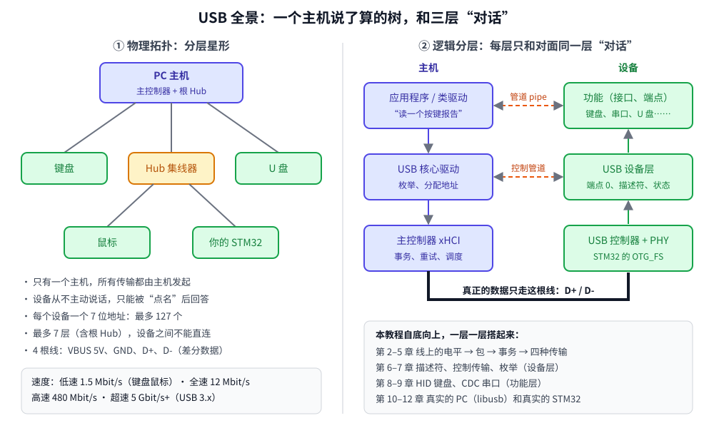

# USB 协议从零到上手：用 C++ 模拟器一层层拆开 USB

这是一套面向**会写 C/C++、但不了解 USB 协议**的开发者的教程。核心是一个两千多行、只有头文件的 C++17 教学库 `miniusb`：它把主机、总线、设备全部用代码模拟出来，D+/D− 上的电平、每一个包、每一次握手都能打印出来看。学完协议之后，再用 libusb 在 PC 上写真实的主机程序，用 STM32 + TinyUSB 做一个真实的设备。

- 前 9 章和第 12 章：**纯软件**，一台装了 `g++` 和 `cmake` 的 Linux / WSL2 就能跟着做
- 第 10 章：PC 上的主机程序，需要 `libusb-1.0-0-dev`
- 第 11 章：STM32 固件，需要 `arm-none-eabi-gcc`、隔壁 [`../stm32`](../stm32/docs/README.md) 教程的构建框架，和一块 **STM32F4 Discovery** 或 **立创·地阔星 STM32F103C8T6**
- 每章都有可运行代码（`examples/`）、原理图（`docs/images/`）和**本机实际运行输出**
- 只讲全速（12 Mbit/s）USB 2.0：最常见、单片机最容易做、所有概念都齐全



## 学习路线

```
协议篇：在模拟器里从电平一路走到枚举（不需要任何硬件）

  01 全景 → 02 物理层 → 03 包 → 04 事务 → 05 传输类型 → 06 描述符 → 07 枚举
                                                                        │
设备类篇：用学到的协议做两个“真正的” USB 设备（模拟）                    │
                                                                        ▼
                                           08 HID 键盘    09 CDC 虚拟串口
                                                                        │
实战篇：真实的主机、真实的设备、真实的排错                              │
                                                                        ▼
  10 libusb 主机程序  ⇄  11 STM32 + TinyUSB 固件  →  12 抓包与排错
```

协议篇是**自底向上**的：每一章都用上一章的东西。第 2 章把比特变成电平，第 3 章把字节变成包，第 4 章把包组成事务，第 5 章把事务组成传输……到第 7 章，你会看到主机和设备完整地走一遍枚举，而其中每一个字节都是你在前面几章亲手算过的。

设备类篇和实战篇用的是同一套概念：第 8、9 章在模拟器里做键盘和串口，第 10 章的 PC 程序能直接复用第 6 章写的描述符解析器，第 11 章的固件里每个 TinyUSB 回调都能在模拟器里找到对应的函数。第 12 章把前面所有章节串起来，变成一张排错地图。

## 章节目录

| 章 | 文档 | 例子 | 你会学到 |
|----|------|------|---------|
| 1 | [USB 全景](docs/01-overview.md) | `tests/test_miniusb` | 拓扑、“主机说了算”、端点和管道、速度、搭环境 |
| 2 | [物理层](docs/02-physical-layer.md) | `02-signal` | J/K/SE0、NRZI、位填充、SYNC/EOP、上拉电阻识别速度 |
| 3 | [包](docs/03-packets.md) | `03-packet` | PID 自校验、令牌/数据/握手/SOF、手算 CRC5 和 CRC16 |
| 4 | [事务](docs/04-transactions.md) | `04-transaction` | 一问一答、ACK/NAK/STALL、DATA0/DATA1、出错重试 |
| 5 | [传输类型和带宽](docs/05-transfer-types.md) | `05-transfer-types` | 控制/批量/中断/同步、1 ms 帧、算出 1216 KB/s 的上限 |
| 6 | [描述符](docs/06-descriptors.md) | `06-descriptors` | 设备/配置/接口/端点/字符串描述符，逐字节构造和解析 |
| 7 | [控制传输与枚举](docs/07-enumeration.md) | `07-enumeration` | SETUP 三阶段、标准请求、9 步枚举、`SET_ADDRESS` 的经典 bug |
| 8 | [HID 键盘](docs/08-hid.md) | `08-hid-keyboard` | 报告描述符、启动键盘报告、LED 输出报告、按下与松开 |
| 9 | [CDC 虚拟串口](docs/09-cdc.md) | `09-cdc-serial` | IAD、功能描述符、波特率、DTR、ZLP |
| 10 | [libusb 主机程序](docs/10-libusb.md) | `10-libusb/` | 读真实设备的描述符、厂商请求、批量回环、WSL2 usbipd、udev |
| 11 | [STM32 + TinyUSB](docs/11-stm32-tinyusb.md) | `11-stm32-vendor/` | 厂商自定义设备、DWC2 与 FSDEV、48 MHz 时钟、烧录联调 |
| 12 | [抓包与排错](docs/12-debugging.md) | `12-troubleshoot` | 四种典型故障、`dmesg`、设备管理器、Wireshark |

## 快速开始

```bash
sudo apt install g++ cmake make
cd usb
cmake -S . -B build
cmake --build build -j
./build/tests/test_miniusb        # 用规范里的已知数据自测
./build/examples/02-signal        # 从第 2 章开始
```

本机实际输出（没装 libusb 时会跳过第 10 章，不影响其他章节）：

```
-- 没找到 libusb-1.0，跳过第 10 章的例子。安装：sudo apt install libusb-1.0-0-dev
...
全部通过
```

然后从 [第 1 章](docs/01-overview.md) 开始读。

## 目录结构

```
usb/
├── README.md                  本文件
├── CMakeLists.txt             编译所有模拟器例子；找到 libusb 时也编译第 10 章
├── include/miniusb/           教学用 USB 协议栈，只有头文件
│   ├── signal.hpp             第 2 章：NRZI、位填充、线路状态
│   ├── crc.hpp、packet.hpp    第 3 章：CRC5/CRC16、包的编码和解码
│   ├── bus.hpp、trace.hpp     第 4 章：总线、故障注入、分级日志
│   ├── host.hpp               第 4、5、7 章：事务、传输、枚举
│   ├── setup.hpp              第 7 章：SETUP 包和标准请求
│   ├── descriptors.hpp        第 6 章：描述符的构造和解析
│   └── device.hpp             第 7–9 章：端点、控制传输状态机、类请求钩子
├── examples/                  每章一个目录
├── tests/test_miniusb.cpp     自测
└── docs/                      12 章文档，images/ 下是原理图（SVG）
```

## 怎么使用这套教程

1. **按顺序读**。每章的结构都一样：本章目标 → 原理图 → 代码讲解 → 动手运行 → 练习 → 常见坑。
2. **边读边跑**。文档里的“本机实际输出”都是在 WSL2 Ubuntu 上真实运行得到的，你的输出应当一致。
3. **改代码再跑**。练习大多是“改一个地方，先预测输出，再运行验证”。看不懂输出时，把 `trace.level` 调高一级再跑。
4. **有板子再做第 10、11 章**。没有板子也可以读完、编译完。

> 关于硬件部分：写作时手边没有开发板，第 11 章的两份固件**只验证到编译通过**，第 10、11 章里和真实设备通信的结果是按代码和协议推导出的预期，文中都明确标注了。模拟器部分（第 1–9、12 章）的输出全部是实际运行结果。
