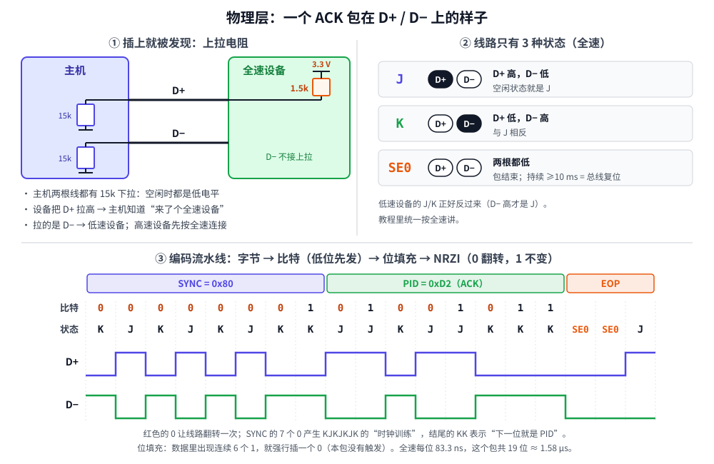

# 第 2 章　物理层：D+/D− 上的 0 和 1

## 本章目标

- 知道主机怎么发现“插上了一个设备”，以及它是低速还是全速
- 认识 J、K、SE0 三种线路状态
- 亲手把一个字节编码成线上的波形：**低位先发 → 位填充 → NRZI**
- 理解 SYNC 和 EOP 为什么长那样

> 这一章是全书最底层的部分。写 USB 设备程序时，这些都由芯片里的 USB 控制器硬件完成，你不需要写任何代码去做 NRZI。但懂了它，你才能看懂逻辑分析仪的波形、理解为什么 USB 对时钟精度那么挑剔，也会明白第 12 章里 `-71（EPROTO）` 这类错误是从哪来的。

## 2.1 插上的那一刻：上拉电阻



看图左上角。主机在 D+ 和 D− 上各接了一个 **15 kΩ 下拉电阻**，没有设备时两根线都是低电平。

设备在 D+ 上接一个 **1.5 kΩ 上拉电阻**到 3.3 V。两个电阻分压后 D+ 变成高电平，主机看到“D+ 高、D− 低”持续一段时间，就知道：

- 有设备插上了；
- 上拉在 D+ 上，所以是**全速**设备（上拉在 D− 上是低速）。

高速设备一开始也按全速连接，复位期间再和主机用一串特殊信号（chirp）协商升级到 480 Mbit/s。

这个电阻有什么实际意义？

- **STM32F407** 的 OTG_FS 控制器内部集成了这个上拉，软件可以开关它，所以固件可以控制“什么时候让电脑看到我”。
- **STM32F103** 内部没有，板子上要焊一个 1.5 kΩ 电阻到 D+（很多开发板直接接在 3.3 V 上）。所以 F103 程序复位后，电脑并不知道设备重启了。第 11 章的固件会先把 PA12（D+）拉低 10 ms，假装“拔掉再插上”，逼电脑重新枚举。

## 2.2 三种线路状态

USB 用**差分信号**：看的不是某一根线的电压，而是两根线谁高谁低。全速下：

| 状态          | D+ | D− | 意义                                                      |
| ------------- | -- | --- | --------------------------------------------------------- |
| **J**   | 高 | 低  | 空闲时的状态（因为上拉在 D+ 上）                          |
| **K**   | 低 | 高  | J 的反面                                                  |
| **SE0** | 低 | 低  | 单端 0：包结束标志；持续 10 ms 以上就是**总线复位** |

数据就是靠 J 和 K 来回切换传过去的。下面的三步说清楚“怎么切换”。

## 2.3 第一步：低位先发

USB 上每个字节都是 **bit0 先发**，bit7 最后发。`0x2D = 0b00101101`，上线顺序是 `1,0,1,1,0,1,0,0`。

[`include/miniusb/signal.hpp`](../include/miniusb/signal.hpp)：

```cpp
// 每个字节都是最低位先发。
inline Bits bytes_to_bits(const Bytes& bytes)
{
    Bits bits;
    for (uint8_t b : bytes) {
        for (int i = 0; i < 8; i++) {
            bits.push_back((b >> i) & 1);
        }
    }
    return bits;
}
```

后面看到 CRC 和多字节字段时，记住这一点：**多字节数值都是小端，比特都是低位先发**。

## 2.4 第二步：NRZI —— 0 翻转，1 不变

USB 线上没有单独的时钟线，接收方必须从数据本身的跳变里“恢复”出时钟。NRZI（Non-Return-to-Zero Inverted）编码规则只有一句话：

> **发 0：线路状态翻转一次。发 1：保持不变。**

```cpp
// NRZI：发 0 = 线路状态翻转一次，发 1 = 保持不变。
inline Lines nrzi_encode(const Bits& bits, Line start = Line::J)
{
    Lines out;
    Line cur = start;
    for (uint8_t bit : bits) {
        if (bit == 0) {
            cur = flip(cur);
        }
        out.push_back(cur);
    }
    return out;
}
```

为什么要这样？好处是：哪怕 D+ 和 D− 接反了，或者接收方不知道初始电平，**只看“变没变”**就能还原数据。坏处是：一长串 1 会让线路一直不变，接收方的时钟会慢慢“走偏”，数不清到底过了几位。于是有了下一步。

## 2.5 第三步：位填充

规则：**数据里每出现连续 6 个 1，发送方就强行插入一个 0。** 接收方看到连续 6 个 1 之后的那个 0，直接扔掉。

```cpp
// 连续 6 个 1 之后，发送方强行插入一个 0。这样线上最多 7 个比特时间就会
// 跳变一次，接收方才能一直对准时钟。
inline Bits bit_stuff(const Bits& in)
{
    Bits out;
    int ones = 0;
    for (uint8_t bit : in) {
        out.push_back(bit);
        ones = bit ? ones + 1 : 0;
        if (ones == 6) {
            out.push_back(0);
            ones = 0;
        }
    }
    return out;
}
```

插入的 0 经过 NRZI 会变成一次跳变，所以线上**最多 7 个比特时间**就保证跳变一次。反过来，如果接收方看到连续 7 个 1，说明一定出错了，这叫**位填充错误**，整个包直接作废。

## 2.6 SYNC 和 EOP：包的开头和结尾

每个包都以 **SYNC** 开头、以 **EOP** 结尾：

- **SYNC** 就是字节 `0x80`。低位先发是 `0000 0001`，NRZI 后变成 `KJKJKJKK`。前面 7 次交替让接收方锁定时钟，最后的 `KK`（两个相同）告诉它：“下一位就是真正的数据了”。
- **EOP**（End Of Packet）是 `SE0 SE0 J`：两根线同时拉低两个比特时间，再回到空闲的 J。

```cpp
// 把一个包变成完整的线路状态：SYNC + 填充并 NRZI 后的数据 + EOP（SE0 SE0 J）。
inline Lines to_wire(const Bytes& packet)
{
    Bytes with_sync{kSync};
    with_sync.insert(with_sync.end(), packet.begin(), packet.end());
    Lines lines = nrzi_encode(bit_stuff(bytes_to_bits(with_sync)), Line::J);
    lines.push_back(Line::SE0);
    lines.push_back(Line::SE0);
    lines.push_back(Line::J);
    return lines;
}
```

图的下半部分就是 `to_wire({0xD2})` 的结果：一个完整的 ACK 包，一共 19 个比特时间。全速下每位 83.3 ns，整个包只占 1.58 µs。

## 2.7 动手：运行第 2 章的例子

[`examples/02-signal/main.cpp`](../examples/02-signal/main.cpp) 把上面每一步都打印出来：

```bash
./build/examples/02-signal
```

本机实际输出：

```
========== 第 1 步：字节变比特，最低位先发 ==========
0x2D = 0b00101101，上线顺序（bit0 先）：10110100

========== 第 2 步：NRZI —— 0 就翻转，1 就不变 ==========
8 个 0：KJKJKJKJ   <- 每位都跳变，接收方很容易对准时钟
8 个 1：JJJJJJJJ   <- 一直不变，接收方数不清有几位

========== 第 3 步：位填充 —— 连续 6 个 1 后强行插入一个 0 ==========
原始 16 位：1111111111111111
填充后 18 位：111111011111101111   <- 第 7、14 位是插进去的 0
NRZI 之后：JJJJJJKKKKKKKJJJJJ   <- 最多 7 位就有一次跳变
接收方看到 7 个连续的 1：位填充错误，整个包丢弃

========== 第 4 步：一个完整的 ACK 包（PID = 0xD2） ==========
SYNC(KJKJKJKK) + PID(8 位) + EOP(SE0 SE0 J)：
KJKJKJKKJJKJJKKK00J
     K J K J K J K K J J K J J K K K 0 0 J 
 D+  ▁▁▔▔▁▁▔▔▁▁▔▔▁▁▁▁▔▔▔▔▁▁▔▔▔▔▁▁▁▁▁▁▁▁▁▁▔▔
 D-  ▔▔▁▁▔▔▁▁▔▔▁▁▔▔▔▔▁▁▁▁▔▔▁▁▁▁▔▔▔▔▔▔▁▁▁▁▁▁
全速每位 1/12MHz = 83.3 ns，这个包在线上占 19 位 = 1.58 us

========== 第 5 步：SETUP 令牌包 2D 00 10（地址 0、端点 0） ==========
     K J K J K J K K K J J J K K J K J K J K J K J K J K J K K J K J 0 0 J 
 D+  ▁▁▔▔▁▁▔▔▁▁▔▔▁▁▁▁▁▁▔▔▔▔▔▔▁▁▁▁▔▔▁▁▔▔▁▁▔▔▁▁▔▔▁▁▔▔▁▁▔▔▁▁▔▔▁▁▁▁▔▔▁▁▔▔▁▁▁▁▔▔
 D-  ▔▔▁▁▔▔▁▁▔▔▁▁▔▔▔▔▔▔▁▁▁▁▁▁▔▔▔▔▁▁▔▔▁▁▔▔▁▁▔▔▁▁▔▔▁▁▔▔▁▁▔▔▁▁▔▔▔▔▁▁▔▔▁▁▁▁▁▁▁▁

========== 第 6 步：接收方把波形解码回字节 ==========
解码结果：2D 00 10
第 12 位被干扰后再解码：1D 00 10
（字节还能解出来，但已经不对了 —— 下一章用 PID 校验和 CRC 把它揪出来）
```

对照输出看几个细节：

- **第 3 步**：16 个 1 填充后变成 18 位，插入的 0 在第 7 位和第 14 位。NRZI 后线路在这两个位置各跳变一次。
- **第 4 步**：把波形和图里的波形对一下，它们是同一个包。
- **第 6 步**：噪声让一个比特的电平翻了，解码出来是 `1D` 而不是 `2D`，接收方自己**完全没发现**。物理层只管“0 和 1 怎么传”，不管“传得对不对”。检错是下一章 PID 校验和 CRC 的工作。

## 2.8 为什么 USB 对时钟这么挑剔

全速要求时钟误差在 **±0.25%** 以内。把位填充的结论代进去算一下：最坏情况下接收方要连续数 7 个比特都不跳变，如果两边时钟差 1%，7 位就累积 7% 的偏差。再加上线缆延迟、上升沿抖动，采样点就会落到相邻比特上。

这就是为什么：

- STM32 的内部 RC 振荡器（HSI，精度 ±1%）**不能**直接给 USB 用，必须用外部晶振倍频出精确的 48 MHz（第 11 章）。
- 有些芯片（如 STM32F0/L0 的 CRS）能用主机每 1 ms 发来的 SOF 包反过来校准内部振荡器，这样不用晶振也能做 USB。

## 练习

1. 预测 `0xFF 0x01` 经过 `bit_stuff` 后有多少位、插入的 0 在哪里。改第 3 步的代码验证。
2. SYNC 为什么用 `0x80` 而不是 `0x00`？提示：看 NRZI 后最后两位。
3. 把第 6 步里的 `noisy[12]` 改成 `noisy[30]`，或者连续翻转三个位置，看看会出现哪几种结果（解码失败、解出别的字节）。
4. 算一算：全速下一个 64 字节的数据包（加上 SYNC、PID、CRC16、EOP），最少占多少微秒？最多呢？（提示：最坏情况是全 1，每 6 位多 1 位。）

## 常见坑

- **D+/D− 接反。** 设备会表现为“插上没反应”或被当成低速设备，因为上拉跑到了主机眼中的 D− 上。
- **F103 板子复位后电脑没反应。** D+ 上拉一直接着，电脑不知道设备重启了。需要硬件控制上拉，或者固件先把 D+ 拉低一会儿（第 11 章）。
- **用 HSI 做 USB 时钟。** 可能“偶尔能用”，换一台电脑或温度一变就开始报错。

---

上一章：[第 1 章　USB 全景](01-overview.md)　|　下一章：[第 3 章　包：PID、地址和 CRC](03-packets.md)
