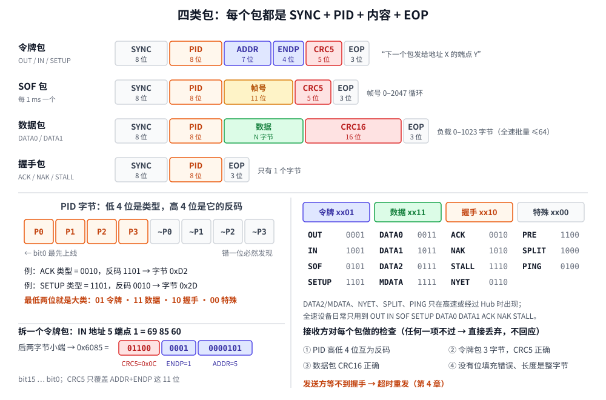

# 第 3 章　包：PID、地址和 CRC

## 本章目标

- 认识 USB 的四类包：**令牌、数据、握手、SOF**
- 看懂 PID 字节，知道它为什么“自带校验”
- 会手工拆一个令牌包：地址、端点、CRC5 各在哪几位
- 理解 CRC5、CRC16 怎么算，以及接收方怎样把坏包挑出来

## 3.1 包是 USB 的最小单位

上一章讲了比特怎么上线，这一章往上一层：线上传的东西是一个一个的**包**（packet），每个包都夹在 SYNC 和 EOP 之间。



图的上半部分是四类包的格式。用一个“快递”的比喻来记：

| 包 | 比喻 | 内容 |
|----|------|------|
| **令牌包** | 快递单：“下面这件是寄给 5 号楼 1 号门的” | PID + 地址 + 端点 + CRC5 |
| **数据包** | 包裹本身 | PID + 0–1023 字节数据 + CRC16 |
| **握手包** | 签收回执：“收到了”/“现在没人在家”/“拒收” | 只有一个 PID 字节 |
| **SOF 包** | 每 1 ms 响一次的整点报时 | PID + 11 位帧号 + CRC5 |

**令牌包永远由主机发出**，它决定接下来谁说话：OUT 和 SETUP 表示“主机要发数据给你”，IN 表示“轮到你发数据给我”。这就是第 1 章说的“主机说了算”在包这一层的体现。

## 3.2 PID：包的第一个字节

PID（Packet IDentifier）告诉接收方“这是什么包”。它只有 4 位有效信息，但占了整整一个字节：**高 4 位是低 4 位的反码**。

[`include/miniusb/packet.hpp`](../include/miniusb/packet.hpp)：

```cpp
// PID 字节的低 4 位。高 4 位是低 4 位取反，所以 PID 错一位一定能被发现。
enum class Pid : uint8_t {
    Out = 0x1, In = 0x9, Sof = 0x5, Setup = 0xD,              // 令牌
    Data0 = 0x3, Data1 = 0xB, Data2 = 0x7, MData = 0xF,       // 数据
    Ack = 0x2, Nak = 0xA, Stall = 0xE, Nyet = 0x6,            // 握手
    Pre = 0xC, Split = 0x8, Ping = 0x4,                       // 特殊（Hub、高速用）
};

inline uint8_t pid_byte(Pid pid)
{
    uint8_t p = static_cast<uint8_t>(pid);
    return static_cast<uint8_t>(p | ((~p & 0xF) << 4));
}
```

为什么要浪费 4 位？因为 PID 太重要了：如果 ACK 被干扰成了 NAK，主机会以为设备没收到而重发，数据就重复了。用反码校验后，**任何单个比特的错误都必然被发现**，坏的 PID 直接丢弃。

图中间的表格里还有个规律：**PID 的最低两位就决定了大类**。`01` 是令牌，`11` 是数据，`10` 是握手，`00` 是特殊包。代码里就是这么判断的：

```cpp
inline PidKind pid_kind(Pid pid)
{
    // PID 的最低两位就能区分包的大类。
    switch (static_cast<uint8_t>(pid) & 0x3) {
    case 0x1: return PidKind::Token;
    case 0x3: return PidKind::Data;
    case 0x2: return PidKind::Handshake;
    default:  return PidKind::Special;
    }
}
```

## 3.3 令牌包：地址 + 端点

令牌包的后两个字节是一个 16 位字段，按小端拼起来：

```
bit  15 14 13 12 11 | 10  9  8  7 |  6  5  4  3  2  1  0
     ----- CRC5 ----- | --- ENDP --- | -------- ADDR --------
```

- **ADDR**（7 位）：设备地址 0–127
- **ENDP**（4 位）：端点号 0–15。注意没有方向位，方向由 PID 决定（IN 还是 OUT）
- **CRC5**（5 位）：只保护前面 11 位

图左下角拆了一个例子：IN 令牌、地址 5、端点 1，编码后是 `69 85 60`。`69` 是 IN 的 PID；`85 60` 小端拼成 `0x6085`，二进制 `01100 0001 0000101`，从右往左依次是地址 5、端点 1、CRC5 = `0x0C`。

编码代码就这么几行：

```cpp
uint16_t data11 = static_cast<uint16_t>(p.addr | (p.endp << 7));
put_u16(b, static_cast<uint16_t>(data11 | (crc5(data11) << 11)));
```

## 3.4 数据包和 DATA0/DATA1

数据包是 `PID + 负载 + CRC16`。负载可以是 0 字节，叫做**零长度包**（ZLP，Zero-Length Packet），后面第 7、9 章会看到它有大用处。

数据包的 PID 有两种常用的：**DATA0** 和 **DATA1**。它们装的东西没有区别，交替使用是为了让接收方发现“这个包我是不是已经收过了”。这是第 4 章的重点，现在只要记住“数据包有两种颜色”。

## 3.5 握手包：三种回答

| 握手 | 字节 | 意思 | 发送方接下来做什么 |
|------|------|------|-------------------|
| **ACK** | `D2` | 收到了，没问题 | 发下一个 |
| **NAK** | `5A` | 我现在忙（缓冲区满，或者还没数据） | 过一会再试，不算错误 |
| **STALL** | `1E` | 出错了，或者这个请求我不支持 | 停下来，需要软件介入 |

还有一种回答是**沉默**：接收方发现包坏了，什么都不回。发送方等不到握手就会超时重发。

## 3.6 CRC：两种校验

CRC（循环冗余校验）是一种“加强版的校验和”：发送方根据数据算出几位校验码附在后面，接收方用同样的方法再算一遍，不一样就说明传错了。

USB 用了两种：

| | 用在 | 生成多项式 | 能发现 |
|--|------|-----------|-------|
| **CRC5** | 令牌包、SOF（保护 11 位） | x⁵ + x² + 1 | 所有单比特、双比特错误 |
| **CRC16** | 数据包（保护全部负载） | x¹⁶ + x¹⁵ + x² + 1（`0x8005`） | 所有单比特、双比特错误，及所有长度 ≤16 的突发错误 |

算法用硬件里的**移位寄存器**来理解最直观：寄存器先置全 1，每进来一个比特，就看“输入位”和“寄存器最高位”是否不同，不同就把寄存器异或上多项式。所有比特喂完后，把寄存器取反就是 CRC。

[`include/miniusb/crc.hpp`](../include/miniusb/crc.hpp)：

```cpp
inline uint16_t crc16(const uint8_t* data, size_t len)
{
    uint32_t reg = 0xFFFF;
    for (size_t n = 0; n < len; n++) {
        for (int i = 0; i < 8; i++) {
            uint32_t in = (data[n] >> i) & 1u;      // 低位先进，和上线顺序一致
            uint32_t top = (reg >> 15) & 1u;
            reg = (reg << 1) & 0xFFFF;
            if (in ^ top) {
                reg ^= 0x8005;
            }
        }
    }
    return static_cast<uint16_t>(reverse_bits(~reg & 0xFFFF, 16));
}
```

最后的 `reverse_bits` 是个小细节：包里其他字段都是低位先发，**唯独 CRC 是高位先发**，所以放进字段之前要把比特顺序倒一下。`crc5` 的写法完全一样，只是寄存器是 5 位、多项式是 `0x05`、只喂 11 位。

> 这个按位计算的版本很慢，但和规范、和硬件完全对应，适合学习。实际软件里会用查表法一次处理一个字节，结果相同。USB 控制器在硬件里自动算 CRC，固件从来不需要碰它。

验证一下：规范里的标准测试数据 `"123456789"` 的 CRC16 应该是 `0xB4C8`，`tests/test_miniusb.cpp` 里就有这一项。

## 3.7 SOF：每毫秒一次的整点报时

全速下主机每 **1 ms** 发一个 SOF（Start Of Frame）包，里面是 11 位帧号，从 0 数到 2047 再回到 0。它有三个作用：

1. 给总线划分时间片（“帧”），第 5 章的带宽调度就是以帧为单位的。
2. 让设备知道“主机还活着”。设备连续 3 ms 没看到任何总线活动，就要进入**挂起**（suspend）省电。
3. 同步传输（音频）用帧号对齐时间；没有晶振的芯片可以用 SOF 校准内部时钟。

## 3.8 动手：运行第 3 章的例子

[`examples/03-packet/main.cpp`](../examples/03-packet/main.cpp) 手工拼出每一类包，最后故意打坏一位，看接收方的反应：

```bash
./build/examples/03-packet
```

本机实际输出：

```
========== 第 1 步：PID —— 低 4 位是类型，高 4 位是它的反码 ==========
  OUT    0x1 -> PID 字节 0xE1  (高4位 0xE = ~0x1)  令牌包
  IN     0x9 -> PID 字节 0x69  (高4位 0x6 = ~0x9)  令牌包
  SETUP  0xD -> PID 字节 0x2D  (高4位 0x2 = ~0xD)  令牌包
  SOF    0x5 -> PID 字节 0xA5  (高4位 0xA = ~0x5)  令牌包
  DATA0  0x3 -> PID 字节 0xC3  (高4位 0xC = ~0x3)  数据包
  DATA1  0xB -> PID 字节 0x4B  (高4位 0x4 = ~0xB)  数据包
  ACK    0x2 -> PID 字节 0xD2  (高4位 0xD = ~0x2)  握手包
  NAK    0xA -> PID 字节 0x5A  (高4位 0x5 = ~0xA)  握手包
  STALL  0xE -> PID 字节 0x1E  (高4位 0x1 = ~0xE)  握手包

========== 第 2 步：令牌包 = PID + 7 位地址 + 4 位端点 + CRC5 ==========
IN 令牌，地址 5，端点 1：69 85 60
  后两字节按小端拼成 16 位：0x6085
  bit 0..6   ADDR = 5
  bit 7..10  ENDP = 1
  bit 11..15 CRC5 = 0x0C  (只覆盖 ADDR+ENDP 这 11 位)
SETUP 地址 0 端点 0        SETUP addr=0 ep=0              字节: 2D 00 10
OUT 地址 1 端点 2          OUT addr=1 ep=2                字节: E1 01 C1

========== 第 3 步：数据包 = PID + 负载 + CRC16 ==========
DATA0 + 8 字节 SETUP 数据  DATA0 [8] 80 06 00 01 00 00 40 00 字节: C3 80 06 00 01 00 00 40 00 DD 94
DATA1 + "ABC"              DATA1 [3] 41 42 43             字节: 4B 41 42 43 AF 7A
零长度数据包 ZLP           DATA1 [0]                      字节: 4B 00 00
  ZLP 没有负载，CRC16 = 00 00；它的意思是“这次传输到此为止”

========== 第 4 步：握手包只有一个 PID 字节 ==========
ACK  我收到了              ACK                            字节: D2
NAK  我现在忙，待会再来    NAK                            字节: 5A
STALL 出错了/不支持        STALL                          字节: 1E

========== 第 5 步：SOF —— 每 1 ms 广播一次帧号 ==========
SOF 帧号 1234              SOF frame=1234                 字节: A5 D2 04

========== 第 6 步：接收方的检查 ==========
完好的包：4B 41 42 43 AF 7A -> 通过
打坏 PID 的第 0 位      4A 41 42 43 AF 7A -> PID 校验位不对
打坏 负载 'B' 的第 3 位 4B 41 4A 43 AF 7A -> CRC16 错误
打坏 CRC 的最高位       4B 41 42 43 AF FA -> CRC16 错误
令牌地址被打成 3        E1 03 C1 -> CRC5 错误

被丢弃的包不会有任何回应。发送方等不到握手，就知道要重发（第 4 章）。
```

几个值得注意的地方：

- **第 2 步**的 `2D 00 10` 就是上一章画成波形的那个包。现在你能读懂它了：SETUP、地址 0、端点 0，CRC5 = `0x02`（`0x10 >> 3`）。
- **第 3 步**第一行是电脑枚举任何 USB 设备时发的**第一个数据包**：`80 06 00 01 00 00 40 00` 的意思是“请把设备描述符给我，最多 64 字节”。第 7 章会逐字节拆开它。
- **第 3 步**的 ZLP：负载为空时 CRC16 恰好是 `00 00`（全 1 初值 + 取反）。
- **第 6 步**：上一章物理层发现不了的错误，在这一层全被抓住了。最后一行很关键：如果没有 CRC5，地址 1 的数据会被地址 3 的设备收走。

## 3.9 模拟器怎么用这些

`encode()` 把 `Packet` 变成字节，`decode()` 做接收方的全部检查并返回失败原因。后面几章的总线（`bus.hpp`）每发一个包都会先 `encode` 成字节、按需要注入干扰、再 `decode`，所以你在第 4 章注入的干扰，会经过本章这些检查，被真实地丢弃。

## 练习

1. 手算 OUT 令牌、地址 1、端点 2 的 16 位字段（不含 CRC），再和输出里的 `E1 01 C1` 对照：CRC5 是多少？
2. 修改第 6 步，把 `good` 里两个比特同时打坏，看 CRC16 能不能发现。再试试把 `AF 7A` 改成正确值、只打坏 PID，会怎样？
3. 写一个循环，对 `"ABC"` 的数据包每一个比特都翻转一次，统计 `decode` 漏掉了几个错误（应该是 0 个）。
4. 为什么握手包不需要 CRC？提示：想想 PID 自己的校验能力，以及握手包只有一个字节。

## 常见坑

- **端点号和端点地址搞混。** 令牌包里只有 4 位端点号，没有方向位；`0x81` 这种“端点地址”只出现在描述符和软件 API 里，方向由 IN/OUT 令牌表达。
- **自己算 CRC 时忘了比特顺序。** 输入低位先进，输出要倒序再放进字段。用 `"123456789" → 0xB4C8` 检验你的实现。
- **以为 NAK 是错误。** NAK 是正常的流量控制，高频出现很常见；STALL 和“没有回应”才是问题。

---

上一章：[第 2 章　物理层](02-physical-layer.md)　|　下一章：[第 4 章　事务：一问一答和数据翻转](04-transactions.md)
