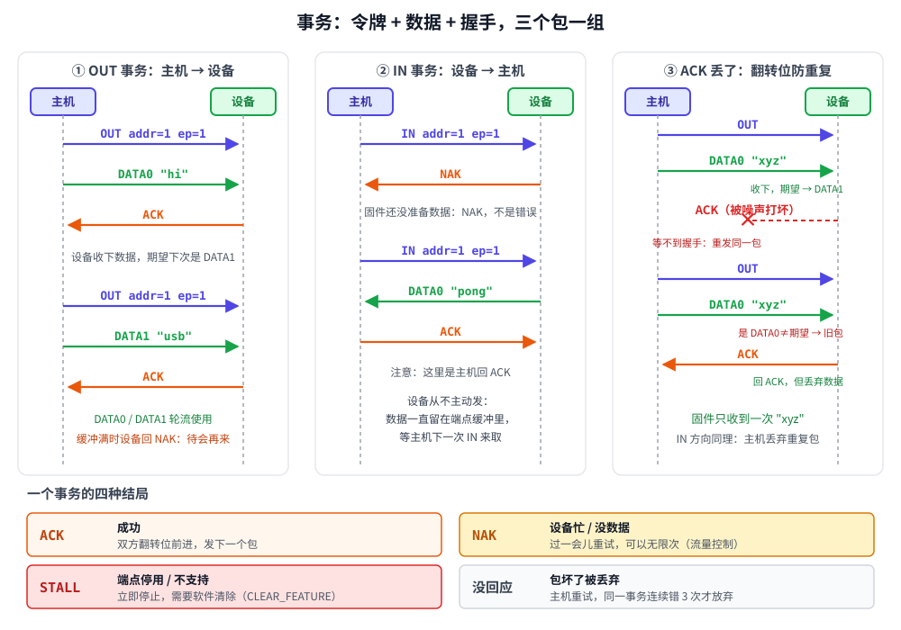

# 第 4 章　事务：一问一答和数据翻转

## 本章目标

- 理解**事务**（transaction）：令牌、数据、握手三个包组成的一次“问答”
- 分清 OUT 事务和 IN 事务里，分别是谁发数据、谁回握手
- 学会 NAK 流量控制和 STALL 的含义
- 搞懂 **DATA0/DATA1 数据翻转**：ACK 丢了之后，USB 怎样保证数据不重复、不丢失
- 第一次用模拟器的**总线、主机、设备**三个对象，并在总线上注入干扰

## 4.1 从包到事务

上一章的包都是“孤立”的。实际上包总是成组出现：主机发一个令牌包说明“这次要干什么”，接着是数据包，最后由接收方回一个握手包。这一组就叫一个**事务**。



| 事务 | 第 1 个包（主机发） | 第 2 个包 | 第 3 个包 |
|------|-------------------|-----------|-----------|
| **OUT** | OUT 令牌 | 主机发 DATAx | **设备**回 ACK / NAK / STALL |
| **IN** | IN 令牌 | **设备**发 DATAx，或者直接回 NAK / STALL | **主机**回 ACK |
| **SETUP** | SETUP 令牌 | 主机发 DATA0（8 字节） | 设备回 ACK（必须） |

记住一个规律：**握手包总是由收到数据的那一方发出**。OUT 时设备收数据，设备回 ACK；IN 时主机收数据，主机回 ACK。IN 事务里如果设备没数据，就用 NAK 代替数据包，这次事务就只有两个包。

## 4.2 模拟器的三个角色

从这一章开始，例子里会出现三个对象，正好对应真实世界：

```cpp
Bus bus;                          // 一条总线（真实世界：线缆 + Hub）
DemoDevice dev;                   // 一个设备（真实世界：单片机里的 USB 控制器 + 固件）
bus.attach(dev);                  // 插上
dev.debug_force_configured(1);    // 作弊：跳过枚举，直接设成“地址 1、已配置”
Host host(bus);                   // 主机（真实世界：xHCI 控制器 + 操作系统 USB 驱动）
```

`debug_force_configured` 是为了让本章只关注事务本身，不被枚举分心。第 7 章会去掉它，让主机从头认识设备。

总线的核心是 `host_send`：主机发一个包，所有设备都能“听到”，被点名的那个设备回答。

[`include/miniusb/bus.hpp`](../include/miniusb/bus.hpp)：

```cpp
std::optional<Packet> host_send(const Packet& p)
{
    std::optional<Packet> seen = deliver(Dir::HostToDevice, p);
    if (!seen) {
        return std::nullopt;   // 设备收到的是坏包，按规范直接装没听见
    }
    std::optional<Packet> reply;
    for (BusDevice* d : devices_) {
        std::optional<Packet> r = d->on_packet(*seen);
        if (r) {
            if (reply) {
                log(kTransfer, "[总线] 错误：两个设备同时回答（地址冲突）");
            }
            reply = std::move(r);
        }
    }
    if (!reply) {
        return std::nullopt;
    }
    return deliver(Dir::DeviceToHost, *reply);
}
```

`deliver` 里会把包编码成字节，如果你之前调用过 `bus.corrupt_next(...)`，就在这里把最后一个字节翻转一位，然后用上一章的 `decode` 检查。坏包会被接收方丢弃，就像真实的噪声一样。

## 4.3 主机这一边：一个 IN 事务

[`include/miniusb/host.hpp`](../include/miniusb/host.hpp)：

```cpp
// IN 事务：IN 令牌 + 设备回 DATAx（或 NAK/STALL）+ 主机回 ACK
Result in_transaction(uint8_t addr, uint8_t ep, bool toggle, Bytes& data)
{
    auto reply = bus_.host_send(Packet::token(Pid::In, addr, ep));
    Result r;
    if (!reply) {
        r = Result::Error;
    } else if (reply->pid == Pid::Nak) {
        r = Result::Nak;
    } else if (reply->pid == Pid::Stall) {
        r = Result::Stall;
    } else if (reply->kind() == PidKind::Data) {
        // 不管翻转位对不对，主机都回 ACK；不对说明是重发的旧数据，丢掉。
        bus_.host_send(Packet::handshake(Pid::Ack));
        if ((reply->pid == Pid::Data1) == toggle) {
            data = reply->data;
            r = Result::Ack;
        } else {
            r = Result::Duplicate;
        }
    } else {
        r = Result::Error;
    }
    // ……打印日志
    return r;
}
```

注意 `toggle` 参数：主机给每个端点记着“下一个应该是 DATA0 还是 DATA1”。这就是下一节的主角。

## 4.4 数据翻转：ACK 丢了怎么办

考虑这样一个场景（图中第 ③ 栏）：

1. 主机发 OUT + DATA0 `"xyz"`，设备收下了。
2. 设备回 ACK，**但 ACK 在线上被噪声打坏了**，主机没收到。
3. 主机不知道设备到底收没收到，只能重发同样的 OUT + DATA0 `"xyz"`。

如果没有额外信息，设备会把 `"xyz"` 再收一遍，固件就拿到了 `"xyzxyz"`，这对 U 盘来说是灾难。

USB 的解法就是 DATA0/DATA1 这两种“颜色”：

- 主机和设备**各自**给每个端点记一个翻转位，初始都是 DATA0。
- 发送方只有在**收到 ACK** 后才翻转自己的位；接收方只有在**接受数据**后才翻转自己的位。
- 接收方如果收到的颜色和自己期望的**不一样**，就知道这是“我已经收过的那一包”：照样回 ACK（让对方放心往下走），但**把数据丢掉**。

回到上面的场景：设备收下 DATA0 后期望变成了 DATA1；主机没收到 ACK，翻转位还停在 DATA0，所以重发的仍是 DATA0。设备一看颜色不对，回 ACK 丢数据。双方又对齐了。

设备这一边的代码，[`include/miniusb/device.hpp`](../include/miniusb/device.hpp)：

```cpp
bool toggle = (p.pid == Pid::Data1);
if (toggle != e->toggle) {
    // 翻转位和期望的不一样：说明这是主机重发的、我们已经收过的包
    // （上次我们回的 ACK 主机没收到）。回 ACK 让主机放心，但数据丢掉。
    log(kTransaction, "[%s] 收到 %s，期望 %s：这是重发的旧包，回 ACK 但丢弃数据", name(),
        pid_name(p.pid), pid_name(data_pid(e->toggle)));
    return Packet::handshake(Pid::Ack);
}
// ……
if (e->rx.size() + p.data.size() > e->rx_capacity) {
    return Packet::handshake(Pid::Nak);   // 缓冲满了：数据不收，翻转位也不动
}
e->rx.insert(e->rx.end(), p.data.begin(), p.data.end());
e->toggle = !e->toggle;
return Packet::handshake(Pid::Ack);
```

IN 方向是对称的：设备发出 DATA0 后，只有收到主机的 ACK 才翻转、才把这一包从队列里删掉。主机的 ACK 丢了，设备下次就原样重发；主机发现颜色和期望不一样，回 ACK 并丢弃（上面代码里的 `Result::Duplicate`）。

> 翻转位是“一个比特的序号”。它之所以够用，是因为 USB 的事务严格一问一答，同一时刻最多只有一个包“悬而未决”。

## 4.5 NAK 和 STALL

**NAK** 不是错误，而是**流量控制**：

- OUT 时设备回 NAK：“我的接收缓冲满了，你待会再发”。数据没被接收，双方翻转位都不动。
- IN 时设备回 NAK：“我现在没数据给你”。键盘没人按的时候，每次轮询都是 NAK。

主机收到 NAK 后会一直重试（真实主机控制器会在之后的帧里继续尝试，直到软件设定的超时）。模拟器用 `host.max_naks` 代替超时时间。

**STALL** 是“出事了，别再试了”：

- 端点被固件**停用**（halt），比如 U 盘收到一个无法处理的命令。
- 控制传输里设备**不支持这个请求**（第 7 章）。

STALL 不会自己消失。对普通端点，主机要发一个控制请求 `CLEAR_FEATURE(ENDPOINT_HALT)` 才能解除，同时**双方的翻转位都要回到 DATA0**。

还有一种结局是**没有回应**：包坏了被丢弃，或者设备根本不在。主机等一段时间后判定出错，**同一个事务连续出错 3 次**才放弃，这是规范规定的。

```cpp
// 出错（Error）就重试，最多 max_errors 次；NAK 就让设备先忙一会再试。
template <typename F>
Result retry(F transaction)
{
    int errors = 0, naks = 0;
    for (;;) {
        Result r = transaction();
        if (r == Result::Error) {
            if (++errors >= max_errors) {
                return r;
            }
            log(kTransaction, "  ↻ 第 %d 次出错，重试同一个事务", errors);
        } else if (r == Result::Nak) {
            if (++naks > max_naks) {
                return r;
            }
            bus_.run_device_tasks();
        } else if (r != Result::Duplicate) {
            return r;
        }
    }
}
```

## 4.6 动手：运行第 4 章的例子

[`examples/04-transaction/main.cpp`](../examples/04-transaction/main.cpp) 里的 `DemoDevice` 有两个批量端点：`0x01`（OUT）和 `0x81`（IN），最大包长 8 字节。它的“固件主循环” `task()` 把 OUT 端点收到的数据取走并打印。

```bash
./build/examples/04-transaction
```

前 4 步日志级别是 `kPacket`，每个包都打印出来，`|` 右边是包的原始字节；从第 5 步起切到 `kTransaction`，一个事务一行。本机实际输出：

```
[总线] 插入设备 "demo"：设备把 D+ 上拉到 3.3V，主机检测到一个全速设备

========== 第 1 步：OUT 事务 —— OUT 令牌 + DATA0 + ACK ==========
    主机→设备  OUT addr=1 ep=1                    | E1 81 58
    主机→设备  DATA0 [2] 68 69                    | C3 68 69 11 A1
    设备→主机  ACK                                | D2
  OUT   addr=1 ep=1  DATA0 [2] → ACK
    [固件] 从端点 0x01 取走 2 字节: "hi"

========== 第 2 步：下一个 OUT 事务用 DATA1，DATA0/DATA1 轮流 ==========
    主机→设备  OUT addr=1 ep=1                    | E1 81 58
    主机→设备  DATA1 [3] 75 73 62                 | 4B 75 73 62 3B 3C
    设备→主机  ACK                                | D2
  OUT   addr=1 ep=1  DATA1 [3] → ACK
    [固件] 从端点 0x01 取走 3 字节: "usb"

========== 第 3 步：IN 事务 —— 设备没数据时回 NAK ==========
    主机→设备  IN addr=1 ep=1                     | 69 81 58
    设备→主机  NAK                                | 5A
  IN    addr=1 ep=1  → NAK

========== 第 4 步：固件准备好数据后，IN 拿到 DATA0，主机回 ACK ==========
    主机→设备  IN addr=1 ep=1                     | 69 81 58
    设备→主机  DATA0 [4] 70 6F 6E 67              | C3 70 6F 6E 67 B8 8C
    主机→设备  ACK                                | D2
  IN    addr=1 ep=1  DATA0 [4] 70 6F 6E 67 ← ACK
主机收到: "pong"
```

第 1–4 步对应图里的第 ① ② 栏。注意第 4 步：数据早就被固件 `write` 进了端点缓冲，但直到主机发来 IN 令牌，它才真正上线。

```
========== 第 5 步：主机发的 DATA 包被噪声打坏 ==========
设备 CRC 校验失败，什么都不回；主机等不到握手，判定出错并重发同一个包。
  [demo] 进入 Configured 状态：端点已按配置描述符建立，可以干活了
  ⚡ 噪声打坏了 DATA0 包的一个比特
  ✗ 设备丢弃了这个包：CRC16 错误
  OUT   addr=1 ep=1  DATA0 [3] → 超时/出错
    ↻ 第 1 次出错，重试同一个事务
  OUT   addr=1 ep=1  DATA0 [3] → ACK
批量写  addr=1 ep=1 ← 3 字节（1 个包）
    [固件] 从端点 0x01 取走 3 字节: "abc"
```

（第 5 步开头那行 `进入 Configured 状态` 是因为例子再次调用了 `debug_force_configured`，把翻转位清回 DATA0，方便观察。）

这是最简单的错误：数据包坏了，设备不回答，主机重发。翻转位还没动，重发的仍然是 DATA0。

```
========== 第 6 步：设备回的 ACK 被打坏 —— 数据翻转位的用处 ==========
设备其实收下了数据，但主机没看到 ACK，于是用同一个 DATA1 重发。
设备期望的已经是 DATA0 了，一看是 DATA1 就知道是重复包：回 ACK，丢掉数据。
  ⚡ 噪声打坏了 ACK 包的一个比特
  ✗ 主机丢弃了这个包：PID 校验位不对
  OUT   addr=1 ep=1  DATA1 [3] → 超时/出错
    ↻ 第 1 次出错，重试同一个事务
  [demo] 收到 DATA1，期望 DATA0：这是重发的旧包，回 ACK 但丢弃数据
  OUT   addr=1 ep=1  DATA1 [3] → ACK
批量写  addr=1 ep=1 ← 3 字节（1 个包）
    [固件] 从端点 0x01 取走 3 字节: "xyz"
结果：固件只收到一次 "xyz"，没有重复。

========== 第 7 步：IN 方向主机的 ACK 被打坏 ==========
设备没收到 ACK，下次 IN 原样重发；主机发现翻转位没变，回 ACK 并丢掉重复的那份。
  ⚡ 噪声打坏了 ACK 包的一个比特
  ✗ 设备丢弃了这个包：PID 校验位不对
  IN    addr=1 ep=1  DATA0 [8] 31 32 33 34 35 36 37 38 ← ACK
  [demo] 没等到 ACK，那包数据留着下次重发
  IN    addr=1 ep=1  DATA0 [8] 31 32 33 34 35 36 37 38 ← 重复数据
  IN    addr=1 ep=1  DATA1 [4] 41 42 43 44 ← ACK
批量读  addr=1 ep=1 → 12 字节
主机最终收到 12 字节: "12345678ABCD"
```

第 6 步就是图里的第 ③ 栏，只是这一次轮到的颜色是 DATA1。第 7 步是它在 IN 方向的镜像：`"12345678"` 在线上出现了两次，但主机只收了一次。

```
========== 第 8 步：NAK 做流量控制 —— 设备缓冲区满了 ==========
设备的接收缓冲只有 8 字节，固件暂时不取数据。
  OUT   addr=1 ep=1  DATA0 [8] → ACK
  [demo] 端点 1 的接收缓冲满了，回 NAK
  OUT   addr=1 ep=1  DATA1 [8] → NAK
    （省略了后面连续的 3 个 NAK）
批量写  addr=1 ep=1 失败：NAK
固件开始取数据，主机重试就成功了：
  OUT   addr=1 ep=1  DATA1 [8] → NAK
    [固件] 从端点 0x01 取走 8 字节: "ABCDEFGH"
  OUT   addr=1 ep=1  DATA1 [8] → ACK
批量写  addr=1 ep=1 ← 8 字节（1 个包）

========== 第 9 步：STALL —— 端点被停用 ==========
  IN    addr=1 ep=1  → STALL
批量读  addr=1 ep=1 端点被 STALL
STALL 不会自己消失，主机要用控制传输 CLEAR_FEATURE(ENDPOINT_HALT) 解除（第 7 章）。
```

第 8 步要仔细看：第一个 16 字节的写传输只送进去了前 8 字节，第二包一直被 NAK，最后 `max_naks = 3` 用完，传输失败。这对应真实世界里的“写超时”：**超时并不代表什么都没写进去**，可能已经写了一部分。后面主机继续写时，翻转位接着用 DATA1，没有错乱。

## 4.7 把日志调到最细

把 `main()` 里的 `trace.level = kPacket;` 改成 `trace.level = kWire;` 重新编译运行，每个包下面会多一行 `线路: KJKJKJKK...`，那就是第 2 章的 J/K 状态。至此，从电平到事务的每一层你都能看到了。

## 练习

1. 在第 6 步之前加一行 `bus.corrupt_next(Dir::DeviceToHost, Pid::Ack, 0);` 再加一行同样的，让 ACK **连续**被打坏两次，预测输出，再运行验证。连续打坏 3 次呢？（提示：`max_errors = 3`。）
2. 在 `Device::on_out` 里把“翻转位不对就丢弃”的判断注释掉，重新运行第 6 步，固件会收到什么？这就是没有数据翻转的世界。
3. 第 7 步中，如果打坏的是**设备发出的 DATA0**（`Dir::DeviceToHost, Pid::Data0`），日志会是什么样？主机会回 ACK 吗？
4. 把第 8 步的 `max_naks` 改成 100，固件仍然不取数据，会怎样？这说明 NAK 和“错误”有什么本质区别？

## 常见坑

- **以为 ACK 丢了数据就重复了。** 有数据翻转，不会。但如果**固件或驱动自己把翻转位搞乱了**（比如端点复位后只清了一边），就会出现“每隔一包丢一包”的诡异现象。
- **CLEAR_FEATURE 之后忘了复位翻转位。** 主机端清了、设备端没清，第一包就会被当成重复包丢掉。TinyUSB 和 Linux 都会自动处理，自己写协议栈时要注意。
- **把 NAK 当错误处理。** 设备用 NAK 告诉主机“慢一点”，是正常现象。真正需要关心的是 STALL 和超时。

---

上一章：[第 3 章　包](03-packets.md)　|　下一章：[第 5 章　四种传输类型和带宽](05-transfer-types.md)
