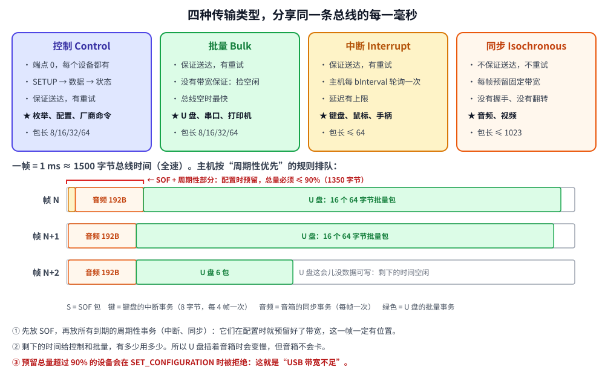

# 第 5 章　四种传输类型和带宽

## 本章目标

- 分清**事务**和**传输**：传输是“一件完整的事”，由一个或多个事务组成
- 认识四种传输类型：控制、批量、中断、同步，知道各自用在哪
- 会算全速 USB 的理论吞吐量，理解为什么全速 U 盘最快只有约 1 MB/s
- 理解主机怎样把每 1 ms 的总线时间分给不同的设备，以及“带宽不足”是怎么来的
- 亲眼看到同一段噪声对同步传输和批量传输的不同影响

## 5.1 传输 = 一串事务

上一章的事务一次最多搬 64 字节（全速批量）。要写 1000 字节，主机就要连续做 16 个 OUT 事务。这一整件事叫一次**传输**（transfer）。

传输怎么知道“结束了”？规则是：**收到一个比最大包长短的包**（包括零长度包），或者读满了请求的长度。

[`include/miniusb/host.hpp`](../include/miniusb/host.hpp) 的批量写：

```cpp
// 批量写：把数据切成最大包长的块逐个 OUT。长度正好是包长整数倍时，
// zlp = true 会补一个零长度包，告诉设备“传完了”。
bool bulk_out(uint8_t addr, uint8_t ep, const Bytes& data, uint16_t mps, bool zlp = true)
{
    std::vector<Bytes> packets;
    for (size_t i = 0; i < data.size(); i += mps) {
        size_t n = std::min<size_t>(mps, data.size() - i);
        packets.emplace_back(data.begin() + static_cast<long>(i),
                             data.begin() + static_cast<long>(i + n));
    }
    if (zlp && data.size() % mps == 0) {
        packets.emplace_back();   // 零长度包
    }
    bool& toggle = toggles_[key(addr, ep)];
    for (const Bytes& chunk : packets) {
        Result r = retry([&] { return out_transaction(addr, ep, toggle, chunk); });
        if (r != Result::Ack) {
            // ……失败
            return false;
        }
        toggle = !toggle;
    }
    // ……
    return true;
}
```

`bulk_in` 是反过来：一直发 IN，直到收到短包为止。ZLP 的坑留到第 9 章，在串口例子里亲手踩一次。

## 5.2 四种传输类型



| 类型 | 保证送达 | 保证带宽 | 保证延迟 | 典型设备 |
|------|---------|---------|---------|---------|
| **控制** Control | ✔ | 预留约 10% | — | 所有设备的端点 0 |
| **批量** Bulk | ✔ | ✘（捡剩下的） | ✘ | U 盘、串口、打印机 |
| **中断** Interrupt | ✔ | ✔ | ✔（每 bInterval 帧至少轮询一次） | 键盘、鼠标、手柄 |
| **同步** Isochronous | ✘（不重传） | ✔ | ✔ | 声卡、摄像头 |

用生活里的例子记：

- **控制**：办手续。步骤固定（提交申请 → 交材料 → 拿回执），每个设备都要办（第 7 章）。
- **批量**：搬家。东西一件都不能丢，但什么时候搬完无所谓，路上车少就快一点。
- **中断**：保安巡逻。每隔固定时间来看一眼“有情况吗”，大部分时候回答“没有”（NAK）。
- **同步**：直播。必须准时到，偶尔丢一帧画面没关系，但不能停下来重传，否则后面的全乱了。

> **“中断传输”和单片机的中断没有关系。** 它依然是主机轮询，只是轮询间隔有保证。键盘的 `bInterval = 10` 意思是“主机至少每 10 ms 来问一次”。

同步传输有几个特殊之处：没有握手包（没人回 ACK）、没有数据翻转（永远 DATA0）、出错不重传。模拟器里的设备代码对它单独处理：

```cpp
if (e->type == TransferType::Isochronous) {
    // 同步传输：没有握手、没有重传、没有数据翻转，永远 DATA0。
    // ……
    return Packet::data_packet(false, d);
}
```

## 5.3 算一算带宽

全速 12 Mbit/s，1 ms 一帧，每帧是 12000 位 = **1500 字节**的总线时间。但每个事务除了负载，还有令牌包、PID、CRC、握手包、SYNC/EOP 和包之间的间隔。USB 2.0 规范第 5 章给出了每种传输每个事务的开销：

| 类型 | 每个事务的额外开销 |
|------|------------------|
| 批量、中断、控制 | 13 字节 |
| 同步 | 9 字节（没有握手包） |

于是一个 64 字节的批量事务要占 77 字节的总线时间，一帧最多放 1500 ÷ 77 = **19 个**，也就是 19 × 64 = 1216 字节/帧 ≈ **1.2 MB/s**。这就是全速 USB 的极限，实际产品（CH340、全速 U 盘）通常只能做到 800–1000 KB/s。

中断端点每帧最多只轮询一次，64 字节 × 1000 次/秒 = 64 KB/s。它慢，但它换来了“每 1 ms 一定有一次机会”。

## 5.4 主机怎样排一帧

图的下半部分是主机每一帧的排班规则：

1. 帧开头发 SOF。
2. 所有**周期性**传输（中断、同步）按配置时预留的带宽先放进去。它们的预留总量不能超过一帧的 **90%**。
3. 剩下的时间留给控制传输和批量传输，有多少用多少。

第 3 条解释了“为什么同时拷文件和听 USB 音箱，拷贝会变慢，但音乐不卡”。第 2 条解释了“为什么两个 USB 摄像头插在同一个口上，第二个打不开”：主机在 `SET_CONFIGURATION` 时就会检查预留带宽，不够就直接拒绝。

## 5.5 动手：运行第 5 章的例子

[`examples/05-transfer-types/main.cpp`](../examples/05-transfer-types/main.cpp) 分三部分：先按上面的公式算表，再逐帧模拟调度，最后在模拟总线上注入噪声。

```bash
./build/examples/05-transfer-types
```

本机实际输出（第一、二部分）：

```
========== 第一部分：全速下每种传输的理论最大吞吐量 ==========
  类型（单个端点）       包长   每帧事务       最大吞吐量
  批量 Bulk                 8         71         568 KB/s
  批量 Bulk                64         19        1216 KB/s
  中断 Interrupt            8          1           8 KB/s
  中断 Interrupt           64          1          64 KB/s
  同步 Isochronous        192          1         192 KB/s
  同步 Isochronous       1023          1        1023 KB/s

  一个批量端点一帧最多塞 19 个 64 字节的包 = 1216 字节/帧 = 1216 KB/s，
  这就是全速 U 盘、串口芯片的速度上限（实际还要再打折扣）。
  一个中断端点每帧只轮询一次：64 字节 × 1000 次/秒 = 64 KB/s，换来的是“延迟有保证”。

========== 第二部分 A：只插一个 U 盘 ==========
周期性传输预留 0 字节/帧（上限 1350 = 90%）
每个字符 = 25 字节总线时间，'S' = SOF，'.' = 空闲
  帧  0 |Suuuuuuuuuuuuuuuuuuuuuuuuuuuuuuuuuuuuuuuuuuuuuuuuuuuuuuuuuu.| U盘 19 包
  帧  1 |Suuuuuuuuuuuuuuuuuuuuuuuuuuuuuuuuuuuuuuuuuuuuuuuuuuuuuuuuuu.| U盘 19 包
  帧  2 |Suuuuuuuuuuuuuuuuuuuuuuuuuuuuuuuuuuuuuuuuuuuuuuuuuuuuuuuuuu.| U盘 19 包
U 盘平均写入速度 ≈ 1216 KB/s

========== 第二部分 B：再插一个键盘（中断，8 字节，每 4 ms）和一个 USB 音箱（同步，192 字节，每帧） ==========
周期性传输预留 222 字节/帧（上限 1350 = 90%）
每个字符 = 25 字节总线时间，'S' = SOF，'.' = 空闲
  帧  0 |Skaaaaaaaaauuuuuuuuuuuuuuuuuuuuuuuuuuuuuuuuuuuuuuuuuuuuuuuuu| U盘 16 包
  帧  1 |Saaaaaaaaauuuuuuuuuuuuuuuuuuuuuuuuuuuuuuuuuuuuuuuuuuuuuuuuu.| U盘 16 包
  帧  2 |Saaaaaaaaauuuuuuuuuuuuuuuuuuuuuuuuuuuuuuuuuuuuuuuuuuuuuuuuu.| U盘 16 包
  帧  3 |Saaaaaaaaauuuuuuuuuuuuuuuuuuuuuuuuuuuuuuuuuuuuuuuuuuuuuuuuu.| U盘 16 包
  帧  4 |Skaaaaaaaaauuuuuuuuuuuuuuuuuuuuuuuuuuuuuuuuuuuuuuuuuuuuuuuuu| U盘 16 包
U 盘平均写入速度 ≈ 1024 KB/s

========== 第二部分 C：再插两个摄像头（同步，每个 1023 字节/帧） ==========
周期性传输预留 2286 字节/帧（上限 1350 = 90%） -> 带宽不够，主机拒绝配置这个设备！
（Windows 上会弹出“USB 控制器带宽不足”，常见于同一个口挂两个摄像头）
```

读这段输出：

- **8 字节的批量包**每帧能塞 71 个，但只有 568 KB/s。包越小，开销占比越大。这就是为什么批量端点一般都用最大的 64 字节。
- **第二部分 B**：音箱每帧固定占走 201 字节（`a`），键盘每 4 帧占 21 字节（`k`），U 盘从 19 包/帧降到 16 包/帧，速度从 1216 降到 1024 KB/s。音箱一帧也没少。
- **第二部分 C**：两个摄像头各要 1032 字节/帧，加起来远超 1350 的上限，第二个设备根本配置不上。

第三部分在真正的模拟总线上运行：一个设备同时有一个同步 OUT 端点（`0x01`，音频）和一个批量 OUT 端点（`0x02`，数据），给两者注入同样的噪声：

```
========== 第三部分：同一段噪声，同步传输丢数据，批量传输重传 ==========
[总线] 插入设备 "speaker+disk"：设备把 D+ 上拉到 3.3V，主机检测到一个全速设备
-- 同步 OUT：5 帧音频，每帧 192 字节，第 3 帧被打坏
  OUT   addr=1 ep=1  DATA0 [192] （同步传输，没有握手）
  OUT   addr=1 ep=1  DATA0 [192] （同步传输，没有握手）
  ⚡ 噪声打坏了 DATA0 包的一个比特
  ✗ 设备丢弃了这个包：CRC16 错误
  OUT   addr=1 ep=1  DATA0 [192] （同步传输，没有握手）
  OUT   addr=1 ep=1  DATA0 [192] （同步传输，没有握手）
  OUT   addr=1 ep=1  DATA0 [192] （同步传输，没有握手）
设备收到 768 字节 = 4 帧音频（丢了的那帧不会重发，喇叭里是一声“咔”）

-- 批量 OUT：5 个 64 字节的包，第 3 个被打坏
  OUT   addr=1 ep=2  DATA0 [64] → ACK
  OUT   addr=1 ep=2  DATA1 [64] → ACK
  ⚡ 噪声打坏了 DATA0 包的一个比特
  ✗ 设备丢弃了这个包：CRC16 错误
  OUT   addr=1 ep=2  DATA0 [64] → 超时/出错
    ↻ 第 1 次出错，重试同一个事务
  OUT   addr=1 ep=2  DATA0 [64] → ACK
  OUT   addr=1 ep=2  DATA1 [64] → ACK
  OUT   addr=1 ep=2  DATA0 [64] → ACK
批量写  addr=1 ep=2 ← 320 字节（5 个包）
设备收到 320 字节，一个都不少（代价是多花了一点时间）
```

同步传输全是 DATA0、没有握手，坏了就丢。批量传输重试一次，数据完整。这两种行为都是**设计出来的**：对音频来说，迟到的数据和丢掉的数据一样没用。

## 5.6 怎么为自己的设备选类型

| 你的需求 | 选 |
|---------|----|
| 发配置命令、读状态，量很少 | 控制传输（厂商请求，第 7、11 章） |
| 大量数据，不能丢，不赶时间 | 批量 |
| 少量数据，要及时（按键、传感器告警） | 中断 |
| 持续的流，宁可丢也不能晚 | 同步 |

另外两个经验：

- 想“不装驱动就能用”，优先套用**标准类**：HID（中断，第 8 章）、CDC 串口（批量，第 9 章）、MSC（U 盘，批量）、UAC（音频，同步）。
- 低速设备只能用控制和中断，不能用批量和同步。

## 练习

1. 改第一部分的 `rows`，加一行 32 字节的批量包，预测每帧事务数和吞吐量。
2. 第二部分 B 里把音箱改成 48 kHz、16 位、双声道（每帧 192 字节就是这么来的：48 × 2 × 2），再加一个同样的音箱。U 盘还剩多少速度？
3. 第三部分，把同步传输的噪声改成打坏**两帧**（调用两次 `corrupt_next`），设备收到多少字节？
4. 为什么 USB 规范不允许同步传输重传？假设允许，一个 48 kHz 音频流丢了一帧后重传，接下来会发生什么？

## 常见坑

- **用中断端点传大量数据。** 全速下每个中断端点最多 64 KB/s，传固件、传图片要用批量。
- **以为 12 Mbit/s 能跑到 1.5 MB/s。** 协议开销让理论上限只有 1.2 MB/s，再加上主机软件开销会更低。要更快就要选高速（480 Mbit/s）芯片，比如 STM32F4 的 OTG_HS 加外部 PHY。
- **同步设备“插上就带宽不足”。** 看看是不是在同一个 Hub 或同一个控制器下挂了多个摄像头/声卡。换到另一个控制器的口上通常就好了。

---

上一章：[第 4 章　事务](04-transactions.md)　|　下一章：[第 6 章　描述符：设备的自我介绍](06-descriptors.md)
