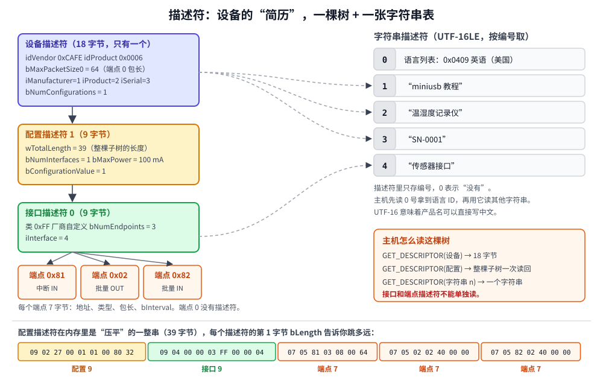

# 第 6 章　描述符：设备的自我介绍

## 本章目标

- 知道描述符是什么：一组**固定格式的字节数组**，主机靠它们认识设备
- 认识五种标准描述符：设备、配置、接口、端点、字符串，以及它们组成的树
- 能逐字节读懂一份配置描述符，和 `lsusb -v` 的输出对上号
- 会用 `ConfigBuilder` 写描述符，并知道手写时最容易犯的四个错

## 6.1 为什么需要描述符

电脑插上一个从没见过的设备，必须先回答这些问题，才能决定加载什么驱动、怎么跟它说话：

- 你是谁？（厂商、产品、序列号）
- 你是哪一类设备？（键盘？串口？U 盘？还是“我自己的协议”？）
- 你有哪些端点，各是什么类型、多大的包、多久轮询一次？
- 你要多少电流？

设备把这些答案写成几段固定格式的字节数组，放在固件的 Flash 里，主机来要的时候原样发过去。这些字节数组就是**描述符**（descriptor）。

所有描述符的前两个字节都一样：

| 偏移 | 字段 | 含义 |
|------|------|------|
| 0 | `bLength` | 这个描述符一共多少字节 |
| 1 | `bDescriptorType` | 类型：1 设备、2 配置、3 字符串、4 接口、5 端点…… |

有了这两个字节，主机拿到一串不认识的描述符，也能一个一个跳过去。

## 6.2 描述符树



描述符之间是树的关系：

```
设备描述符（1 个）
└── 配置描述符（通常 1 个）
    ├── 接口描述符 0
    │   ├── 端点描述符 0x81
    │   ├── 端点描述符 0x02
    │   └── 端点描述符 0x82
    └── 接口描述符 1（如果有）
        └── ……
字符串描述符 0、1、2……（被上面的 iXxx 字段按编号引用）
```

- **配置**（configuration）：设备的一种“工作模式”。理论上可以有多个（比如“低功耗模式”和“全功能模式”），但实际上几乎所有设备都只有一个。
- **接口**（interface）：设备的一个**功能**。一个 USB 耳机可能有“音频输出”“麦克风”“音量按键”三个接口，操作系统给每个接口分别加载驱动。
- **端点**：接口用来收发数据的口（第 1 章）。**端点 0 不属于任何接口，也没有端点描述符**，它的包长写在设备描述符里。

图的底部是关键：主机发 `GET_DESCRIPTOR(配置)` 时，设备要把**配置描述符和它下面的所有接口、端点描述符一次性连在一起发回去**。主机拿到的是一个“压平”的字节串，靠每段的 `bLength` 往后跳。

## 6.3 设备描述符：18 字节

[`include/miniusb/descriptors.hpp`](../include/miniusb/descriptors.hpp)：

```cpp
struct DeviceDescriptor {
    uint16_t bcdUSB = 0x0200;        // 遵循的 USB 版本，0x0200 = USB 2.0
    uint8_t bDeviceClass = 0;        // 0 = 类别写在各个接口里（最常见）
    uint8_t bDeviceSubClass = 0;
    uint8_t bDeviceProtocol = 0;
    uint8_t bMaxPacketSize0 = 64;    // 端点 0 的最大包长：8/16/32/64
    uint16_t idVendor = 0;           // VID，向 USB-IF 购买
    uint16_t idProduct = 0;          // PID，厂商自己分配
    uint16_t bcdDevice = 0x0100;     // 设备自己的版本号
    uint8_t iManufacturer = 0;       // 字符串描述符的编号，0 = 没有
    uint8_t iProduct = 0;
    uint8_t iSerialNumber = 0;
    uint8_t bNumConfigurations = 1;
    // ……
};
```

几个要特别注意的字段：

- **`bMaxPacketSize0`**（偏移 7）：端点 0 一包最多多少字节。主机第一次读描述符时还不知道这个值，所以它在描述符里放得很靠前，读到前 8 个字节就够了（第 7 章）。
- **`idVendor` / `idProduct`**：VID 要向 USB-IF 购买（几千美元），PID 由厂商自己分配。Windows 和 Linux 用 VID:PID 匹配驱动。本教程用 `0xCAFE` 只是为了桌面测试，**不能用在产品上**。开源项目可以向 [pid.codes](https://pid.codes) 免费申请一个 PID。
- **多字节字段都是小端**：`0xCAFE` 在字节里是 `FE CA`。
- **`bcd` 开头的字段是 BCD 码**：`0x0200` 表示 2.00，`0x0102` 表示 1.02。

## 6.4 配置、接口、端点描述符

**配置描述符**（9 字节）：

| 偏移 | 字段 | 例子里的值 | 含义 |
|------|------|-----------|------|
| 2 | `wTotalLength` | 39 | 配置描述符**加上它下面所有描述符**的总长度 |
| 4 | `bNumInterfaces` | 1 | 有几个接口 |
| 5 | `bConfigurationValue` | 1 | 主机用 `SET_CONFIGURATION(1)` 选中它 |
| 7 | `bmAttributes` | `0x80` | bit7 必须是 1；bit6 自供电；bit5 支持远程唤醒 |
| 8 | `bMaxPower` | 50 | 最大电流，**单位 2 mA**，50 表示 100 mA |

**接口描述符**（9 字节）：编号、备用设置号（alternate setting，第 9 章的练习会提到）、`bNumEndpoints`（**不含端点 0**），以及最重要的三个字段：类、子类、协议。

| `bInterfaceClass` | 类 | 系统自带驱动 |
|------------------|----|------------|
| `0x01` | 音频 Audio | ✔ |
| `0x02` / `0x0A` | CDC 通信 / CDC 数据（虚拟串口、网卡） | ✔ |
| `0x03` | HID（键盘、鼠标、手柄） | ✔ |
| `0x08` | 大容量存储 MSC（U 盘） | ✔ |
| `0x0E` | 视频 Video（摄像头） | ✔ |
| `0xFE` | 应用专用（DFU 固件升级） | 部分 |
| `0xFF` | 厂商自定义 | ✘，需要 libusb 或自己的驱动 |

**端点描述符**（7 字节）：

| 偏移 | 字段 | 含义 |
|------|------|------|
| 2 | `bEndpointAddress` | bit7 方向（1 = IN），bit3..0 端点号 |
| 3 | `bmAttributes` | bit1..0 传输类型：0 控制、1 同步、2 批量、3 中断 |
| 4 | `wMaxPacketSize` | 最大包长 |
| 6 | `bInterval` | 中断端点：轮询间隔（全速下单位是 ms）；批量端点填 0 |

## 6.5 用 ConfigBuilder 写配置描述符

手写配置描述符最容易出错的是那几个“数一数”的字段：总长度、接口个数、每个接口的端点个数。模拟器的 `ConfigBuilder` 把它们自动算出来：

```cpp
Bytes cfg = ConfigBuilder(1, 100)                       // 配置值 1，总线供电 100 mA
                .interface(0, 0, 0xFF, 0x00, 0x00, 4)   // 厂商自定义类，名字是字符串 4
                .endpoint(0x81, TransferType::Interrupt, 8, 100)
                .endpoint(0x02, TransferType::Bulk, 64)
                .endpoint(0x82, TransferType::Bulk, 64)
                .build();
```

`build()` 的实现很简单：先把所有子描述符拼起来，最后算出总长度填到头部。

```cpp
Bytes build() const
{
    Bytes b{9, desc::CONFIGURATION};
    put_u16(b, static_cast<uint16_t>(9 + body_.size()));
    b.push_back(static_cast<uint8_t>(itf_numbers_.size()));
    b.push_back(value_);
    b.push_back(iconfig_);
    b.push_back(attributes_);
    b.push_back(static_cast<uint8_t>(max_power_ma_ / 2));   // 单位是 2 mA
    b.insert(b.end(), body_.begin(), body_.end());
    return b;
}
```

TinyUSB 用宏做同样的事（第 11 章会看到 `TUD_CONFIG_DESCRIPTOR`、`TUD_VENDOR_DESCRIPTOR`），区别只是总长度要你自己用 `#define` 算好。

## 6.6 字符串描述符

字符串用 **UTF-16LE** 编码，所以 `bLength = 2 + 2 × 字符数`。0 号字符串很特殊：它不是文字，而是设备支持的**语言 ID 列表**，几乎所有设备都只写一个 `0x0409`（英语-美国）。

因为是 UTF-16，中文完全没问题：“温”是 U+6E29，存成 `29 6E`。

## 6.7 动手：运行第 6 章的例子

[`examples/06-descriptors/main.cpp`](../examples/06-descriptors/main.cpp) 给一个假想的“USB 温湿度记录仪”写全套描述符：一个厂商自定义接口，中断 IN 端点每 100 ms 报告当前读数，一对批量端点用来下发命令和上传历史记录。

```bash
./build/examples/06-descriptors
```

本机实际输出（第 1–3 步）：

```
========== 第 1 步：设备描述符（18 字节） ==========
  0000: 12 01 00 02 00 00 00 40 FE CA 06 00 02 01 01 02  .......@........
  0010: 03 01                                            ..
注意 idVendor=0xCAFE 在内存里是 FE CA —— USB 是小端序。

Device Descriptor:
  bLength                  18  
  bDescriptorType           1  DEVICE
  bcdUSB               0x0200  USB 2.00
  bDeviceClass              0  （由接口各自定义）
  bDeviceSubClass           0  
  bDeviceProtocol           0  
  bMaxPacketSize0          64  端点 0 一包最多这么多字节
  idVendor             0xCAFE  
  idProduct            0x0006  
  bcdDevice            0x0102  1.02
  iManufacturer             1  字符串编号
  iProduct                  2  字符串编号
  iSerialNumber             3  字符串编号
  bNumConfigurations        1  

========== 第 2 步：配置描述符 —— 一整串，主机一次读走 ==========
共 39 字节：
  0000: 09 02 27 00 01 01 00 80 32 09 04 00 00 03 FF 00  ..'.....2.......
  0010: 00 04 07 05 81 03 08 00 64 07 05 02 02 40 00 00  ........d....@..
  0020: 07 05 82 02 40 00 00                             ....@..

按 bLength 切开：
  偏移  0: 09 02 27 00 01 01 00 80 32  <- CONFIGURATION
  偏移  9: 09 04 00 00 03 FF 00 00 04  <- INTERFACE
  偏移 18: 07 05 81 03 08 00 64        <- ENDPOINT
  偏移 25: 07 05 02 02 40 00 00        <- ENDPOINT
  偏移 32: 07 05 82 02 40 00 00        <- ENDPOINT

========== 第 3 步：像 lsusb -v 一样逐字段解释 ==========
Configuration Descriptor:
  bLength                   9  
  bDescriptorType           2  CONFIGURATION
  wTotalLength             39  配置描述符 + 后面所有描述符的总长
  bNumInterfaces            1  
  bConfigurationValue       1  SET_CONFIGURATION 用这个值
  iConfiguration            0  
  bmAttributes           0x80  总线供电
  bMaxPower                50  100 mA
  Interface Descriptor:
    bInterfaceNumber          0  
    bAlternateSetting         0  
    bNumEndpoints             3  不含端点 0
    bInterfaceClass         255  Vendor Specific 厂商自定义
    bInterfaceSubClass        0  
    bInterfaceProtocol        0  
    iInterface                4  
    Endpoint Descriptor:
      bEndpointAddress       0x81  IN（设备→主机），端点 1
      bmAttributes              3  中断 Interrupt
      wMaxPacketSize            8  字节/包
      bInterval               100  每 100 ms 轮询一次
    Endpoint Descriptor:
      bEndpointAddress       0x02  OUT（主机→设备），端点 2
      bmAttributes              2  批量 Bulk
      wMaxPacketSize           64  字节/包
      bInterval                 0  
    Endpoint Descriptor:
      bEndpointAddress       0x82  IN（设备→主机），端点 2
      bmAttributes              2  批量 Bulk
      wMaxPacketSize           64  字节/包
      bInterval                 0  
```

拿第 2 步的十六进制对照第 3 步的解释读一遍：`27 00` 是 `wTotalLength = 0x0027 = 39`，`32` 是 `bMaxPower = 50`（×2 mA = 100 mA），`64` 是 `bInterval = 100`，`40 00` 是包长 64。这一步做熟了，以后看任何设备的描述符都不怕。

第 3 步的格式特意模仿了 Linux 的 `lsusb -v`。在原生 Linux 上对任何设备运行 `lsusb -v -d VID:PID`，看到的就是同样的结构；第 10 章我们会写一个自己的 `lsusb_lite`，从真设备上读出描述符，用同一个函数打印。

```
========== 第 4 步：字符串描述符（UTF-16LE） ==========
字符串 0（语言列表）：04 03 09 04  <- 0x0409 = 英语（美国）
字符串 1 "miniusb 教程"：
  0000: 16 03 6D 00 69 00 6E 00 69 00 75 00 73 00 62 00  ..m.i.n.i.u.s.b.
  0010: 20 00 59 65 0B 7A                                 .Ye.z
字符串 2 "温湿度记录仪"：
  0000: 0E 03 29 6E 7F 6E A6 5E B0 8B 55 5F EA 4E        ..)n.n.^..U_.N
字符串 3 "SN-0001"：
  0000: 10 03 53 00 4E 00 2D 00 30 00 30 00 30 00 31 00  ..S.N.-.0.0.0.1.
字符串 4 "传感器接口"：
  0000: 0C 03 20 4F 1F 61 68 56 A5 63 E3 53              .. O.ahV.c.S
“温” = U+6E29，小端存成 29 6E。所以产品名可以写中文，lsusb 和 Windows 设备管理器都能显示。

========== 第 5 步：解析器读回来（主机枚举时就是这么做的） ==========
配置 1：1 个接口，最大电流 100 mA
  接口 0：类 0xFF Vendor Specific 厂商自定义
    端点 0x81  IN  中断 Interrupt      包长 8
    端点 0x02  OUT 批量 Bulk           包长 64
    端点 0x82  IN  批量 Bulk           包长 64

========== 第 6 步：常见错误 —— 主机会直接拒绝这样的设备 ==========
  wTotalLength 少算了一个端点    -> wTotalLength=32，实际有 39 字节
  bNumInterfaces 写成 2          -> bNumInterfaces=2，实际有 1 个接口
  bNumEndpoints 写成 2           -> 接口 0 的 bNumEndpoints=2，实际有 3 个端点
  第二个端点的 bLength 写成 0    -> 偏移 25 处的 bLength=0 不合法
```

第 6 步是本章最有实用价值的部分。这四种错误在手写描述符时都极其常见，而它们在真实系统里的症状往往只是一句含糊的“无法识别的 USB 设备”或者 dmesg 里的 `config 1 has an invalid descriptor`。模拟器的 `parse_config` 会告诉你具体哪里错了。

## 练习

1. 给温湿度记录仪加第二个接口：一个只有中断 IN 端点 `0x83` 的“告警”接口。看看 `wTotalLength`、`bNumInterfaces` 变成多少，再用 `parse_config` 读回来。
2. 把 `ConfigBuilder(1, 100)` 改成 `ConfigBuilder(1, 500, 0xC0)`，`bmAttributes` 和 `bMaxPower` 的字节变成什么？`0xC0` 的含义是什么？
3. 把产品名改成你自己的名字（中文），数一数 `bLength`。字符串最长能有多少个字符？（提示：`bLength` 只有一个字节。）
4. 第 6 步再加一种错误：把某个端点的类型改成 0（控制）。`parse_config` 能发现吗？真实主机会怎么处理？

## 常见坑

- **`wTotalLength` 没算对。** 加了一个端点忘了改总长，主机读到的配置就少一截。TinyUSB 工程里这个值通常是一个 `#define CONFIG_TOTAL_LEN (...)`，改描述符时一定要同步改它。
- **`bMaxPower` 当成 mA 填。** 单位是 2 mA，填 500 实际变成 1000 mA，超出 USB 2.0 的 500 mA 上限，有的主机会拒绝配置。
- **改了描述符，Windows 还是显示旧的。** Windows 按 VID:PID（和序列号）缓存驱动和设备信息。调试时改了描述符，最好同时改 PID 或 `bcdDevice`，或者在设备管理器里卸载设备再插。
- **序列号相同。** 两个序列号相同的设备同时插上，Windows 可能把它们当成同一个，COM 口号也会乱。量产时用芯片 UID 生成序列号（第 11 章就是这么做的）。

---

上一章：[第 5 章　传输类型](05-transfer-types.md)　|　下一章：[第 7 章　控制传输与枚举](07-enumeration.md)
