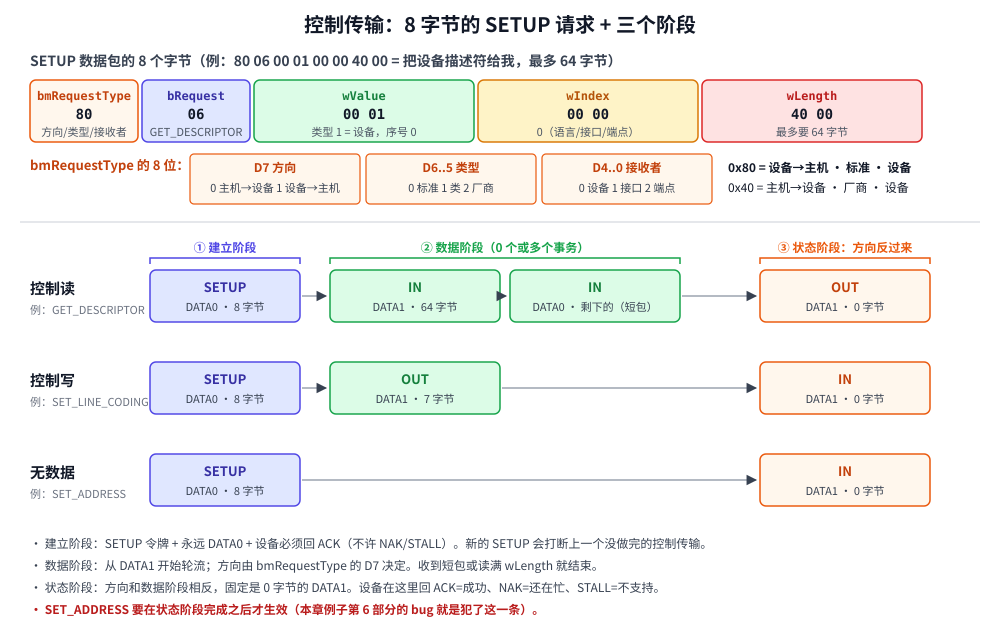
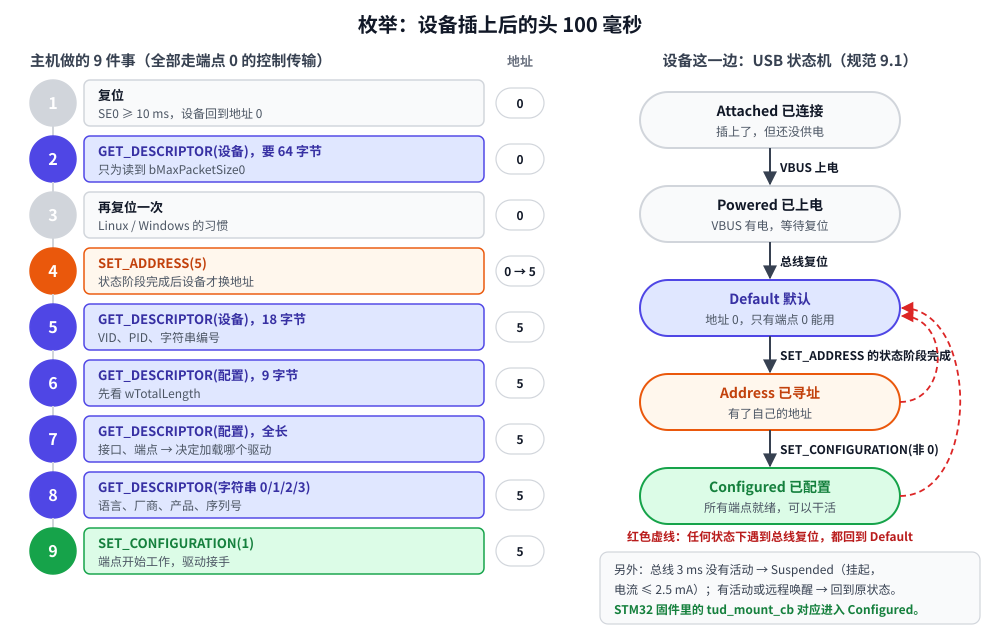

# 第 7 章　控制传输与枚举

## 本章目标

- 读懂 8 字节的 **SETUP 请求**：`bmRequestType`、`bRequest`、`wValue`、`wIndex`、`wLength`
- 掌握控制传输的**三个阶段**：建立、数据、状态
- 从头到尾走一遍**枚举**：主机从“发现设备”到“加载驱动”的 9 个步骤
- 认识设备的状态机：Default → Address → Configured
- 用**厂商请求**给自己的设备加命令；理解 STALL 在控制传输里的用法
- 复现两个经典 bug：端点 0 包长、`SET_ADDRESS` 生效时机

这是全书最重要的一章。前面几章的所有知识（包、事务、数据翻转、描述符）在这里汇合，第 8–11 章的所有内容都建立在它之上。

## 7.1 SETUP 请求：8 个字节说清一件事

控制传输都以一个 8 字节的**SETUP 请求**开头，它就像一张申请表：



| 字段 | 长度 | 含义 |
|------|------|------|
| `bmRequestType` | 1 | D7 方向（数据阶段往哪走）、D6..5 类型（标准/类/厂商）、D4..0 接收者（设备/接口/端点） |
| `bRequest` | 1 | 请求编号，含义由“类型”决定 |
| `wValue` | 2 | 参数 1 |
| `wIndex` | 2 | 参数 2，常用来放接口号或端点地址 |
| `wLength` | 2 | 数据阶段最多传多少字节，0 表示没有数据阶段 |

拿第 3 章见过的 `80 06 00 01 00 00 40 00` 来练手：

- `0x80`：设备→主机、标准请求、接收者是设备
- `0x06`：`GET_DESCRIPTOR`
- `wValue = 0x0100`：高字节是描述符类型 1（设备），低字节是序号 0
- `wIndex = 0`
- `wLength = 0x0040 = 64`：最多给我 64 字节

所有 USB 设备都必须支持的**标准请求**（USB 2.0 规范第 9.4 节）：

| `bRequest` | 名字 | 用途 |
|-----------|------|------|
| 0 | `GET_STATUS` | 自供电？远程唤醒？端点是否被 STALL？ |
| 1 / 3 | `CLEAR_FEATURE` / `SET_FEATURE` | 最常用的是解除/设置端点 HALT（STALL） |
| 5 | `SET_ADDRESS` | 分配地址 |
| 6 | `GET_DESCRIPTOR` | 读描述符 |
| 8 / 9 | `GET_CONFIGURATION` / `SET_CONFIGURATION` | 查询/选中配置 |
| 10 / 11 | `GET_INTERFACE` / `SET_INTERFACE` | 切换接口的备用设置 |

“类型”为**类请求**时，`bRequest` 由类规范定义（第 8 章的 HID `SET_IDLE`、第 9 章的 CDC `SET_LINE_CODING`）；为**厂商请求**时，含义完全由你自己定义（本章 7.6 节和第 11 章）。

## 7.2 控制传输的三个阶段

图的下半部分是控制传输的三种形态：

1. **建立阶段**：SETUP 令牌 + DATA0（8 字节请求）+ 设备回 ACK。设备**必须** ACK，不许 NAK 或 STALL；新来的 SETUP 还会打断上一个没做完的控制传输。
2. **数据阶段**（可以没有）：方向由 `bmRequestType` 的 D7 决定，**从 DATA1 开始**轮流翻转。收到短包或读满 `wLength` 就结束。
3. **状态阶段**：**方向和数据阶段相反**，固定是一个 0 字节的 DATA1。它是“回执”：控制读时主机发 0 字节 OUT 表示“我收到了”；控制写时设备回 0 字节 IN 表示“我处理完了”。设备在这里回 STALL 就表示“这个请求我不支持”。

主机这一边的控制读，[`include/miniusb/host.hpp`](../include/miniusb/host.hpp)：

```cpp
// 控制读：建立阶段（SETUP）→ 数据阶段（若干 IN）→ 状态阶段（一个零长度 OUT）
std::optional<Bytes> control_in(uint8_t addr, const SetupPacket& s)
{
    log(kTransaction, "── 建立阶段");
    if (retry([&] { return setup_transaction(addr, s.to_bytes()); }) != Result::Ack) {
        return fail_control(s, "SETUP 没有被确认");
    }
    log(kTransaction, "── 数据阶段（设备→主机）");
    uint16_t mps = mps0(addr);
    Bytes result;
    bool toggle = true;
    // ……
    while (result.size() < s.wLength) {
        Bytes chunk;
        Result r = in_transaction(addr, 0, toggle, chunk);
        if (r == Result::Ack) {
            result.insert(result.end(), chunk.begin(), chunk.end());
            toggle = !toggle;
            if (chunk.size() < mps) {
                break;   // 短包：设备说“我就这么多了”
            }
        } else if (r == Result::Stall) {
            return fail_control(s, "设备回了 STALL");
        }
        // ……NAK、出错的处理
    }
    log(kTransaction, "── 状态阶段（主机发零长度 OUT 表示“收到了”）");
    Result r = retry([&] { return out_transaction(addr, 0, true, {}); });
    // ……
    return result;
}
```

设备这一边收到 SETUP 时，[`include/miniusb/device.hpp`](../include/miniusb/device.hpp)：

```cpp
std::optional<Packet> on_setup(const Packet& p)
{
    auto s = SetupPacket::from_bytes(p.data);
    // ……
    // SETUP 永远要回 ACK，并且会打断上一个没做完的控制传输、解除端点 0 的 STALL。
    Endpoint& out0 = eps_[0x00];
    Endpoint& in0 = eps_[0x80];
    out0.stalled = in0.stalled = false;
    in0.tx.clear();
    out0.toggle = in0.toggle = true;   // 数据阶段和状态阶段都从 DATA1 开始
    setup_ = *s;
    // ……
    if (s->is_in() && s->wLength > 0) {
        Bytes reply;
        if (dispatch(*s, reply)) {
            if (reply.size() > s->wLength) {
                reply.resize(s->wLength);   // 主机要多少就最多给多少
            }
            queue_packets(in0, reply, reply.size() < s->wLength);
            ctrl_ = Ctrl::DataIn;
        } else {
            stall_ep0();
        }
    }
    // ……控制写、无数据的情况
    return Packet::handshake(Pid::Ack);
}
```

`dispatch` 根据请求类型分发给 `standard_request`（标准请求，设备核心自己处理）、`on_class_request`、`on_vendor_request`（这两个是虚函数，由具体设备重写）。后面几章的键盘、串口、STM32 固件，**做的都是重写这几个钩子**。

注意 `queue_packets` 的最后一个参数：如果回复比 `wLength` 短、又正好是包长的整数倍，就要补一个 ZLP，否则主机会一直等下一包。

## 7.3 枚举：九个步骤



设备插上后，主机按图左边的 9 个步骤认识它。模拟器的 `Host::enumerate` 和 Linux 内核（`drivers/usb/core/hub.c`）的做法基本一致：

```cpp
log(kTransfer, "\n【枚举 1】复位总线，设备回到地址 0");
reset_bus();

log(kTransfer, "【枚举 2】在地址 0 上读设备描述符，只为知道端点 0 的最大包长");
auto first = control_in(0, SetupPacket::get_descriptor(desc::DEVICE, 0, 64));
// ……
uint8_t mps = (*first)[7];

log(kTransfer, "【枚举 3】再复位一次（Linux 和 Windows 都这么做）");
reset_bus();

log(kTransfer, "【枚举 4】分配地址 %u", new_address);
if (!control_out(0, SetupPacket::set_address(new_address))) { /* …… */ }
mps0_[new_address] = mps;
wait_ms(2);   // 规范给设备 2 ms 时间切换地址

// 【枚举 5】读 18 字节设备描述符
// 【枚举 6】读配置描述符前 9 字节，拿到 wTotalLength
// 【枚举 7】按 wTotalLength 读完整配置描述符
// 【枚举 8】读字符串
// 【枚举 9】SET_CONFIGURATION
```

几个值得想一想的问题：

- **为什么第 2 步要 64 字节，而且只用第 8 个字节？** 主机还不知道端点 0 的包长（8、16、32 或 64），只能先假设最大的。设备描述符把 `bMaxPacketSize0` 放在偏移 7，就是为了让任何包长的设备，在第一个包里都能把它交出来。
- **为什么配置描述符要读两次？** 主机事先不知道它有多长。先读 9 字节拿到 `wTotalLength`，再按这个长度读一次。
- **为什么复位两次？** 历史原因：一些老设备在第一次读描述符后状态不对，复位一下更稳。Windows 和 Linux 都保留了这个习惯。

## 7.4 设备状态机

图右边是设备这一边的状态（USB 2.0 规范 9.1 节）：

| 状态 | 地址 | 能用的端点 | 怎么进入 |
|------|------|-----------|---------|
| **Default** | 0 | 只有端点 0 | 总线复位 |
| **Address** | 已分配 | 只有端点 0 | `SET_ADDRESS` 的状态阶段完成 |
| **Configured** | 已分配 | 全部 | `SET_CONFIGURATION(非 0)` |

`SET_ADDRESS` 有个特别的规则：**设备必须在状态阶段完成之后才改用新地址**。因为状态阶段的 IN 令牌是主机发给**旧地址 0** 的，如果设备收到请求就立刻改地址，就没人回答这个 IN 了。模拟器把它实现在状态阶段完成的回调里：

```cpp
// 状态阶段完成，整个控制传输才算结束。
void finish_control()
{
    ctrl_ = Ctrl::Idle;
    if (setup_.type() == req::kTypeStandard && setup_.bRequest == req::SET_ADDRESS &&
        !bug_set_address_too_early) {
        set_address_now(pending_address_);
    }
}
```

`bug_set_address_too_early` 是故意留的开关，7.7 节的第 6 部分会打开它，看看会发生什么。

## 7.5 动手：一次控制传输，逐包看

[`examples/07-enumeration/main.cpp`](../examples/07-enumeration/main.cpp) 的设备还是上一章的温湿度记录仪，额外支持两个厂商请求：

| 请求 | 方向 | 数据 |
|------|------|------|
| `0x01` GET_READING | 设备→主机 | 4 字节：温度 ×100、湿度 ×100（小端 int16） |
| `0x02` SET_INTERVAL | 主机→设备 | 2 字节：报告间隔（毫秒） |

```bash
./build/examples/07-enumeration
```

第 1 部分把日志调到 `kPacket`，看一个 `GET_DESCRIPTOR` 的全部 9 个包。本机实际输出：

```
========== 第 1 部分：一次控制传输的三个阶段（逐包展示） ==========
[总线] 插入设备 "温湿度计"：设备把 D+ 上拉到 3.3V，主机检测到一个全速设备
  [总线] 复位：SE0 保持 10 ms，所有设备回到“默认状态”，地址 = 0
  [温湿度计] 复位：地址 = 0，进入 Default 状态
  ── 建立阶段
    主机→设备  SETUP addr=0 ep=0                  | 2D 00 10
    主机→设备  DATA0 [8] 80 06 00 01 00 00 40 00  | C3 80 06 00 01 00 00 40 00 DD 94
  [温湿度计] 收到请求 GET_DESCRIPTOR(DEVICE #0) wLength=64
    设备→主机  ACK                                | D2
  SETUP addr=0 ep=0  DATA0 [8] → ACK
  ── 数据阶段（设备→主机）
    主机→设备  IN addr=0 ep=0                     | 69 00 10
    设备→主机  DATA1 [18] 12 01 00 02 00 00 00 40 FE CA 06 00 02 01 01 02 ... | 4B 12 01 00 02 00 00 00 40 FE CA 06 ...
    主机→设备  ACK                                | D2
  IN    addr=0 ep=0  DATA1 [18] 12 01 00 02 00 00 00 40 FE CA 06 00 02 01 01 02 ... ← ACK
  ── 状态阶段（主机发零长度 OUT 表示“收到了”）
    主机→设备  OUT addr=0 ep=0                    | E1 00 10
    主机→设备  DATA1 [0]                          | 4B 00 00
    设备→主机  ACK                                | D2
  OUT   addr=0 ep=0  DATA1 [0] → ACK
控制读  addr=0 GET_DESCRIPTOR(DEVICE #0) wLength=64 → 18 字节

设备描述符只有 18 字节，主机要了 64：设备回一个 18 字节的短包，主机就知道没有了。
```

把它和图里“控制读”那一行对照：SETUP 用 DATA0，数据阶段从 DATA1 开始，状态阶段是 0 字节的 DATA1 OUT。第 2、3 章里那些孤立的字节（`2D 00 10`、`DD 94`、`4B 00 00`），现在都有了位置。

## 7.6 动手：完整枚举和厂商请求

第 2、3 部分让 `Host::enumerate(5)` 跑完整个流程，日志调回 `kTransfer`，一个传输一行：

```
========== 第 2 部分：完整的枚举过程 ==========

【枚举 1】复位总线，设备回到地址 0
【枚举 2】在地址 0 上读设备描述符，只为知道端点 0 的最大包长
控制读  addr=0 GET_DESCRIPTOR(DEVICE #0) wLength=64 → 18 字节
        收到 18 字节，bMaxPacketSize0 = 64
【枚举 3】再复位一次（Linux 和 Windows 都这么做）
【枚举 4】分配地址 5
控制写  addr=0 SET_ADDRESS(5) → 完成
【枚举 5】在新地址上读完整的设备描述符（18 字节）
控制读  addr=5 GET_DESCRIPTOR(DEVICE #0) wLength=18 → 18 字节
【枚举 6】先读配置描述符的前 9 字节，看看总长 wTotalLength 是多少
控制读  addr=5 GET_DESCRIPTOR(CONFIGURATION #0) wLength=9 → 9 字节
        wTotalLength = 39
【枚举 7】再一次读出完整的配置描述符（39 字节）
控制读  addr=5 GET_DESCRIPTOR(CONFIGURATION #0) wLength=39 → 39 字节
【枚举 8】读字符串描述符：语言列表、厂商、产品、序列号
控制读  addr=5 GET_DESCRIPTOR(STRING #0) wLength=255 → 4 字节
控制读  addr=5 GET_DESCRIPTOR(STRING #1) wLength=255 → 22 字节
控制读  addr=5 GET_DESCRIPTOR(STRING #2) wLength=255 → 14 字节
控制读  addr=5 GET_DESCRIPTOR(STRING #3) wLength=255 → 16 字节
【枚举 9】选中配置 1（SET_CONFIGURATION），设备开始工作
控制写  addr=5 SET_CONFIGURATION(1) → 完成

========== 第 3 部分：主机现在知道了什么 ==========
Bus 001 Device 005: ID cafe:0006 miniusb 教程 温湿度记录仪（序列号 SN-0001）
  接口 0 类 0xFF -> 厂商自定义类，系统没有现成驱动，要由应用程序（libusb）或厂商驱动来用
```

第 3 部分那一行就是 `lsusb` 的格式。接口类是 `0xFF`，操作系统不会给它加载任何驱动，要由应用程序通过 libusb 直接使用（第 10 章）。

第 4 部分在枚举之后发几个控制传输。厂商请求的处理在设备类里只有十几行：

```cpp
bool on_vendor_request(const SetupPacket& s, Bytes& data) override
{
    if (s.bRequest == 0x01 && s.is_in()) {
        data.clear();
        put_u16(data, 2350);   // 23.50 ℃
        put_u16(data, 4120);   // 41.20 %
        return true;
    }
    if (s.bRequest == 0x02 && !s.is_in() && data.size() == 2) {
        interval_ms = get_u16(data.data());
        std::printf("    [固件] 报告间隔改为 %u ms\n", interval_ms);
        return true;
    }
    return false;   // 其他请求一律 STALL
}
```

返回 `true` 表示“处理了”，返回 `false` 设备核心就回 STALL。TinyUSB 的 `tud_vendor_control_xfer_cb` 是一模一样的设计（第 11 章）。

```
========== 第 4 部分：枚举之后的控制传输 ==========
-- 厂商请求 GET_READING（控制读）
  ── 建立阶段
  [温湿度计] 收到请求 厂商请求 0x01 wValue=0x0000 wIndex=0 wLength=4
  SETUP addr=5 ep=0  DATA0 [8] → ACK
  ── 数据阶段（设备→主机）
  IN    addr=5 ep=0  DATA1 [4] 2E 09 18 10 ← ACK
  ── 状态阶段（主机发零长度 OUT 表示“收到了”）
  OUT   addr=5 ep=0  DATA1 [0] → ACK
控制读  addr=5 厂商请求 0x01 wValue=0x0000 wIndex=0 wLength=4 → 4 字节
温度 23.50 ℃，湿度 41.20 %

-- 厂商请求 SET_INTERVAL（控制写，带 2 字节数据）
  ── 建立阶段
  [温湿度计] 收到请求 厂商请求 0x02 wValue=0x0000 wIndex=0 wLength=2
  SETUP addr=5 ep=0  DATA0 [8] → ACK
  ── 数据阶段（主机→设备）
    [固件] 报告间隔改为 1000 ms
  OUT   addr=5 ep=0  DATA1 [2] → ACK
  ── 状态阶段（设备回零长度 DATA1 表示“处理完了”）
  IN    addr=5 ep=0  DATA1 [0] ← ACK
控制写  addr=5 厂商请求 0x02 wValue=0x0000 wIndex=0 wLength=2 → 完成

-- 设备不认识的请求：回 STALL，下一个 SETUP 自动恢复
  ── 建立阶段
  [温湿度计] 收到请求 厂商请求 0x7F wValue=0x0000 wIndex=0 wLength=1
  [温湿度计] 不支持这个请求，端点 0 回 STALL
  SETUP addr=5 ep=0  DATA0 [8] → ACK
  ── 数据阶段（设备→主机）
  IN    addr=5 ep=0  → STALL
控制传输失败 厂商请求 0x7F wValue=0x0000 wIndex=0 wLength=1：设备回了 STALL
  ── 建立阶段
  [温湿度计] 收到请求 GET_STATUS wValue=0 wIndex=0x00 wLength=2
  SETUP addr=5 ep=0  DATA0 [8] → ACK
  ── 数据阶段（设备→主机）
  IN    addr=5 ep=0  DATA1 [2] 00 00 ← ACK
  ── 状态阶段（主机发零长度 OUT 表示“收到了”）
  OUT   addr=5 ep=0  DATA1 [0] → ACK
控制读  addr=5 GET_STATUS wValue=0 wIndex=0x00 wLength=2 → 2 字节

-- 批量端点被 STALL 后，用 CLEAR_FEATURE(ENDPOINT_HALT) 解除
  IN    addr=5 ep=2  → STALL
批量读  addr=5 ep=2 端点被 STALL
  ── 建立阶段
  [温湿度计] 收到请求 CLEAR_FEATURE wValue=0 wIndex=0x82 wLength=0
  [温湿度计] 端点 0x82 解除 STALL，翻转位回到 DATA0
  SETUP addr=5 ep=0  DATA0 [8] → ACK
  ── 状态阶段（设备回零长度 DATA1 表示“处理完了”）
  IN    addr=5 ep=0  DATA1 [0] ← ACK
控制写  addr=5 CLEAR_FEATURE wValue=0 wIndex=0x82 wLength=0 → 完成
  IN    addr=5 ep=2  DATA0 [2] 4F 4B ← ACK
批量读  addr=5 ep=2 → 2 字节
```

两种 STALL 要分清：

- **端点 0 的 STALL**（叫 *protocol stall*）：只表示“这一个请求不支持”。下一个 SETUP 到来时自动解除，所以紧接着的 `GET_STATUS` 照常成功。
- **普通端点的 STALL**（叫 *functional stall*）：端点被停用了，一直保持，直到主机发 `CLEAR_FEATURE(ENDPOINT_HALT)`。解除后双方翻转位回到 DATA0，下一包是 `DATA0 [2] 4F 4B`（"OK"）。

## 7.7 动手：两个经典问题

第 5 部分换成一个端点 0 只有 8 字节的设备（很多低成本芯片如此）：

```
========== 第 5 部分：端点 0 只有 8 字节的设备 ==========
主机一开始不知道 bMaxPacketSize0，先按 64 去读。设备回了 8 字节（正好是它的包长），
可对主机来说 8 < 64 是个短包，于是只拿到前 8 字节就结束了。
这正是设备描述符把 bMaxPacketSize0 放在第 7 字节的原因：前 8 字节里就能读到它。
[总线] 拔出设备 "温湿度计"
[总线] 插入设备 "小包设备"：设备把 D+ 上拉到 3.3V，主机检测到一个全速设备

【枚举 1】复位总线，设备回到地址 0
【枚举 2】在地址 0 上读设备描述符，只为知道端点 0 的最大包长
控制读  addr=0 GET_DESCRIPTOR(DEVICE #0) wLength=64 → 8 字节
        收到 8 字节，bMaxPacketSize0 = 8
……（中间的枚举步骤和上面一样）……
控制写  addr=6 SET_CONFIGURATION(1) → 完成

枚举成功。之后主机按 8 字节一包来读，18 字节的设备描述符要分 3 个包：
  ── 建立阶段
  [小包设备] 收到请求 GET_DESCRIPTOR(DEVICE #0) wLength=18
  SETUP addr=6 ep=0  DATA0 [8] → ACK
  ── 数据阶段（设备→主机）
  IN    addr=6 ep=0  DATA1 [8] 12 01 00 02 00 00 00 08 ← ACK
  IN    addr=6 ep=0  DATA0 [8] FE CA 06 00 02 01 01 02 ← ACK
  IN    addr=6 ep=0  DATA1 [2] 03 01 ← ACK
  ── 状态阶段（主机发零长度 OUT 表示“收到了”）
  OUT   addr=6 ep=0  DATA1 [0] → ACK
控制读  addr=6 GET_DESCRIPTOR(DEVICE #0) wLength=18 → 18 字节
```

第一个包的最后一个字节 `08`，就是 `bMaxPacketSize0`。还能看到状态阶段到来时，设备丢掉了没被读走的剩余数据，这也是规范允许的（见 `on_ep0_out` 的注释）。

第 6 部分打开 `bug_set_address_too_early`，让设备一收到 `SET_ADDRESS` 就立刻换地址：

```
========== 第 6 部分：经典 bug —— 收到 SET_ADDRESS 立刻改地址 ==========
……
【枚举 4】分配地址 7
  ── 建立阶段
  [有bug的设备] 收到请求 SET_ADDRESS(7)
  [有bug的设备] 地址改为 7，进入 Address 状态
  SETUP addr=0 ep=0  DATA0 [8] → ACK
  ── 状态阶段（设备回零长度 DATA1 表示“处理完了”）
  IN    addr=0 ep=0  → 超时/出错
    ↻ 第 1 次出错，重试同一个事务
  IN    addr=0 ep=0  → 超时/出错
    ↻ 第 2 次出错，重试同一个事务
  IN    addr=0 ep=0  → 超时/出错
控制传输失败 SET_ADDRESS(7)：状态阶段 超时/出错
枚举失败：SET_ADDRESS 没有完成

枚举失败。Linux 的 dmesg 里会看到 "device not accepting address 7, error -71"。
```

主机发给地址 0 的 IN 没人回答，3 次后放弃。在真实世界里这表现为“插上后反复识别失败”，是自己写 USB 协议栈时最常见的 bug 之一。

> STM32 的 USB 硬件对这一点有两种处理：F1 的 FSDEV 控制器要固件在状态阶段完成的中断里再写地址寄存器；F4 的 DWC2 控制器则相反，要求**立刻**写地址寄存器，由硬件自己等状态阶段完成。TinyUSB 已经替你处理好了，但如果你读 ST 的参考手册，看到两种不同的写法不要奇怪。

## 练习

1. 在 `Thermometer::on_vendor_request` 里加一个 `0x03 GET_HISTORY` 请求：返回 100 字节。按 64 字节的包长，数据阶段会有几个 IN 事务？最后一个包多长？再改成正好返回 64 字节，看看是否出现了 ZLP。
2. 第 4 部分的 `GET_STATUS` 请求改成问端点：`{0x82, req::GET_STATUS, 0, 0x82, 2}`。在 `set_stall(0x82, true)` 之后问一次，在 `CLEAR_FEATURE` 之后再问一次，对比返回值。
3. 在第 2 部分的 `enumerate(5)` 之前加一行 `bus.corrupt_next(Dir::DeviceToHost, Pid::Data1);`，它会打坏枚举第 2 步里设备发回的描述符数据包。先预测日志，再运行。然后把 `host.max_errors` 改成 1 再试一次，枚举还能成功吗？
4. 思考：如果设备在第 2 步就回 STALL（比如固件还没初始化好），Linux 会怎样？（提示：搜索 dmesg 里的 `device descriptor read/64, error -32`，-32 就是 `EPIPE`，即 STALL。）

## 常见坑

- **`SET_ADDRESS` 过早生效。** 见第 6 部分。
- **控制读的回复长度正好是包长整数倍，又比 `wLength` 短，却没发 ZLP。** 主机会一直等下一包直到超时。字符串描述符、HID 报告描述符最容易碰上。
- **在建立阶段回 NAK 或 STALL。** 规范不允许。设备再忙，SETUP 也要先 ACK，处理不过来就在数据或状态阶段 NAK。
- **厂商请求的 `bmRequestType` 写错。** `0xC0` 是“设备→主机、厂商、设备”，`0x40` 是“主机→设备、厂商、设备”。写成 `0x80`（标准请求）会被设备核心当成 `GET_STATUS` 之类的标准请求处理。

---

上一章：[第 6 章　描述符](06-descriptors.md)　|　下一章：[第 8 章　HID：做一个 USB 键盘](08-hid.md)
