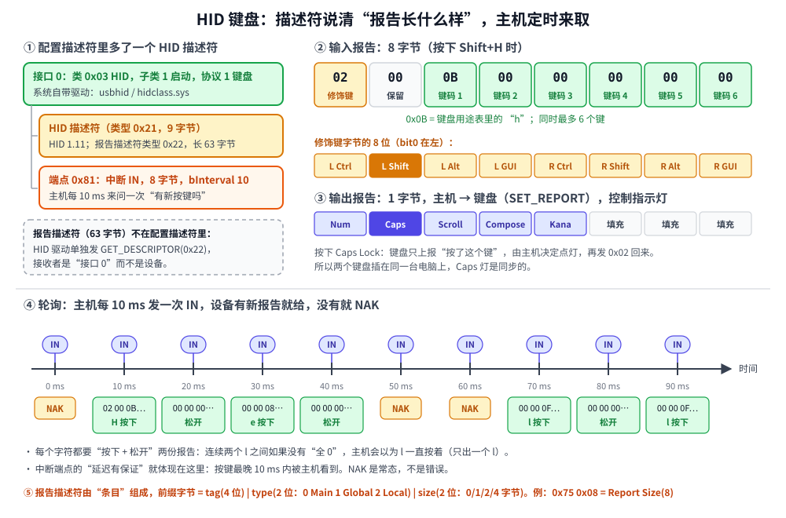

# 第 8 章　HID：做一个 USB 键盘

## 本章目标

- 理解什么是**设备类**，以及为什么 HID 设备“插上就能用”
- 认识 HID 描述符和**报告描述符**，能读懂一份键盘报告描述符
- 掌握 8 字节的启动键盘报告格式：修饰键、键码、为什么要“松开”
- 用中断端点实现“主机定时轮询”；用类请求 `SET_IDLE`、`SET_REPORT` 和键盘对话
- 在模拟器里让键盘“敲”出一句话

## 8.1 类：不用装驱动的秘密

前几章的温湿度计接口类是 `0xFF`（厂商自定义），操作系统不认识它，只能靠应用程序用 libusb 去驱动。

如果接口类填 `0x03`，操作系统就知道“这是一个 **HID**（Human Interface Device，人机接口设备）”，自动加载自带的 HID 驱动（Linux 的 `usbhid`、Windows 的 `hidclass.sys`）。键盘、鼠标、游戏手柄、条码枪、很多 U 盾和单片机调试器都是 HID。

HID 的巧妙之处在于：驱动事先**不知道**你的设备会发什么数据，而是先读一份**报告描述符**，从中知道“每份报告有几个字节、每一位代表什么”，然后按描述去解析。所以同一个驱动能支持千奇百怪的设备。

## 8.2 HID 设备的描述符



和第 6 章的设备相比，HID 设备的配置描述符里多了一个 **HID 描述符**（类型 `0x21`），夹在接口描述符和端点描述符之间（图左上）：

```cpp
// HID 描述符：夹在接口描述符和端点描述符之间，告诉主机报告描述符有多长。
static Bytes hid_descriptor(const Bytes& report)
{
    Bytes d{9, desc::HID, 0x11, 0x01 /* HID 1.11 */, 0 /* 国家码 */, 1, desc::HID_REPORT};
    put_u16(d, static_cast<uint16_t>(report.size()));
    return d;
}
```

整个配置用 `ConfigBuilder` 拼出来，[`examples/08-hid-keyboard/main.cpp`](../examples/08-hid-keyboard/main.cpp)：

```cpp
ConfigBuilder(1, 100, 0xA0 /* 支持远程唤醒 */)
    .interface(0, 0, 0x03 /* HID */, 0x01 /* 启动设备 */, 0x01 /* 键盘 */)
    .raw(hid_descriptor(kKeyboardReport))
    .endpoint(0x81, TransferType::Interrupt, 8, 10)
    .build()
```

- **子类 1 = 启动设备**（boot device）：表示这个键盘支持一种固定的简化格式，电脑 BIOS 不用解析报告描述符也能用它。协议 1 = 键盘，2 = 鼠标。
- **一个中断 IN 端点**，包长 8，`bInterval = 10`：主机每 10 ms 来问一次。
- **`0xA0`**：bit5 表示支持**远程唤醒**，电脑睡眠时按键盘可以把它叫醒。

报告描述符本身**不在配置描述符里**。HID 驱动接手后，会单独发 `GET_DESCRIPTOR(类型 0x22)` 来读它，而且接收者是**接口**，不是设备。模拟器的设备通过 `get_other_descriptor` 钩子提供它：

```cpp
bool get_other_descriptor(const SetupPacket& s, Bytes& out) override
{
    uint8_t type = static_cast<uint8_t>(s.wValue >> 8);
    if (type == desc::HID_REPORT) {
        out = kKeyboardReport;
        return true;
    }
    // ……
}
```

## 8.3 读懂报告描述符

报告描述符是一串**条目**（item），每个条目的第一个字节是前缀：

```
   bit 7..4   bit 3..2   bit 1..0
  ┌────────┬──────────┬──────────┐
  │  tag   │   type   │   size   │   size: 0/1/2/3 -> 后面跟 0/1/2/4 字节数据
  └────────┴──────────┴──────────┘   type: 0 = Main 1 = Global 2 = Local
```

比如 `75 08`：`0x75 = 0111 01 01`，tag 7、type 1（Global）、size 1，是 **Report Size = 8**。

三种条目的作用：

- **Global**（Usage Page、Report Size、Report Count、Logical Min/Max……）：像“全局变量”，设了之后一直有效，直到被改掉。
- **Local**（Usage、Usage Min/Max）：只对紧跟着的下一个 Main 条目有效。
- **Main**（Input、Output、Feature、Collection）：真正“生成”报告里的字段。每遇到一个 Input，就在输入报告里加上 `Report Count × Report Size` 位。

用这个规则读键盘描述符的前半段：

```
05 01  Usage Page (Generic Desktop)
09 06  Usage (Keyboard)
A1 01  Collection (Application)          ← 开始一个“应用集合”：这是一个键盘
05 07    Usage Page (Keyboard/Keypad)
19 E0    Usage Minimum (224)             ← 用途 224..231 = 左Ctrl..右GUI 这 8 个修饰键
29 E7    Usage Maximum (231)
15 00    Logical Minimum (0)
25 01    Logical Maximum (1)             ← 每个值是 0 或 1
75 01    Report Size (1)
95 08    Report Count (8)
81 02    Input (Data,Var,Abs)            ← 输入报告第 0 字节：8 个 1 位的开关
95 01    Report Count (1)
75 08    Report Size (8)
81 01    Input (Const)                   ← 第 1 字节：常量，保留不用
……
```

模拟器里的解析器 [`examples/08-hid-keyboard/hid_report.hpp`](../examples/08-hid-keyboard/hid_report.hpp) 就是按这个规则一个条目一个条目往下读，统计输入、输出报告各有多少位。它只有 200 行左右，建议对照着读一遍。

## 8.4 键盘报告

图右上是解析出来的报告格式：

**输入报告（8 字节，键盘 → 主机）**

| 字节 | 内容 |
|------|------|
| 0 | 修饰键位图：bit0 左 Ctrl、bit1 左 Shift、bit2 左 Alt、bit3 左 GUI（Win 键），bit4..7 是右边的 |
| 1 | 保留，填 0 |
| 2–7 | 当前按下的普通键的**键码**（usage ID），最多同时 6 个 |

键码不是 ASCII，而是 HID 用途表（HID Usage Tables 第 10 章）里的编号：`a` 是 `0x04`，`b` 是 `0x05`……`z` 是 `0x1D`，`1` 是 `0x1E`，回车是 `0x28`，空格是 `0x2C`。大写字母 = Shift + 小写字母的键码。

**最关键的一点：报告描述的是“现在哪些键是按着的”**，而不是“按了一下某个键”。所以：

- 打一个字符要发**两份**报告：按下（键码 = 0x0B），松开（全 0）。
- 连打两个 `l`，中间**必须**有一份“全部松开”。否则主机看到的是“`l` 一直按着”，只会出一个 `l`（然后过半秒开始自动重复）。

**输出报告（1 字节，主机 → 键盘）**：bit0 NumLock、bit1 CapsLock、bit2 ScrollLock……用来点亮键盘上的指示灯。注意：按 Caps Lock 时，键盘只上报“按了 Caps Lock 这个键”，**由主机决定**是否切换大写，再用 `SET_REPORT` 把新的灯状态发回来。

## 8.5 HID 类请求

HID 规范定义了几个类请求（`bmRequestType = 0x21` 或 `0xA1`，接收者是接口）：

| 请求 | 编号 | 作用 |
|------|------|------|
| `GET_REPORT` | `0x01` | 通过控制传输主动读一份报告 |
| `SET_REPORT` | `0x09` | 通过控制传输写一份报告（键盘的 LED 就是这么写的） |
| `SET_IDLE` | `0x0A` | 设置“空闲时多久重发一次报告”，0 = 没变化就不发 |
| `SET_PROTOCOL` | `0x0B` | 切换启动协议 / 报告协议 |

设备端只需重写 `on_class_request`：

```cpp
bool on_class_request(const SetupPacket& s, Bytes& data) override
{
    switch (s.bRequest) {
    case hidreq::SET_IDLE:
        // 高字节 = 间隔（单位 4 ms），0 = 只在按键变化时才发报告
        // ……
        return true;
    case hidreq::SET_REPORT:
        if (!data.empty()) {
            std::printf("    [固件] 主机设置 LED：NumLock=%d CapsLock=%d ScrollLock=%d\n",
                        data[0] & 1, (data[0] >> 1) & 1, (data[0] >> 2) & 1);
        }
        return true;
    // ……
    }
}
```

## 8.6 中断端点：固件怎么“发”按键

图下半部分是中断传输的实际样子：主机每 10 ms 发一次 IN，键盘有新报告就交出去，没有就回 NAK。

固件的写法是：**有一份报告在端点里等着时，就不再放新的**。

```cpp
// 固件主循环：上一份报告被主机取走了，就放下一份进端点。
void task() override
{
    if (state() == State::Configured && !reports_.empty() && !tx_busy(0x81)) {
        write(0x81, reports_.front(), false);   // 正好 8 字节 = 包长，不需要 ZLP
        reports_.pop_front();
    }
}
```

这和 TinyUSB 的 `tud_hid_ready()` / `tud_hid_keyboard_report()` 是同一个模式。注意 `write` 的第三个参数 `false`（不补 ZLP）：HID 驱动每次正好请求一份报告的长度（8 字节），读满就算这次传输结束，不需要再用短包或 ZLP 来表示“没有了”。

## 8.7 动手：运行第 8 章的例子

```bash
./build/examples/08-hid-keyboard
```

例子里主机端扮演一个“迷你 HID 驱动”：枚举、读报告描述符并解析、`SET_IDLE`、按 `bInterval` 轮询、把报告翻译回字符、最后用 `SET_REPORT` 点亮 Caps Lock。本机实际输出（枚举部分和第 7 章一样，省略）：

```
接口类 0x03 子类 1 协议 1 -> 系统的 HID 驱动接手（usbhid / hidclass.sys）
中断端点 0x81，包长 8，每 10 ms 轮询一次

========== 第 2 步：HID 驱动读取报告描述符（发给接口，而不是设备） ==========
控制读  addr=3 GET_DESCRIPTOR(HID_REPORT #0) wLength=63 → 63 字节
  05 01     Usage Page (Generic Desktop)             
  09 06     Usage (Keyboard)                         
  A1 01     Collection (Application)                 
  05 07       Usage Page (Keyboard/Keypad)           
  19 E0       Usage Minimum (224)                    
  29 E7       Usage Maximum (231)                    
  15 00       Logical Minimum (0)                    
  25 01       Logical Maximum (1)                    
  75 01       Report Size (1)                        
  95 08       Report Count (8)                       
  81 02       Input (Data,Var,Abs)                   <- 8 个 × 1 位 = 8 位
  95 01       Report Count (1)                       
  75 08       Report Size (8)                        
  81 01       Input (Const,Array,Abs)                <- 1 个 × 8 位 = 8 位
  95 05       Report Count (5)                       
  75 01       Report Size (1)                        
  05 08       Usage Page (LEDs)                      
  19 01       Usage Minimum (1)                      
  29 05       Usage Maximum (5)                      
  91 02       Output (Data,Var,Abs)                  <- 5 个 × 1 位 = 5 位
  95 01       Report Count (1)                       
  75 03       Report Size (3)                        
  91 01       Output (Const,Array,Abs)               <- 1 个 × 3 位 = 3 位
  95 06       Report Count (6)                       
  75 08       Report Size (8)                        
  15 00       Logical Minimum (0)                    
  25 65       Logical Maximum (101)                  
  05 07       Usage Page (Keyboard/Keypad)           
  19 00       Usage Minimum (0)                      
  29 65       Usage Maximum (101)                    
  81 00       Input (Data,Array,Abs)                 <- 6 个 × 8 位 = 48 位
  C0        End Collection                           
  => 输入报告 64 位 = 8 字节，输出报告 8 位 = 1 字节

========== 第 3 步：SET_IDLE(0) —— 没有变化就别发 ==========
    [固件] SET_IDLE(0)：只有按键变化时才发报告
控制写  addr=3 类请求 0x0A wValue=0x0000 wIndex=0 wLength=0 → 完成
```

解析器的结论“输入 8 字节、输出 1 字节”，就是 8.4 节的两张表。最后一个 Input 是 `Array`（数组）而不是 `Var`（变量）：6 个字节里放的是“哪些键按着”的编号，而不是 101 个键各占一位。

```
========== 第 4 步：固件敲出 "Hello, USB!"，主机每 10 ms 轮询一次 ==========
  帧  10  02 00 0B 00 00 00 00 00  [Shift] 键码 0x0B 'H' 按下
  帧  20  00 00 00 00 00 00 00 00  全部松开
  帧  30  00 00 08 00 00 00 00 00  键码 0x08 'e' 按下
  帧  40  00 00 00 00 00 00 00 00  全部松开
  帧  50  00 00 0F 00 00 00 00 00  键码 0x0F 'l' 按下
  帧  60  00 00 00 00 00 00 00 00  全部松开
  帧  70  00 00 0F 00 00 00 00 00  键码 0x0F 'l' 按下
  帧  80  00 00 00 00 00 00 00 00  全部松开
  帧  90  00 00 12 00 00 00 00 00  键码 0x12 'o' 按下
  帧 100  00 00 00 00 00 00 00 00  全部松开
  帧 110  00 00 36 00 00 00 00 00  键码 0x36 ',' 按下
  帧 120  00 00 00 00 00 00 00 00  全部松开
  帧 130  00 00 2C 00 00 00 00 00  键码 0x2C ' ' 按下
  帧 140  00 00 00 00 00 00 00 00  全部松开
  帧 150  02 00 18 00 00 00 00 00  [Shift] 键码 0x18 'U' 按下
  帧 160  00 00 00 00 00 00 00 00  全部松开
  帧 170  02 00 16 00 00 00 00 00  [Shift] 键码 0x16 'S' 按下
  帧 180  00 00 00 00 00 00 00 00  全部松开
  帧 190  02 00 05 00 00 00 00 00  [Shift] 键码 0x05 'B' 按下
  帧 200  00 00 00 00 00 00 00 00  全部松开
  帧 210  02 00 1E 00 00 00 00 00  [Shift] 键码 0x1E '!' 按下
  帧 220  00 00 00 00 00 00 00 00  全部松开
  帧 230  00 00 28 00 00 00 00 00  键码 0x28 '回车' 按下
  帧 240  00 00 00 00 00 00 00 00  全部松开
主机轮询了 30 次，其中 6 次设备回 NAK（没有新按键，这很正常）
屏幕上出现：Hello, USB!

========== 第 5 步：用户按了 Caps Lock，主机通过 SET_REPORT 让键盘点灯 ==========
    [固件] 主机设置 LED：NumLock=0 CapsLock=1 ScrollLock=0
控制写  addr=3 类请求 0x09 wValue=0x0200 wIndex=0 wLength=1 → 完成
```

注意：

- 每 10 帧（10 ms）才有一行，这就是 `bInterval = 10`。打 12 个字符用了 240 ms，键盘的最高“打字速度”就是这么来的。
- `!` 是 Shift + `1`（键码 `0x1E`），`,` 不需要 Shift。键码对应的是**键盘上的位置**，不是字符：同一个键码在法语键盘布局下会变成另一个字符，翻译工作由操作系统按布局完成。
- 最后 6 次 NAK 是字符打完以后，主机还在照常轮询。
- `SET_REPORT` 的 `wValue = 0x0200`：高字节 2 = 输出报告，低字节 0 = 报告 ID 0。

例子最后用同一个解析器读了一份鼠标的报告描述符：3 字节报告，`[按键位图][X 位移][Y 位移]`，X/Y 是 `Rel`（相对量）。这就是 HID 的通用性：换一份描述符，驱动就知道怎么解析。

## 8.8 在真实电脑上看 HID

- **Linux**（原生，不是 WSL）：`sudo usbhid-dump -m VID:PID -e descriptor` 可以导出任何 HID 设备的报告描述符；也可以读 `/sys/kernel/debug/hid/*/rdesc`。
- **Windows**：用 USBTreeView 或 Wireshark + USBPcap（第 12 章）。
- 在线解析器：把报告描述符的十六进制粘贴到 [USB Descriptor and Request Parser](https://eleccelerator.com/usbdescreqparser/) 里，能看到和本章一样的逐条解释。

## 练习

1. `hid_report.hpp` 里的 `find_key` 只认识字母、数字和十几个符号。给它加上 `#`（Shift + `3`）、`(`、`)`、`'`、Tab（键码 `0x2B`），然后让键盘敲一句 `printf("Hi #1")`。
2. 去掉 `type()` 里“松开”那份报告（只推 `press`），运行，`Hello` 变成了什么？为什么？
3. 把 `bInterval` 改成 1，敲同样的句子用了几帧？再改成 100 呢？
4. 写一个“鼠标”设备：接口子类 1、协议 2，用附录里那份鼠标报告描述符，每 10 ms 报告一次 `[0, 5, 0]`（向右移 5 个单位）。主机端读 10 次，累加 X 位移。
5. 给键盘的报告描述符加一个**媒体键**集合（Usage Page 0x0C Consumer，Usage 0xE9 音量加），并使用**报告 ID**区分两种报告。提示：加了报告 ID 后，每份输入报告的第一个字节就是 ID，设备就不再是“启动键盘”格式了。

## 常见坑

- **报告描述符和实际发的报告长度不一致。** 描述符说 8 字节，固件发了 9 字节，主机会丢弃或者解析错位。改描述符时一定要同时检查端点包长和固件里的报告结构。
- **忘了发“松开”。** 键会一直按着，触发自动重复。
- **报告描述符长度没更新到 HID 描述符里。** HID 描述符最后两个字节是报告描述符长度，主机按它去读。
- **Windows 下 HID 设备“已连接”但没反应。** 很可能报告描述符有语法错误（比如 Collection 没有配对的 End Collection），Windows 的 HID 解析器比 Linux 严格。

---

上一章：[第 7 章　控制传输与枚举](07-enumeration.md)　|　下一章：[第 9 章　CDC：做一个虚拟串口](09-cdc.md)
