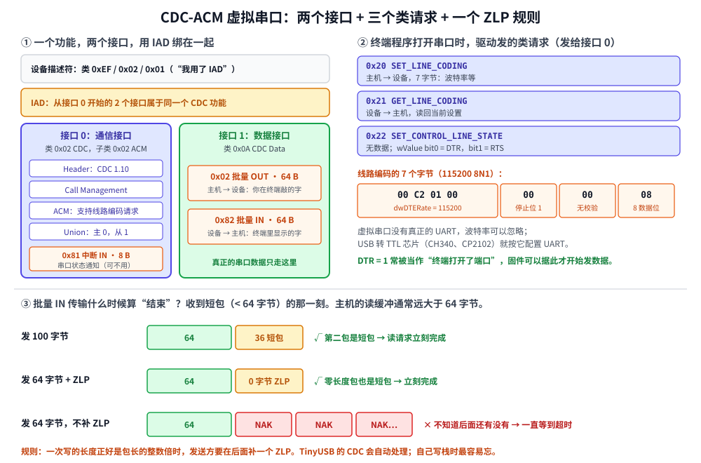

# 第 9 章　CDC：做一个虚拟串口

## 本章目标

- 认识 **CDC-ACM** 类：为什么一个 USB 设备能在电脑上变成 `COM3` 或 `/dev/ttyACM0`
- 理解**复合功能**：一个功能占两个接口，用 **IAD** 绑在一起
- 读懂 CDC 的**功能描述符**和三个类请求：`SET_LINE_CODING`、`GET_LINE_CODING`、`SET_CONTROL_LINE_STATE`
- 用批量端点收发数据，彻底弄明白**零长度包（ZLP）**这个坑

## 9.1 为什么是“虚拟”串口

单片机开发最常用的调试手段是串口。以前要一根 USB 转 TTL 线（CH340、CP2102），现在 STM32 自己就有 USB，能不能让它直接在电脑上变成一个串口？

能。USB 规范里有一个 **CDC**（Communications Device Class，通信设备类），其中的 **ACM**（Abstract Control Model）子类就是“像调制解调器一样的串口”。只要描述符说“我是 CDC-ACM”，Linux 加载 `cdc_acm` 驱动出现 `/dev/ttyACM0`，Windows 10 以后加载自带的 `usbser.sys` 出现 `COMx`，macOS 出现 `/dev/cu.usbmodem*`，**都不用装驱动**。

叫“虚拟”是因为：数据其实是通过 USB 批量端点传的，没有真正的 UART，**波特率设多少都一样快**（全速下约 1 MB/s，第 5 章算过）。

## 9.2 一个功能，两个接口



CDC-ACM 用两个接口（图左）：

- **接口 0：通信接口**（类 `0x02`，子类 `0x02` ACM）。负责“控制”：接收类请求（设置波特率、DTR），还有一个中断端点用来通知主机串口状态（比如 DCD、RI 信号），很多实现根本不用它。
- **接口 1：数据接口**（类 `0x0A` CDC Data）。一对批量端点，真正的串口数据只走这里。

两个接口属于同一个功能，但主机怎么知道？靠两样东西：

1. **Union 功能描述符**：在通信接口里写明“主接口 0，从接口 1”。这是 CDC 规范自己的办法。
2. **IAD**（Interface Association Descriptor，接口关联描述符）：放在两个接口前面，告诉主机“从接口 0 开始的 2 个接口是一个功能”。这是 USB 2.0 后来加的通用办法。用了 IAD 的设备，设备描述符的类/子类/协议要写成 `0xEF / 0x02 / 0x01`。

IAD 的意义在于**复合设备**：一个设备既是串口又是 U 盘又是键盘时，Windows 要靠 IAD 才能正确地把两个 CDC 接口交给同一个驱动。只有一个 CDC 功能时，Linux 不要 IAD 也能用，但 Windows 上最好带着。

配置描述符，[`examples/09-cdc-serial/main.cpp`](../examples/09-cdc-serial/main.cpp)：

```cpp
static Bytes serial_config()
{
    return ConfigBuilder(1, 100)
        .iad(0, 2, 0x02, 0x02, 0x00)
        // 接口 0：通信接口。类 0x02 CDC，子类 0x02 ACM（抽象控制模型）
        .interface(0, 0, 0x02, 0x02, 0x00, 4)
        .raw({5, desc::CS_INTERFACE, cdc::HEADER, 0x10, 0x01})          // CDC 1.10
        .raw({5, desc::CS_INTERFACE, cdc::CALL_MANAGEMENT, 0x00, 0x01}) // 数据接口是 1
        .raw({4, desc::CS_INTERFACE, cdc::ACM, 0x02})                   // 支持 LINE_CODING 等请求
        .raw({5, desc::CS_INTERFACE, cdc::UNION, 0x00, 0x01})           // 主接口 0，从接口 1
        .endpoint(0x81, TransferType::Interrupt, 8, 16)                 // 串口状态通知
        // 接口 1：数据接口。类 0x0A CDC Data，一对批量端点传真正的数据
        .interface(1, 0, 0x0A, 0x00, 0x00)
        .endpoint(0x02, TransferType::Bulk, 64)
        .endpoint(0x82, TransferType::Bulk, 64)
        .build();
}
```

`CS_INTERFACE`（`0x24`）是“类专用的接口描述符”。四个功能描述符的第 3 个字节是子类型：Header、Call Management、ACM、Union。它们的具体字段不用死记，抄 TinyUSB 的 `TUD_CDC_DESCRIPTOR` 宏就行，但要知道它们存在、以及 Union 的作用。

## 9.3 三个类请求

终端程序（PuTTY、minicom、Python 的 pyserial）打开串口时，驱动会给**通信接口**发这几个类请求（图右上）：

| 请求 | `bmRequestType` | 数据 | 作用 |
|------|----------------|------|------|
| `SET_LINE_CODING` `0x20` | `0x21` | 7 字节 | 设置波特率、停止位、校验、数据位 |
| `GET_LINE_CODING` `0x21` | `0xA1` | 7 字节 | 读回当前设置 |
| `SET_CONTROL_LINE_STATE` `0x22` | `0x21` | 无 | `wValue` bit0 = DTR，bit1 = RTS |

线路编码的 7 个字节：

```cpp
struct LineCoding {
    uint32_t baud = 9600;
    uint8_t stop_bits = 0;   // 0 = 1 位，1 = 1.5 位，2 = 2 位
    uint8_t parity = 0;      // 0 = 无，1 = 奇，2 = 偶
    uint8_t data_bits = 8;
    // ……
};
```

**DTR** 很有用：大多数终端程序打开端口时把它拉高，关闭时拉低。固件可以据此判断“现在有没有人在听”，比如等 DTR 拉高了再打印欢迎语，否则开机信息在没人打开端口时就发出去，丢了。Arduino 的 Leonardo 还用“以 1200 波特率打开再关闭”作为“进入 bootloader”的信号，这就是在利用 `SET_LINE_CODING`。

设备端处理这三个请求：

```cpp
bool on_class_request(const SetupPacket& s, Bytes& data) override
{
    switch (s.bRequest) {
    case cdc::SET_LINE_CODING:
        coding_ = cdc::LineCoding::from_bytes(data);
        // ……
        return true;
    case cdc::GET_LINE_CODING:
        data = coding_.to_bytes();
        return true;
    case cdc::SET_CONTROL_LINE_STATE:
        dtr_ = s.wValue & 1;
        // ……
        return true;
    default:
        return false;
    }
}
```

## 9.4 零长度包

第 5 章说过：批量传输**以短包结束**。主机的读请求缓冲通常很大（Linux `cdc_acm` 用的是几 KB），它会一直发 IN，直到收到一个比包长短的包。

图下半部分是三种情况：

1. 发 100 字节：拆成 64 + 36，36 是短包，主机马上知道“完了”。
2. 发 64 字节：只有一个满包。发送方**必须再补一个 0 字节的包**（ZLP），主机看到这个短包才知道完了。
3. 发 64 字节但**没补 ZLP**：主机以为后面还有，继续 IN，设备没数据只能 NAK……这次读请求一直挂着，直到下次有数据或超时。

第 3 种情况在实际中表现为**“数据卡住了，再发一点东西才一起吐出来”**，而且只在长度正好是 64 的倍数时出现，非常难查。

设备端的 `write` 默认就会补 ZLP：

```cpp
static void queue_packets(Endpoint& e, const Bytes& data, bool zlp)
{
    for (size_t i = 0; i < data.size(); i += e.max_packet) {
        size_t n = std::min<size_t>(e.max_packet, data.size() - i);
        e.tx.emplace_back(data.begin() + static_cast<long>(i),
                          data.begin() + static_cast<long>(i + n));
    }
    if (zlp && data.size() % e.max_packet == 0) {
        e.tx.emplace_back();   // 零长度包（ZLP）
    }
}
```

> ZLP 规则对两个方向都适用。主机发 64 字节时也会补 ZLP（第 5 步的输出里能看到 `DATA0 [0]`），设备端的协议栈也要能正确处理“收到 0 字节的包”。

## 9.5 动手：运行第 9 章的例子

```bash
./build/examples/09-cdc-serial
```

例子里的设备是一个“大写回显串口”：收到什么就转成大写发回去。主机端相当于 `cdc_acm` 驱动加一个终端程序。本机实际输出：

```
========== 第 1 步：枚举，看看 CDC 设备的配置描述符 ==========
Configuration Descriptor:
  bLength                   9  
  bDescriptorType           2  CONFIGURATION
  wTotalLength             75  配置描述符 + 后面所有描述符的总长
  bNumInterfaces            2  
  bConfigurationValue       1  SET_CONFIGURATION 用这个值
  iConfiguration            0  
  bmAttributes           0x80  总线供电
  bMaxPower                50  100 mA
  Interface Association:
    bFirstInterface           0  
    bInterfaceCount           2  
    bFunctionClass            2  CDC 通信
    bFunctionSubClass         2  
    bFunctionProtocol         0  
  Interface Descriptor:
    bInterfaceNumber          0  
    bAlternateSetting         0  
    bNumEndpoints             1  不含端点 0
    bInterfaceClass           2  CDC 通信
    bInterfaceSubClass        2  
    bInterfaceProtocol        0  
    iInterface                4  
      CDC Header 功能描述符: 05 24 00 10 01
      CDC Call Management 功能描述符: 05 24 01 00 01
      CDC ACM 功能描述符: 04 24 02 02
      CDC Union 功能描述符: 05 24 06 00 01
    Endpoint Descriptor:
      bEndpointAddress       0x81  IN（设备→主机），端点 1
      bmAttributes              3  中断 Interrupt
      wMaxPacketSize            8  字节/包
      bInterval                16  每 16 ms 轮询一次
  Interface Descriptor:
    bInterfaceNumber          1  
    bAlternateSetting         0  
    bNumEndpoints             2  不含端点 0
    bInterfaceClass          10  CDC Data 数据
    bInterfaceSubClass        0  
    bInterfaceProtocol        0  
    iInterface                0  
    Endpoint Descriptor:
      bEndpointAddress       0x02  OUT（主机→设备），端点 2
      bmAttributes              2  批量 Bulk
      wMaxPacketSize           64  字节/包
      bInterval                 0  
    Endpoint Descriptor:
      bEndpointAddress       0x82  IN（设备→主机），端点 2
      bmAttributes              2  批量 Bulk
      wMaxPacketSize           64  字节/包
      bInterval                 0  
-> Linux 加载 cdc_acm，出现 /dev/ttyACM0；Windows 加载 usbser.sys，出现 COMx
```

75 字节 = 配置 9 + IAD 8 + 接口 9 + 功能描述符 5+5+4+5 + 端点 7 + 接口 9 + 端点 7+7。第 11 章的 STM32 固件用 TinyUSB 时，你会看到 `TUD_CDC_DESC_LEN` 正好是 66 = 75 − 9。

```
========== 第 2 步：终端程序打开端口：设置 115200 8N1，拉高 DTR ==========
    [固件] SET_LINE_CODING：115200 8N1（虚拟串口不在乎；USB 转 TTL 芯片要据此设置 UART）
控制写  addr=4 类请求 0x20 wValue=0x0000 wIndex=0 wLength=7 → 完成
控制读  addr=4 类请求 0x21 wValue=0x0000 wIndex=0 wLength=7 → 7 字节
读回来：115200 8N1
    [固件] SET_CONTROL_LINE_STATE：DTR=1 RTS=1 -> 终端打开了端口
控制写  addr=4 类请求 0x22 wValue=0x0003 wIndex=0 wLength=0 → 完成
批量读  addr=4 ep=2 → 25 字节
终端显示：welcome! type something\r\n

========== 第 3 步：敲一行字 ==========
批量写  addr=4 ep=2 ← 10 字节（1 个包）
批量读  addr=4 ep=2 → 10 字节
终端显示：HELLO USB\r

========== 第 4 步：一次发 100 字节 —— 自动拆成 64 + 36 两个包 ==========
  OUT   addr=4 ep=2  DATA1 [64] → ACK
  OUT   addr=4 ep=2  DATA0 [36] → ACK
批量写  addr=4 ep=2 ← 100 字节（2 个包）
  IN    addr=4 ep=2  DATA0 [64] 58 58 58 58 58 58 58 58 58 58 58 58 58 58 58 58 ... ← ACK
  IN    addr=4 ep=2  DATA1 [36] 58 58 58 58 58 58 58 58 58 58 58 58 58 58 58 58 ... ← ACK
批量读  addr=4 ep=2 → 100 字节
```

欢迎语是在 DTR 拉高之后才发的。第 4 步的 OUT 从 DATA1 开始，是因为第 3 步已经用掉了一个 DATA0，翻转位一直在延续。

```
========== 第 5 步：正好 64 字节 —— 设备补了零长度包（ZLP） ==========
  OUT   addr=4 ep=2  DATA1 [64] → ACK
  OUT   addr=4 ep=2  DATA0 [0] → ACK
批量写  addr=4 ep=2 ← 64 字节（2 个包）
  IN    addr=4 ep=2  DATA0 [64] 41 41 41 41 41 41 41 41 41 41 41 41 41 41 41 41 ... ← ACK
  IN    addr=4 ep=2  DATA1 [0] ← ACK
批量读  addr=4 ep=2 → 64 字节
读请求正常结束，收到 64 字节

========== 第 6 步：正好 64 字节，但设备忘了补 ZLP ==========
主机的读请求缓冲是 4096 字节。收到一个满 64 字节的包后，主机无法知道
“后面还有没有”，只能继续 IN，而设备已经没数据了，只会回 NAK……
  OUT   addr=4 ep=2  DATA1 [64] → ACK
  OUT   addr=4 ep=2  DATA0 [0] → ACK
批量写  addr=4 ep=2 ← 64 字节（2 个包）
  IN    addr=4 ep=2  DATA0 [64] 42 42 42 42 42 42 42 42 42 42 42 42 42 42 42 42 ... ← ACK
  IN    addr=4 ep=2  → NAK
    （省略了后面连续的 5 个 NAK）
批量读  addr=4 ep=2 超时：已收到 64 字节，但一直等不到短包
读请求超时，收到 64 字节。应用程序看起来就是“数据卡住了，再发点东西才吐出来”。

========== 第 7 步：终端关闭端口 ==========
    [固件] SET_CONTROL_LINE_STATE：DTR=0 RTS=0 -> 终端关闭了端口
控制写  addr=4 类请求 0x22 wValue=0x0000 wIndex=0 wLength=0 → 完成
```

第 5、6 步唯一的区别是设备的 `send_zlp`。在模拟器里，主机最后拿到了 64 字节（因为 `bulk_in` 超时时会把已收到的数据一起返回）；真实系统里，取决于驱动的实现，数据可能一直卡在内核缓冲区里，直到下一个短包到来。

## 9.6 在真实电脑上用

第 11 章的 STM32 固件做的是厂商自定义设备，不是 CDC。如果你想在真板上体验本章的内容，隔壁 STM32 教程的[第 24 章](../../stm32/docs/24-usb.md)就是用 TinyUSB 实现的 CDC 串口，现在你可以对照本章，看懂它的描述符和回调里的每一行了。

在电脑上测试：

```bash
# Linux（原生）：插上后
dmesg | tail          # 看到 cdc_acm 1-1:1.0: ttyACM0: USB ACM device
picocom /dev/ttyACM0  # 波特率随便填
```

Windows 上用 PuTTY 或者 VS Code 的 Serial Monitor 打开对应的 COM 口。

## 练习

1. 把回显改成“收到一行（以 `\r` 结尾）才回复”，并在行首加上 `> `。
2. 把第 4 步的 100 字节改成 128 字节，预测 OUT 方向有几个包；设备回显时又有几个包？
3. 在第 2 步之前，固件就往 `0x82` 写一句开机日志（不等 DTR）。主机一直没来读，第 2 步打开端口后读到了什么？真实系统里这样做会怎样？
4. 在 `SET_LINE_CODING` 里加一个“魔法波特率”：主机设置 1200 波特时，固件打印“准备进入 bootloader”。这就是 Arduino 的做法。
5. 通信接口的中断端点 `0x81` 可以发 `SERIAL_STATE` 通知（CDC PSTN 规范 6.5.4 节），告诉主机 DCD/DSR 等信号的变化。查资料，写出这个 10 字节通知的格式。

## 常见坑

- **ZLP。** 本章的主角。用 TinyUSB 的 `tud_cdc_write` 时它会自动处理；自己操作端点时要记得。
- **数据接口的端点地址和 Union 描述符对不上。** 主机会认为功能不完整，不加载驱动。
- **Windows 7 及更早要装 `.inf`。** Windows 10 以后自带 `usbser.sys`，不用装。
- **以为设置波特率能让 USB 更快。** 虚拟串口的速度只由 USB 决定，波特率只是一个数字。但如果你的固件把收到的数据再转发到一个真正的 UART，那就要按 `SET_LINE_CODING` 配置那个 UART。
- **在 DTR 拉低时疯狂写数据。** 没人读，端点缓冲满了，`write` 会阻塞或丢数据，固件主循环可能卡住。写之前检查 `tud_cdc_connected()`（TinyUSB 里它就是看 DTR）。

---

上一章：[第 8 章　HID](08-hid.md)　|　下一章：[第 10 章　libusb：在 PC 上写主机程序](10-libusb.md)
