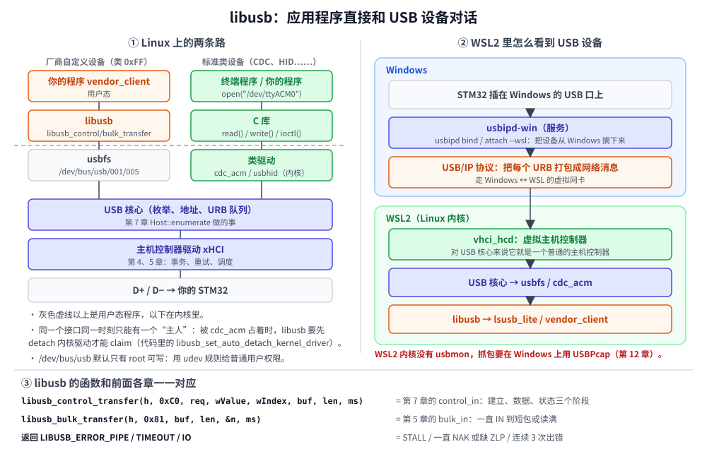

# 第 10 章　libusb：在 PC 上写主机程序

## 本章目标

- 知道 libusb 在操作系统 USB 软件栈里的位置，以及什么时候该用它
- 安装 libusb，编译本章的两个程序：`lsusb_lite` 和 `vendor_client`
- 学会在 **WSL2** 里使用 USB 设备（usbipd），以及在 Linux 上配置**设备权限**（udev）
- 把 libusb 的每个 API、每个错误码，和前面几章在模拟器里看到的现象对应起来

从这一章开始离开模拟器，进入真实世界。主机这一边换成了真正的操作系统和主机控制器，第 11 章再把设备这一边换成真正的 STM32。

## 10.1 libusb 是什么



看图左边。标准类设备（CDC 串口、HID 键盘、U 盘）有内核里的**类驱动**，应用程序通过 `/dev/ttyACM0` 这样的设备文件间接使用它们，完全不用知道 USB 的存在。

厂商自定义设备（接口类 `0xFF`）没有现成的驱动。传统做法是写一个内核驱动，门槛很高。**libusb** 提供了另一条路：Linux 内核有一个通用的 **usbfs** 接口（`/dev/bus/usb/总线号/设备号`），允许用户态程序直接提交控制、批量、中断、同步传输。libusb 把它（以及 Windows、macOS 上的等价机制）包装成一套跨平台的 C API。

什么时候用 libusb：

- 设备是你自己做的厂商自定义设备（第 11 章）；
- 需要发厂商请求、读写自定义端点，类驱动不支持；
- 写设备的测试工具、固件升级工具。

它和前面各章的对应关系几乎是一对一的：

| libusb | 模拟器里的对应物 | 章节 |
|--------|----------------|------|
| `libusb_control_transfer` | `Host::control_in` / `control_out` | 第 7 章 |
| `libusb_bulk_transfer` | `Host::bulk_in` / `bulk_out` | 第 5、9 章 |
| `libusb_interrupt_transfer` | `Host::interrupt_in` | 第 8 章 |
| `libusb_get_descriptor` | `GET_DESCRIPTOR` 控制读 | 第 6、7 章 |
| `libusb_clear_halt` | `CLEAR_FEATURE(ENDPOINT_HALT)` | 第 7 章 |

不同的是：**事务、重试、数据翻转、ZLP 的拆包，全部由主机控制器和内核完成**。你只提交“传输”，看不到包。

## 10.2 安装和编译

```bash
sudo apt install libusb-1.0-0-dev
cmake -S . -B build          # 重新配置，这次会找到 libusb
cmake --build build -j
```

配置时会多出一行 `-- libusb: /usr/lib/x86_64-linux-gnu/libusb-1.0.so`，`build/examples/` 下多出 `lsusb_lite` 和 `vendor_client` 两个程序。

## 10.3 一层 C++ 外壳

libusb 是 C 接口：打开的东西要手动关，每个函数都返回错误码。[`examples/10-libusb/libusb_raii.hpp`](../examples/10-libusb/libusb_raii.hpp) 用 RAII 包了一层，析构时自动释放，错误变成异常。最有用的是错误码的解释，它把 libusb 的错误和前面学过的总线现象对应起来：

```cpp
// libusb 的错误码和第 4、7 章里学到的现象是一一对应的。
inline std::string explain(int err)
{
    switch (err) {
    case LIBUSB_ERROR_PIPE: return "LIBUSB_ERROR_PIPE：设备回了 STALL（请求不支持或端点被停用）";
    case LIBUSB_ERROR_TIMEOUT: return "LIBUSB_ERROR_TIMEOUT：超时（设备一直 NAK，或者缺了 ZLP）";
    case LIBUSB_ERROR_NO_DEVICE: return "LIBUSB_ERROR_NO_DEVICE：设备被拔掉了";
    case LIBUSB_ERROR_ACCESS: return "LIBUSB_ERROR_ACCESS：没有权限（见第 10 章 udev 规则）";
    case LIBUSB_ERROR_BUSY: return "LIBUSB_ERROR_BUSY：接口被别的驱动或程序占用了";
    case LIBUSB_ERROR_IO: return "LIBUSB_ERROR_IO：总线传输出错（连续 3 次出错）";
    case LIBUSB_ERROR_OVERFLOW: return "LIBUSB_ERROR_OVERFLOW：设备发来的数据比缓冲区大";
    default: return std::string(libusb_error_name(err)) + "：" + libusb_strerror(err);
    }
}
```

`Handle::claim` 封装了“认领接口”：用批量、中断端点之前必须先 claim，告诉内核“这个接口归我”。如果接口正被内核驱动（比如 `cdc_acm`）占着，`libusb_set_auto_detach_kernel_driver` 会先把它卸下来。

## 10.4 lsusb_lite：读真实设备的描述符

[`examples/10-libusb/lsusb_lite.cpp`](../examples/10-libusb/lsusb_lite.cpp) 做两件事：

- 不带参数：列出所有设备（不需要权限，信息来自内核缓存）。
- 带 `vid:pid`：打开这个设备，用控制传输读出**原始**描述符字节，再交给第 6 章写的 `musb::dump_device` / `dump_config` / `parse_config` 解析。

```cpp
// 配置描述符：先读 9 字节拿到 wTotalLength，再整个读出来 —— 和第 7 章枚举一样
for (uint8_t i = 0; i < dd.bNumConfigurations; i++) {
    r = libusb_get_descriptor(h.get(), LIBUSB_DT_CONFIG, i, buf, 9);
    usb::check(r, "GET_DESCRIPTOR(CONFIGURATION, 9)");
    uint16_t total = static_cast<uint16_t>(buf[2] | (buf[3] << 8));
    r = libusb_get_descriptor(h.get(), LIBUSB_DT_CONFIG, i, buf,
                              total < sizeof buf ? total : sizeof buf);
    usb::check(r, "GET_DESCRIPTOR(CONFIGURATION)");
    musb::Bytes cfg(buf, buf + r);
    std::printf("\n原始配置描述符 %u（%d 字节）：\n%s\n%s", i, r, musb::hexdump(cfg).c_str(),
                musb::dump_config(cfg).c_str());
    // ……
}
```

这就是本教程的一个“闭环”：第 6 章在模拟器里写的解析器，原封不动地用在了真实设备上。拿你手边的鼠标、U 盘、手机试一试，看看商业产品的描述符长什么样。

## 10.5 在 WSL2 里使用 USB 设备

WSL2 是一个虚拟机，默认**看不到**任何 USB 设备。本机（WSL2，没有转发任何设备）运行的实际输出：

```
$ ./build/examples/lsusb_lite
一个 USB 设备都没找到。
在 WSL2 里这是正常的：先在 Windows 上用 usbipd 把设备转进来（见第 10 章）。
```

微软官方的办法是 [usbipd-win](https://github.com/dorssel/usbipd-win)，原理见图右边：Windows 上的服务把设备从 Windows 驱动上“摘”下来，用 **USB/IP** 协议把每一个 USB 请求打包成网络消息，发给 WSL2 内核里的虚拟主机控制器 `vhci_hcd`。对 WSL2 里的 USB 核心来说，这就是一个普通的主机控制器，后面的一切（枚举、cdc_acm、libusb）都照常工作。

本机的 WSL2 内核已经带了需要的模块（`CONFIG_USBIP_VHCI_HCD=m`、`CONFIG_USB_ACM=m`），步骤如下。

**第 1 步，在 Windows 上安装 usbipd**（管理员 PowerShell）：

```powershell
winget install --interactive --exact dorssel.usbipd-win
```

**第 2 步，找到设备的 BUSID**：

```powershell
usbipd list
```

输出里每行一个设备，第一列是 `BUSID`（形如 `2-3`），后面是 `VID:PID` 和设备名。第 11 章的固件是 `cafe:4011`。

**第 3 步，共享并转发**（`bind` 只需做一次，需要管理员权限；`attach` 每次插拔后都要做）：

```powershell
usbipd bind --busid 2-3
usbipd attach --wsl --busid 2-3
```

**第 4 步，在 WSL 里确认**：

```bash
./build/examples/lsusb_lite
```

> 设备复位或重新枚举（比如 STM32 重新烧录、按了复位键）后，它会从 WSL 里消失。可以用 `usbipd attach --wsl --busid 2-3 --auto-attach` 让它自动重新转发。用完后 `usbipd detach --busid 2-3` 把设备还给 Windows。

## 10.6 权限：udev 规则

在原生 Linux 上，或者 WSL2 里转发进来后，直接运行 `vendor_client` 多半会得到 `LIBUSB_ERROR_ACCESS`：`/dev/bus/usb/*/*` 默认只有 root 可写。不要养成用 `sudo` 跑的习惯，加一条 udev 规则：

```bash
sudo tee /etc/udev/rules.d/99-miniusb.rules <<'EOF'
# miniusb 教程第 11 章的固件
SUBSYSTEM=="usb", ATTR{idVendor}=="cafe", ATTR{idProduct}=="4011", MODE="0666"
EOF
sudo udevadm control --reload-rules
sudo udevadm trigger
```

然后拔插一次设备（WSL2 里是 `usbipd detach` 再 `attach`）。WSL2 默认用 systemd 时 udev 会自动运行；如果你的 WSL 没开 systemd，先 `sudo service udev start`。

## 10.7 vendor_client：和 STM32 对话

[`examples/10-libusb/vendor_client.cpp`](../examples/10-libusb/vendor_client.cpp) 是第 11 章固件的主机端。两边共用一个头文件 [`examples/11-stm32-vendor/vendor_protocol.h`](../examples/11-stm32-vendor/vendor_protocol.h)，里面定义了 VID/PID、端点地址、请求编号和数据结构：

```c
#define VENDOR_VID 0xCAFE
#define VENDOR_PID 0x4011

#define VENDOR_EP_OUT 0x01
#define VENDOR_EP_IN  0x81

#define VENDOR_REQ_GET_INFO 0x01   /* IN，返回 struct vendor_info */
#define VENDOR_REQ_SET_LED  0x02   /* OUT，wValue = 0 灭 / 1 亮，无数据 */
```

“协议写在一个两边都 include 的头文件里”是实际项目里非常好的习惯：主机和固件永远不会对不上。

五个子命令，每个对应前面学过的一种传输：

| 命令 | 做什么 | 对应 |
|------|-------|------|
| `info` | 厂商控制读 `GET_INFO`，打印板子、运行时间、按键、LED 状态 | 第 7 章控制读 |
| `led on` / `led off` | 厂商控制写 `SET_LED`，`wValue` 带参数，无数据阶段 | 第 7 章无数据控制传输 |
| `echo 文字` | 批量 OUT 发出去，批量 IN 收回来 | 第 5 章批量传输 |
| `bench [KB]` | 回环测速，校验每个字节 | 第 5 章带宽 |
| `bad` | 发一个设备不认识的请求 `0x7F`，再发一个正常请求 | 第 7 章 STALL 与恢复 |

控制读只要一行：

```cpp
vendor_info info{};
int n = libusb_control_transfer(h.get(), kVendorIn, VENDOR_REQ_GET_INFO, 0, 0,
                                reinterpret_cast<unsigned char*>(&info), sizeof info,
                                kTimeoutMs);
usb::check(n, "GET_INFO");
```

`kVendorIn` 就是 `0xC0`：设备→主机、厂商、设备。参数顺序和 SETUP 包的字段顺序完全一样：`bmRequestType, bRequest, wValue, wIndex, 数据, wLength`。libusb 在内核里替你完成了第 7 章画的建立、数据、状态三个阶段。

批量回环里有一个值得注意的细节：

```cpp
// 发出去，再把同样多的字节收回来。收的时候按“期望长度”读，
// 所以就算设备发的正好是 64 的整数倍、没有 ZLP，也不会卡住。
static void loopback(usb::Handle& h, const unsigned char* data, int len, unsigned char* back)
{
    int sent = 0;
    usb::check(libusb_bulk_transfer(h.get(), VENDOR_EP_OUT, const_cast<unsigned char*>(data), len,
                                    &sent, kTimeoutMs),
               "批量写");
    int got = 0;
    while (got < len) {
        int n = 0;
        usb::check(libusb_bulk_transfer(h.get(), VENDOR_EP_IN, back + got, len - got, &n,
                                        kTimeoutMs),
                   "批量读");
        got += n;
    }
}
```

读的长度是“还差多少”，而不是一个很大的缓冲区。这是对付第 9 章 ZLP 问题的另一种办法：**主机知道要多少，读满就停**，不依赖短包。

本机没有接板子时的实际输出：

```
$ ./build/examples/vendor_client info
错误：找不到 cafe:4011（固件烧了吗？WSL 里 usbipd attach 了吗？有权限吗？可以先运行 lsusb_lite 看看）
```

板子接好（第 11 章）以后，按这个顺序试：

```bash
./build/examples/lsusb_lite cafe:4011    # 读描述符，和第 11 章固件里写的对照
./build/examples/vendor_client info
./build/examples/vendor_client led on    # 看板子上的 LED
./build/examples/vendor_client echo 你好
./build/examples/vendor_client bench 1024
./build/examples/vendor_client bad
```

预期会看到：

- `lsusb_lite` 打印 18 字节设备描述符和 32 字节配置描述符：一个接口类 `0xFF`、两个 64 字节的批量端点 `0x01`、`0x81`，序列号是芯片 UID 的十六进制。
- `bad` 的第一个请求得到 `LIBUSB_ERROR_PIPE`（STALL），紧接着的 `info` 照常成功，这就是第 7 章说的“端点 0 的 STALL 在下一个 SETUP 时自动解除”。
- `bench` 的速度会远低于第 5 章算出的 1216 KB/s，因为这个程序是“发 256 字节、等收回 256 字节”串行进行的，大部分时间花在等待上。练习 3 会让你改进它。

> 本教程写作时没有可用的开发板，以上是根据代码和协议推导出的预期结果，而不是实测记录。你跑出来的实际数字，欢迎补充到这里。

## 10.8 Windows 原生怎么办

如果不用 WSL，想在 Windows 上直接用 libusb：Windows 不会自动给厂商自定义设备加载任何驱动，libusb 需要设备绑定 **WinUSB** 驱动。两种办法：

1. **Zadig**（[zadig.akeo.ie](https://zadig.akeo.ie)）：选中 `cafe:4011`，驱动选 WinUSB，点安装。最简单，适合开发阶段。
2. **在固件里加 Microsoft OS 2.0 描述符**：设备主动告诉 Windows“请给我装 WinUSB”，插上就能用，不需要任何操作。这是量产设备的做法，TinyUSB 的 `examples/device/webusb_serial` 有完整示例，作为进阶练习。

编译方面，MSYS2 里 `pacman -S mingw-w64-ucrt-x86_64-libusb` 后用同样的 CMake 命令即可。

## 练习

1. 用 `lsusb_lite vid:pid` 读你的鼠标或 U 盘的描述符，回答：它的端点 0 包长是多少？有几个接口？鼠标的中断端点 `bInterval` 是多少？（WSL2 里需要先用 usbipd 转发。注意：转发鼠标后 Windows 就用不了它了。）
2. 给 `lsusb_lite` 加一个功能：读出并打印所有字符串描述符（包括 0 号语言列表），用 `libusb_get_string_descriptor` 读原始字节，用 `musb::string_from_descriptor` 解码。
3. `bench` 是串行的，改进它：用 libusb 的**异步 API**（`libusb_alloc_transfer` / `libusb_submit_transfer`），同时挂多个 IN 传输。测速能提高多少？离 1216 KB/s 还有多远？
4. 让 `vendor_client` 支持 `--watch`：每 100 ms 读一次 `GET_INFO`，按键状态变化时打印一行。

## 常见坑

- **`LIBUSB_ERROR_ACCESS`。** 权限问题，见 10.6 节。
- **`LIBUSB_ERROR_BUSY` / `NOT_FOUND`（claim 时）。** 接口被内核驱动或另一个程序占着。确认没有其他程序打开了它；本章的 `claim` 已经开了自动 detach。
- **`LIBUSB_ERROR_TIMEOUT` 读不到数据。** 先想第 4 章：设备是不是一直在 NAK？固件真的往 IN 端点写数据了吗？再想第 9 章：读缓冲是不是比实际数据大，而设备没有发 ZLP？
- **设备在 WSL2 里消失。** 设备复位后 usbipd 的转发会断开，重新 `attach` 或用 `--auto-attach`。
- **批量写成功了，以为设备已经“处理完了”。** `libusb_bulk_transfer` 返回只表示数据被设备 ACK 了（进了设备的缓冲区），固件什么时候处理是另一回事。

---

上一章：[第 9 章　CDC](09-cdc.md)　|　下一章：[第 11 章　STM32 + TinyUSB：做一个真正的设备](11-stm32-tinyusb.md)
