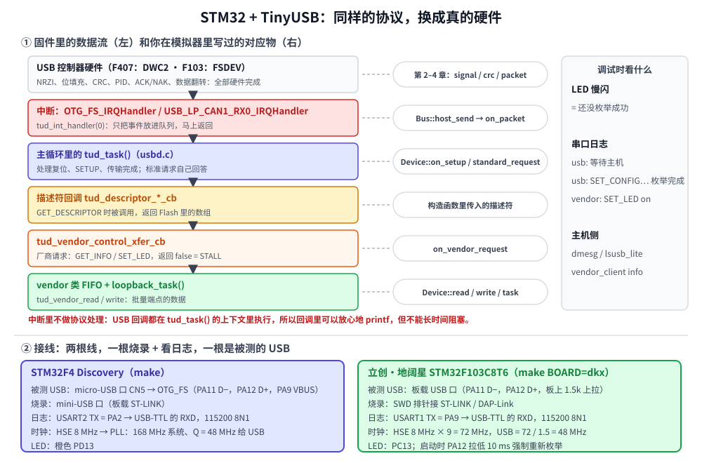

# 第 11 章　STM32 + TinyUSB：做一个真正的设备

## 本章目标

- 在真实的 STM32 上做一个**厂商自定义类**设备：批量回环 + 两个厂商请求，主机端就是第 10 章的 `vendor_client`
- 看懂 TinyUSB 的结构，知道它替你做了什么、你只需要写什么——并且每一块都能对应到前面模拟器里写过的代码
- 搞清楚两种常见 USB 控制器（F407 的 DWC2、F103 的 FSDEV）在板级代码上的差别：48 MHz 时钟、VBUS 检测、D+ 上拉
- 编译、烧录、接线、联调

本章需要两样外部的东西：隔壁 [STM32 教程](../../stm32/docs/README.md) 的构建框架（启动代码、链接脚本、`arm-none-eabi-gcc`、TinyUSB 源码都在那里），以及一块 **STM32F4 Discovery** 或**立创·地阔星 STM32F103C8T6**。没有板子也可以把本章读完、把固件编译出来。

## 11.1 原理：TinyUSB 替你做了什么



回想前 9 章：为了让模拟器里的设备能工作，我们一层层写了 NRZI、位填充、CRC、PID 校验、ACK/NAK、数据翻转、SETUP 的三个阶段、标准请求、描述符……到了真芯片上，这些工作是这样分的（对照图的上半部分）：

| 层 | 谁来做 | 前面哪一章讲过 |
|----|-------|--------------|
| 电平、NRZI、位填充、SYNC/EOP、CRC、PID、握手、DATA0/1 | **USB 控制器硬件** | 第 2–4 章 |
| 复位、SETUP 解析、控制传输三个阶段、`SET_ADDRESS`、`GET_DESCRIPTOR`、`SET_CONFIGURATION` | **TinyUSB 的 `usbd.c`** | 第 6–7 章 |
| 厂商类的端点 FIFO、ZLP | **TinyUSB 的 `vendor_device.c`** | 第 5、9 章 |
| 描述符内容、厂商请求、数据怎么处理 | **你** | 第 6、7、10 章 |

所以真正需要你写的只有三样：**描述符**、**请求回调**、**数据处理**。这和模拟器里继承 `musb::Device`、填描述符、重写 `on_vendor_request`、在 `task()` 里 `read`/`write` 是一回事。

有一点模拟器里没有、真芯片上很重要：**中断和主循环的分工**。USB 控制器一有事件（收到 SETUP、一个包传完、总线复位）就触发中断，中断函数只调用 `tud_int_handler(0)` 把事件放进队列就返回；真正的处理在主循环的 `tud_task()` 里进行，你的回调也都在那里被调用。好处是回调里可以 `printf`、可以访问全局变量而不用担心竞争；代价是主循环不能被长时间阻塞，否则主机等不到回应。

## 11.2 准备

目录结构要求两个教程并排放：

```
mcu/
├── stm32/          隔壁教程：examples/common/（构建框架、驱动）、examples/third_party/tinyusb/
└── usb/            本教程
    └── examples/11-stm32-vendor/
```

如果 STM32 教程放在别处，编译时用 `make STM32_EXAMPLES=/path/to/stm32/examples` 指定。工具链的安装见 STM32 教程第 1 章（`gcc-arm-none-eabi`）和第 15 章（`openocd` 或 `stlink-tools`）。

## 11.3 代码导读

[`examples/11-stm32-vendor/`](../examples/11-stm32-vendor/) 里一共 8 个文件：

| 文件 | 内容 |
|------|------|
| `vendor_protocol.h` | 和第 10 章 `vendor_client` 共用的约定：VID/PID、端点、请求号、`vendor_info` 结构体 |
| `tusb_config.h` | TinyUSB 配置：选控制器驱动、只开 vendor 类、缓冲区大小 |
| `usb_descriptors.cpp` | 设备、配置、字符串描述符和三个取描述符的回调 |
| `main.cpp` | 状态回调、厂商请求、批量回环、主循环 |
| `board_usb.h` | 两块板子共同的接口：`board_init`、`board_usb_start`、`board_led`…… |
| `board_disco.cpp` | STM32F4 Discovery：168 MHz 时钟、OTG_FS 引脚、VBUS 检测、中断入口 |
| `board_dkx.cpp` | 地阔星 F103：72 MHz 时钟、D+ 拉低强制重新枚举、中断入口 |
| `Makefile` | 按 `BOARD` 选源文件，然后包含 STM32 教程的 `cmsis.mk` |

### 配置：`tusb_config.h`

```c
#if defined(STM32F407xx)
#define CFG_TUSB_MCU            OPT_MCU_STM32F4     /* OTG_FS，Synopsys DWC2 核 */
#elif defined(STM32F103xB)
#define CFG_TUSB_MCU            OPT_MCU_STM32F1     /* USB FS device，ST 自己的 FSDEV 核 */
#endif

#define CFG_TUSB_OS             OPT_OS_NONE         /* tud_task() 在主循环里调用 */
#define CFG_TUD_ENDPOINT0_SIZE  64
#define CFG_TUD_VENDOR          1
#define CFG_TUD_VENDOR_EPSIZE     64
#define CFG_TUD_VENDOR_RX_BUFSIZE 512
#define CFG_TUD_VENDOR_TX_BUFSIZE 512
```

`CFG_TUD_ENDPOINT0_SIZE` 就是设备描述符里的 `bMaxPacketSize0`（第 6 章）。全速设备可以选 8/16/32/64，选 64 时控制传输的包最少。

### 描述符：`usb_descriptors.cpp`

设备描述符是一个结构体，字段和第 6 章 `DeviceDescriptor` 一一对应：

```cpp
static const tusb_desc_device_t desc_device = {
    .bLength = sizeof(tusb_desc_device_t),
    .bDescriptorType = TUSB_DESC_DEVICE,
    .bcdUSB = 0x0200,
    .bDeviceClass = 0x00,          // 类别由接口描述符说明
    .bMaxPacketSize0 = CFG_TUD_ENDPOINT0_SIZE,
    .idVendor = VENDOR_VID,
    .idProduct = VENDOR_PID,
    .iManufacturer = 1,
    .iProduct = 2,
    .iSerialNumber = 3,
    .bNumConfigurations = 1,
    // ……
};
```

配置描述符用 TinyUSB 的宏在编译期拼出来，作用和第 6 章的 `ConfigBuilder` 一样，只是结果是放在 Flash 里的常量数组：

```cpp
// 配置描述符 9 字节 + 接口 9 字节 + 两个端点各 7 字节 = 32 字节
#define CONFIG_TOTAL_LEN (TUD_CONFIG_DESC_LEN + TUD_VENDOR_DESC_LEN)

static const uint8_t desc_configuration[] = {
    // 配置值 1，1 个接口，无字符串，总长，属性（总线供电），最大 100 mA
    TUD_CONFIG_DESCRIPTOR(1, 1, 0, CONFIG_TOTAL_LEN, 0x00, 100),
    // 接口 0，字符串 4，OUT 端点，IN 端点，包长
    TUD_VENDOR_DESCRIPTOR(0, 4, VENDOR_EP_OUT, VENDOR_EP_IN, VENDOR_EP_SIZE),
};
static_assert(sizeof desc_configuration == CONFIG_TOTAL_LEN, "wTotalLength mismatch");
```

`static_assert` 把第 6 章说的“`wTotalLength` 必须等于实际长度”变成了编译期检查。宏的第 6 个参数写 `100`，宏内部会除以 2 填进 `bMaxPower`（单位 2 mA）；属性写 `0x00`，宏会自动加上必须为 1 的第 7 位。

字符串描述符在回调里现场生成。格式和第 6 章一样：第一个 16 位字是 `(类型 << 8) | 总字节数`，后面是 UTF-16LE 字符。序列号（3 号）用芯片的唯一 ID 生成，这样同一台电脑上插多块板子也能区分：

```cpp
} else if (index == 3) {
    // 96 位唯一 ID 的前 64 位写成 16 个十六进制字符
    static const char hexdigits[] = "0123456789ABCDEF";
    const uint32_t* uid = board_uid();
    for (int w = 0; w < 2; w++) {
        for (int nib = 7; nib >= 0; nib--) {
            buf[1 + n++] = static_cast<uint16_t>(hexdigits[(uid[w] >> (nib * 4)) & 0xF]);
        }
    }
}
// ……
buf[0] = static_cast<uint16_t>((TUSB_DESC_STRING << 8) | (2 * n + 2));
```

### 厂商请求：`tud_vendor_control_xfer_cb`

这是本章最值得细看的函数。第 7 章讲过控制传输有三个阶段，TinyUSB 会在**每个阶段**各调用一次这个回调，用 `stage` 告诉你现在是哪个阶段：

| `stage` | 什么时候 | 本例怎么做 |
|---------|---------|----------|
| `CONTROL_STAGE_SETUP` | 收到 8 字节 SETUP 包 | 看请求，决定接受（安排数据阶段）还是拒绝（STALL） |
| `CONTROL_STAGE_DATA` | 数据阶段传完 | 直接返回 `true` |
| `CONTROL_STAGE_ACK` | 状态阶段完成 | 直接返回 `true` |

```cpp
bool tud_vendor_control_xfer_cb(uint8_t rhport, uint8_t stage, const tusb_control_request_t* req)
{
    if (stage != CONTROL_STAGE_SETUP) {
        return true;
    }
    if (req->bmRequestType_bit.recipient != TUSB_REQ_RCPT_DEVICE) {
        return false;
    }
    switch (req->bRequest) {
    case VENDOR_REQ_GET_INFO: {
        static vendor_info info;   // 数据阶段结束前不能释放，所以是 static
        info.uptime_ms = millis();
        info.loopback_bytes = loopback_bytes;
        info.button = board_button();
        info.led = led_state;
        info.board = board_id();
        return tud_control_xfer(rhport, req, &info, sizeof info);
    }
    case VENDOR_REQ_SET_LED:
        led_state = req->wValue != 0;
        board_led(led_state);
        printf("vendor: SET_LED %s\n", led_state ? "on" : "off");
        return tud_control_status(rhport, req);   // 没有数据阶段，直接回状态阶段
    default:
        printf("vendor: 未知请求 0x%02X，回 STALL\n", req->bRequest);
        return false;
    }
}
```

三个出口正好对应第 7 章的三种情况：

- `tud_control_xfer(...)`：有数据阶段。TinyUSB 会按 64 字节一包、DATA1 开始交替地把 `info` 发出去，主机要的 `wLength` 比实际数据长时，它还会自己决定要不要补 ZLP。
- `tud_control_status(...)`：没有数据阶段，直接进入状态阶段（设备回一个零长度的 DATA1）。
- `return false`：端点 0 回 STALL。主机的 libusb 得到 `LIBUSB_ERROR_PIPE`；下一个 SETUP 到来时 STALL 自动解除（第 7 章的“协议 STALL”）。

注意 `info` 是 `static` 的：`tud_control_xfer` 只是记下了指针，数据要等主机一包一包地 IN 走。如果把它放在栈上，函数一返回内存就被别的东西覆盖了，主机读到的是垃圾。

### 批量回环：`loopback_task`

```cpp
static void loopback_task()
{
    uint32_t space = tud_vendor_write_available();
    uint32_t avail = tud_vendor_available();
    if (avail == 0 || space == 0) {
        return;
    }
    uint8_t buf[64];
    uint32_t want = avail < space ? avail : space;
    uint32_t n = tud_vendor_read(buf, want < sizeof buf ? want : sizeof buf);
    tud_vendor_write(buf, n);
    tud_vendor_write_flush();
    loopback_bytes += n;
}
```

这里藏着第 4 章的**流控**：发送缓冲（512 字节）满了就不读接收缓冲；接收缓冲也满了以后，TinyUSB 不再准备 OUT 端点，硬件对主机的 OUT 自动回 **NAK**，主机就会等着重试。整个过程不丢数据，也不需要你写一行流控代码。

### 主循环

```cpp
for (;;) {
    tud_task();
    loopback_task();
    // 还没枚举成功时 LED 慢闪，方便判断卡在哪一步
    if (!tud_mounted() && millis() - last_blink > 500) {
        // ……翻转 LED
    }
}
```

`tud_mounted()` 在收到 `SET_CONFIGURATION` 后变成 true（第 7 章的 Configured 状态），同时 TinyUSB 调用 `tud_mount_cb()` 打一行日志。

### 板级差异：两种 USB 控制器

两块板子的 `board_usb_start()` 很不一样，原因在硬件：

| | STM32F407（Discovery） | STM32F103（地阔星） |
|---|---|---|
| 控制器 | OTG_FS，Synopsys **DWC2** 核 | USB FS device，ST 的 **FSDEV** 核 |
| 48 MHz 从哪来 | PLL 的 Q 输出：336 MHz / 7 | PLL / 1.5：72 MHz / 1.5，所以系统时钟只能是 72 或 48 MHz |
| D+ 上拉 | 芯片内部，软件控制 | **芯片没有**，板子上焊了 1.5 kΩ 固定上拉 |
| VBUS 检测 | PA9，`vbus_sensing = true` | 无 |
| 中断入口 | `OTG_FS_IRQHandler` | `USB_HP_CAN1_TX_IRQHandler`、`USB_LP_CAN1_RX0_IRQHandler`（和 CAN 共用） |
| 唯一 ID 地址 | `0x1FFF7A10` | `0x1FFFF7E8` |

**时钟**。第 2 章说过全速 USB 要求时钟误差不超过 ±0.25%，内部 RC 振荡器（HSI）大约 ±1%，做不到，所以两块板子都用外部 8 MHz 晶振（HSE）经过 PLL 得到精确的 48 MHz：

```cpp
// HSE 8 MHz -> /M=8 -> 1 MHz -> xN=336 -> VCO 336 MHz
//   /P=2 -> 168 MHz 系统时钟
//   /Q=7 ->  48 MHz 给 USB（全速 USB 要求时钟误差 < 0.25%，HSI 做不到，必须用晶振）
```

**上拉电阻**。第 2 章的图里，设备靠 D+ 上的 1.5 kΩ 上拉告诉主机“我是全速设备，我来了”。F407 的上拉在芯片里，TinyUSB 在初始化完成（并检测到 VBUS）后才打开，主机看到的就是一次干净的插入。F103 的上拉焊死在板子上，单片机一上电主机就以为设备来了；如果你只是按了复位键、或者重新烧录了程序，主机根本不知道设备已经“换了个人”，不会重新枚举。所以 `board_dkx.cpp` 启动时先把 D+ 拉低 10 ms，假装拔掉一次：

```cpp
// 假装拔掉：D+ 拉低 10 ms
gpio_config(GPIOA, 12, GPIO_CFG_OUT_PP_2MHZ);
GPIOA->BRR = 1u << 12;
delay_ms(10);
gpio_config(GPIOA, 12, GPIO_CFG_IN_FLOATING);   // 交还给 USB 控制器
```

主机看到 D+、D− 都是低电平（SE0）超过 2.5 µs 就认为设备断开了；10 ms 足够让 Linux/Windows 的集线器驱动注意到。

**`SET_ADDRESS` 的时机**。第 7 章强调：新地址要在**状态阶段完成之后**才生效。这一点两个控制器的做法也不同：FSDEV 需要驱动在状态阶段完成的中断里再写地址寄存器；DWC2 允许驱动收到请求后立刻写，由硬件自己保证状态阶段仍用旧地址。TinyUSB 的两个驱动（`dcd_stm32_fsdev.c`、`dcd_dwc2.c`）已经各自处理好了，如果你以后自己写驱动，这是最容易踩的坑之一。

## 11.4 动手：编译

```bash
cd examples/11-stm32-vendor
make                 # STM32F4 Discovery，产物在 build/
make BOARD=dkx       # 地阔星 F103，产物在 build-dkx/
```

本机实际输出（只保留最后几行）：

```
$ make
           FLASH:       20500 B         1 MB      1.96%
             RAM:       10408 B       128 KB      7.94%
arm-none-eabi-size build/firmware.elf
   text	   data	    bss	    dec	    hex	filename
  20356	    136	  10280	  30772	   7834	build/firmware.elf
arm-none-eabi-objcopy -O binary build/firmware.elf build/firmware.bin

$ make BOARD=dkx
           FLASH:       18564 B        64 KB     28.33%
             RAM:       10488 B        20 KB     51.21%
arm-none-eabi-size build-dkx/firmware.elf
   text	   data	    bss	    dec	    hex	filename
  18436	    128	  10368	  28932	   7104	build-dkx/firmware.elf
arm-none-eabi-objcopy -O binary build-dkx/firmware.elf build-dkx/firmware.bin
```

整个 USB 设备（协议栈 + 驱动 + 描述符 + 应用）大约 20 KB Flash，其中不少是 newlib 的 `printf`。RAM 里的 10 KB 有 8 KB 是链接脚本给堆和栈预留的（`arm-none-eabi-nm -S --size-sort build/firmware.elf` 里那个 `0x2000` 字节的 `end`）；USB 自己最大的一块是 vendor 类的 `_vendord_itf`，1076 字节，也就是 `tusb_config.h` 里那两个 512 字节的 FIFO 加上状态。F103 的 RAM 已经用了一半，往上加功能时要留意。

## 11.5 动手：烧录和接线

图的下半部分是两块板子的接线。原则是**两根线**：一根用来烧录和供电（ST-LINK），一根是被测的 USB 线，接到电脑上；再加一个 USB-TTL 模块看串口日志。

**STM32F4 Discovery**：

```bash
openocd -f board/stm32f4discovery.cfg -c "program build/firmware.elf verify reset exit"
```

被测的 USB 线接 **micro-USB 口 CN5**，不是烧录用的 mini-USB 口。日志从 USART2 的 PA2 出来。

**地阔星 F103**（ST-LINK 或 DAP-Link 接 SWD 排针，见 STM32 教程附录 C）：

```bash
openocd -f interface/stlink.cfg -f target/stm32f1x.cfg \
        -c "program build-dkx/firmware.elf verify reset exit"
```

被测的 USB 线接板子上的 USB 口。日志从 USART1 的 PA9 出来。

打开串口终端（`picocom -b 115200 /dev/ttyUSB0`，WSL2 里同样要先把 USB-TTL 模块 `usbipd attach` 进来），按复位键。

## 11.6 动手：和主机对话

1. **WSL2**：在 Windows 上 `usbipd list` 找到 `cafe:4011`，`bind` 再 `attach --wsl --auto-attach`（第 10 章 10.5 节）。`--auto-attach` 在这里特别有用：烧录、复位都会让设备重新枚举，没有它每次都要手动再 attach。
2. 确认 udev 规则已经装好（第 10 章 10.6 节）。
3. 按第 10 章 10.7 节的顺序运行：

```bash
./build/examples/lsusb_lite cafe:4011
./build/examples/vendor_client info
./build/examples/vendor_client led on
./build/examples/vendor_client echo 你好
./build/examples/vendor_client bench 1024
./build/examples/vendor_client bad
```

串口日志预期依次出现（Discovery 板为例）：

```
lesson 11: vendor loopback on STM32F4 Discovery, VID:PID cafe:4011
usb: 等待主机
usb: SET_CONFIGURATION 收到，枚举完成
vendor: SET_LED on
vendor: 未知请求 0x7F，回 STALL
```

LED 的变化：上电后慢闪（还没枚举），枚举完成后停止闪烁，`led on` 后常亮。

`lsusb_lite` 读到的配置描述符应该正好 32 字节，解析结果和 11.3 节的宏参数逐项对得上：1 个接口、类 `0xFF`、端点 `0x01` OUT 和 `0x81` IN、批量、包长 64、`bMaxPower` 50（即 100 mA）。

> 和第 10 章一样：本教程写作时手边没有开发板，**两份固件只验证到编译通过**，本节的日志和现象是按代码和协议推导出的预期，不是实测记录。如果你的结果不一样，先用第 12 章的方法定位。

如果日志停在 `usb: 等待主机`，LED 一直慢闪，说明枚举没有完成，直接去第 12 章按“枚举失败”那条线查。

## 练习

1. 改 `vendor_info`，加一个字段 `uint32_t sof_count`，在 `tud_sof_cb` 里加一（需要调用 `tud_sof_cb_enable(true)`）。主机隔 1 秒读两次，差值应该接近多少？（提示：第 5 章的帧。）记得两边共用同一个头文件，`static_assert` 的 12 也要改。
2. 加一个 OUT 方向的厂商请求 `SET_MESSAGE`：主机在数据阶段发最多 32 字节，设备在 `CONTROL_STAGE_DATA` 阶段把它打印到串口。思考：为什么不能在 `CONTROL_STAGE_SETUP` 阶段打印？
3. 把 `tud_vendor_write_flush()` 删掉，分别跑 `vendor_client echo 你好` 和 `vendor_client bench 64`。为什么一个超时、一个正常？（提示：读 TinyUSB `tusb.c` 里的 `tu_edpt_stream_write`，看它在 FIFO 里攒够多少字节时才自己启动 IN 传输。）
4. 在 `loopback_task` 开头加一个 `delay_ms(5)`，再跑 `bench`。速度变了多少？主机那边有没有出错？用第 4 章的 NAK 解释。
5. 把这个设备改成复合设备：在 vendor 接口之外再加一个 CDC 串口（参考第 9 章的描述符和 STM32 教程第 24 章）。需要哪些改动？别忘了 IAD 和设备类 `0xEF/0x02/0x01`。

## 常见坑

- **接错 USB 口。** Discovery 有两个 USB 口，mini-USB 是 ST-LINK，micro-USB（CN5）才是 STM32 自己的 USB。
- **没开 HSE 或 PLL 算错。** 枚举时好时坏，`dmesg` 里出现 `error -71`。先确认 48 MHz 准不准。
- **板子没接 VBUS 却开了 VBUS 检测。** 设备永远不上拉 D+，主机根本看不到它。换别的 F4 板子时要查原理图。
- **F103 复位后不重新枚举。** D+ 固定上拉的板子都有这个问题，要么像本例那样启动时拉低 D+，要么手动拔插。
- **`tud_control_xfer` 传了栈上的缓冲区。** 主机读到乱码，数据阶段的数据是在函数返回之后才发出去的。
- **在回调或主循环里阻塞。** USB 规范要求设备在 500 ms 内完成带数据阶段的标准请求（`SET_ADDRESS` 只给 50 ms）；主循环里一个 `delay_ms(1000)` 就足以让枚举失败。
- **调试器停在断点上。** 设备不响应，主机会认为设备出错并放弃它；继续运行后通常也恢复不了，要复位让它重新枚举。
- **改了描述符，Windows 还用旧的。** Windows 会按 VID/PID（和序列号）缓存信息，改了接口布局后换个 PID，或者在设备管理器里卸载旧设备。

---

上一章：[第 10 章　libusb](10-libusb.md)　|　下一章：[第 12 章　抓包与排错](12-debugging.md)
