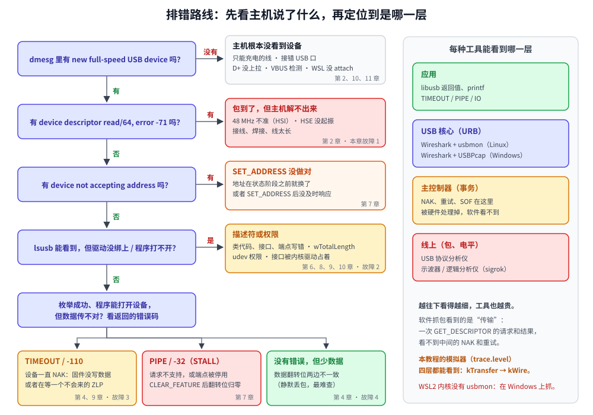

# 第 12 章　抓包与排错

## 本章目标

- 遇到“USB 不工作”时，有一条固定的排查路线，而不是瞎改
- 在模拟器里亲手制造四种最常见的故障，看清每一种在主机眼里是什么样子
- 会读 Linux `dmesg` 和 Windows 设备管理器里的 USB 报错
- 会用 Wireshark 抓 USB 包，知道软件抓包能看到什么、看不到什么

## 12.1 原理：先看主机说了什么



USB 是“主机说了算”的总线（第 1 章）：设备做错了什么，最先、最准确地知道的是**主机**。所以排错的第一步永远是看主机的反应，而不是盯着固件代码猜。

图的左边是排查路线，按枚举的顺序从上往下问：

1. **主机看到设备了吗？** 没看到，说明连 D+ 上拉这一步都没成功（第 2 章），和协议无关。
2. **第一个 `GET_DESCRIPTOR` 成功了吗？** 失败多半是信号或时钟问题：包到了，但主机解不出来（第 2、3 章）。
3. **`SET_ADDRESS` 成功了吗？** 失败多半是设备换地址的时机不对（第 7 章）。
4. **描述符读完了，驱动绑上了吗？** 没绑上是描述符内容或权限的问题（第 6、8–10 章）。
5. **能用了，但数据不对？** 看错误码：超时、STALL，还是根本没报错（第 4、5、9 章）。

图的右边是另一个关键概念：**每种工具只能看到某一层**。Wireshark 这类软件抓包工具挂在操作系统的 USB 核心上，看到的是一次次“传输请求”（Linux 叫 URB，USB Request Block）：“主机要读 18 字节设备描述符，结果拿到了 18 字节”。中间的 NAK、出错重试、SOF 都是主控制器硬件自己处理的，软件抓包**看不到**。要看到包和电平，就得用硬件协议分析仪或逻辑分析仪。

本教程的模拟器是个例外：`trace.level` 从 `kTransfer` 调到 `kWire`，四层都能看到。所以本章先在模拟器里把故障看透，再去对应真实系统里的报错。

## 12.2 动手：在模拟器里制造四种故障

```bash
./build/examples/12-troubleshoot
```

程序在 [`examples/12-troubleshoot/main.cpp`](../examples/12-troubleshoot/main.cpp)，用的设备和第 11 章的固件一样：一个厂商自定义接口、一对 64 字节批量端点、32 字节配置描述符。

### 故障 1：设备的回答到不了主机

时钟不准、接线不良、线太长，结果都一样：设备发出的包到了主机那里是一串解不开的乱码（CRC 错、位填充错），或者干脆什么都没有。程序用一个“包装”来模拟：设备照常收包、照常回答，但回答到不了主机：

```cpp
class BrokenWire : public BusDevice {
public:
    explicit BrokenWire(Device& inner) : inner_(inner) {}
    std::optional<Packet> on_packet(const Packet& p) override
    {
        inner_.on_packet(p);
        return std::nullopt;
    }
    // ……
};
```

本机实际输出：

```
【枚举 1】复位总线，设备回到地址 0
  [总线] 复位：SE0 保持 10 ms，所有设备回到“默认状态”，地址 = 0
  [时钟不准的设备] 复位：地址 = 0，进入 Default 状态
【枚举 2】在地址 0 上读设备描述符，只为知道端点 0 的最大包长
  ── 建立阶段
  [时钟不准的设备] 收到请求 GET_DESCRIPTOR(DEVICE #0) wLength=64
  SETUP addr=0 ep=0  DATA0 [8] → 超时/出错
    ↻ 第 1 次出错，重试同一个事务
  [时钟不准的设备] 收到请求 GET_DESCRIPTOR(DEVICE #0) wLength=64
  SETUP addr=0 ep=0  DATA0 [8] → 超时/出错
    ↻ 第 2 次出错，重试同一个事务
  [时钟不准的设备] 收到请求 GET_DESCRIPTOR(DEVICE #0) wLength=64
  SETUP addr=0 ep=0  DATA0 [8] → 超时/出错
控制传输失败 GET_DESCRIPTOR(DEVICE #0) wLength=64：SETUP 没有被确认
枚举失败：读不到设备描述符
[总线] 拔出设备 "时钟不准的设备"

注意设备那边：它确实“收到请求”了，自己觉得一切正常。只看设备日志是查不出来的。

  主机看到：第一个 SETUP 就连续 3 次出错，枚举在第 2 步失败
  真实系统：usb 1-1: device descriptor read/64, error -71（-71 = EPROTO，传输出错；有的主控制器报 -62 或 -110）
  去查    ：第 2 章：48 MHz 时钟准不准、D+ 上拉、接线
```

重点是倒数第二段：**设备的日志里一切正常**。你在固件里打 `printf`，会看到“收到 GET_DESCRIPTOR”，于是以为描述符有问题，改来改去都没用。真正的问题在线上。第 4 章的“3 次重试”在这里也看得很清楚。（Linux 内核还会在更高一层换着方法把整个枚举再试几遍，所以真实的 `dmesg` 里同一行会出现好几次。）

### 故障 2：`wTotalLength` 写错

```cpp
Bytes cfg = gadget_config();
cfg[2] = 40;   // 实际只有 32 字节，却声称 40
```

本机实际输出：

```
【枚举 6】先读配置描述符的前 9 字节，看看总长 wTotalLength 是多少
控制读  addr=2 GET_DESCRIPTOR(CONFIGURATION #0) wLength=9 → 9 字节
        wTotalLength = 40
【枚举 7】再一次读出完整的配置描述符（40 字节）
控制读  addr=2 GET_DESCRIPTOR(CONFIGURATION #0) wLength=40 → 32 字节
枚举失败：配置描述符不合法：wTotalLength=40，实际有 32 字节
[总线] 拔出设备 "总长写错的设备"

  主机看到：要 40 字节，只收到 32 字节的短包，配置描述符对不上，枚举在第 7 步失败
  真实系统：Linux 打印 config index 0 descriptor too short (expected 40, got 32)，然后将就着用这 32 字节；
            别的主机可能直接拒绝。本模拟器按规范从严处理
  去查    ：第 6 章：wTotalLength = 配置 + 所有接口、端点、类描述符的总和
```

这类错误最麻烦的地方是**不同主机反应不同**：Linux 比较宽容，打一行提示后照样能用；换一台电脑、一个操作系统、一个嵌入式主机，设备就“认不出来”了。所以不要拿“我的电脑上能用”当作描述符正确的证据，用 `lsusb_lite`（第 10 章）读出来逐字节对一遍，或者像第 11 章那样用 `static_assert` 在编译时检查。

### 故障 3：固件没往 IN 端点写数据

本机实际输出：

```
-- 主机读批量端点 0x82：
  IN    addr=3 ep=2  → NAK
    （省略了后面连续的 50 个 NAK）
批量读  addr=3 ep=2 超时：已收到 0 字节，但一直等不到短包

  主机看到：每次 IN 都是 NAK，最后超时（不是出错！设备一直在正常回答）
  真实系统：libusb_bulk_transfer 返回 LIBUSB_ERROR_TIMEOUT；内核驱动里是 -110（ETIMEDOUT）
  去查    ：第 4 章：NAK 是“现在没数据”；第 9 章：读的长度和 ZLP

-- 固件写了 5 字节之后再读：
  IN    addr=3 ep=2  DATA0 [5] 68 65 6C 6C 6F ← ACK
批量读  addr=3 ep=2 → 5 字节
```

要分清**超时**和**出错**：超时说明 USB 链路完全正常，设备每次都按时回了 NAK，只是“没有数据”。这时该查的是固件逻辑（数据有没有写进端点？第 11 章练习 3 的 `flush` 有没有调用？），而不是硬件。另一种超时是第 9 章讲过的：数据都到了，但主机在等一个短包或 ZLP，设备没发。

### 故障 4：数据翻转位不同步

这是四个里最隐蔽的。主机发了 `CLEAR_FEATURE(ENDPOINT_HALT)`，设备按规范把端点的翻转位清回 DATA0（第 7 章），但主机这边忘了同步清零：

```cpp
host.control_out(4, {0x02, req::CLEAR_FEATURE, req::FEATURE_ENDPOINT_HALT, 0x02, 0});
// 少了这一句：host.reset_toggle(4, 0x02);
```

本机实际输出：

```
-- 写 "hello"：
  [翻转位不同步的设备] 收到 DATA1，期望 DATA0：这是重发的旧包，回 ACK 但丢弃数据
  OUT   addr=4 ep=2  DATA1 [5] → ACK
批量写  addr=4 ep=2 ← 5 字节（1 个包）
   bulk_out 返回 成功，设备收到：""

-- 再写 "world"：
  OUT   addr=4 ep=2  DATA0 [5] → ACK
批量写  addr=4 ep=2 ← 5 字节（1 个包）
   设备收到："world"
```

主机得到 ACK，认为写成功了；设备按第 4 章的规则，把翻转位不对的包当成“主机重发的旧包”，回 ACK 但丢掉。下一包两边又对上了，于是整个现象是：**偶尔少一包，没有任何报错**。实际项目里，“偶尔丢数据”的 bug 最难查，翻转位是要优先怀疑的对象之一。用 libusb 时调用 `libusb_clear_halt()` 就不会有这个问题，它会让内核同时重置主机侧的翻转位。

## 12.3 真实系统：读懂报错

### Linux：`dmesg`

```bash
sudo dmesg -w        # 先开着，再插设备；-w 表示持续显示新消息
```

一次成功的枚举大致是这个样子（以第 11 章的固件为例，格式来自 Linux 内核，内容是按固件推出来的，不是实测）：

```
usb 1-1: new full-speed USB device number 2 using xhci_hcd
usb 1-1: New USB device found, idVendor=cafe, idProduct=4011, bcdDevice= 1.00
usb 1-1: New USB device strings: Mfr=1, Product=2, SerialNumber=3
usb 1-1: Product: miniusb vendor loopback
usb 1-1: Manufacturer: miniusb tutorial
usb 1-1: SerialNumber: 0123456789ABCDEF
```

序列号每块芯片都不一样。第一行的 `full-speed` 是主机从 D+ 上拉判断出来的（第 2 章），`number 2` 是它准备用 `SET_ADDRESS` 分配的地址（第 7 章）；后面几行就是设备描述符和字符串描述符的内容（第 6 章）。WSL2 里主控制器那一栏是 `vhci_hcd`（第 10 章的虚拟主控制器）。

常见的失败信息：

| `dmesg` 里的信息 | 错误码含义 | 先怀疑 |
|-----------------|-----------|-------|
| 什么都没有 | 主机没检测到设备 | 线（只能充电的线没有数据线）、接错口、D+ 上拉、VBUS 检测；WSL 没 attach |
| `device descriptor read/64, error -71` | -71 EPROTO：传输出错（CRC、位填充、没回答） | 48 MHz 时钟、HSE、接线（故障 1） |
| `device descriptor read/64, error -110` 或 `-62` | 超时 | 同上；或者设备在中断里卡死了 |
| `device not accepting address 2, error -71` | `SET_ADDRESS` 失败 | 换地址的时机（第 7 章第 6 部分） |
| `unable to enumerate USB device` | 前面的重试全部失败，放弃了 | 看它前面的那几行 |
| `config index 0 descriptor too short` | 配置描述符比声称的短 | `wTotalLength`（故障 2） |
| `can't set config #1, error -32` | -32 EPIPE：设备对 `SET_CONFIGURATION` 回了 STALL | 配置值和描述符里的 `bConfigurationValue` 不一致 |

`-32`（EPIPE）在 Linux 的 USB 代码里永远表示**设备回了 STALL**，对应 libusb 的 `LIBUSB_ERROR_PIPE`；`-71`（EPROTO）对应 `LIBUSB_ERROR_IO`；`-110`（ETIMEDOUT）对应 `LIBUSB_ERROR_TIMEOUT`。记住这三个，大部分报错就能翻译了。

### WSL2 要多想一步：枚举发生在 Windows 上

用 usbipd 转发时（第 10 章的图），设备**先被 Windows 枚举**，WSL2 拿到的是 Windows 已经认出来的设备。所以：

- 枚举阶段的问题（故障 1、地址问题）在 WSL 的 `dmesg` 里**看不到**，要去 Windows 那边看；`usbipd list` 里设备显示成“未知 USB 设备”时，就是枚举没过。
- 描述符内容、驱动绑定、数据传输的问题，在 WSL 里看就行。

### Windows：设备管理器

枚举失败的设备会出现在“通用串行总线控制器”下面，名字直接告诉你卡在哪一步：

| 设备管理器里的名字 | 对应的步骤 |
|------------------|----------|
| 未知 USB 设备(设备描述符请求失败) | 第一个 `GET_DESCRIPTOR` 失败（故障 1） |
| 未知 USB 设备(设置地址失败) | `SET_ADDRESS` 失败 |
| 未知 USB 设备(端口重置失败) | 复位之后设备没有正常回到总线上，常见于供电或时钟 |

成功枚举但没有驱动的厂商自定义设备（比如第 11 章的固件），会出现在“其他设备”下面，带一个黄色感叹号。这不是错误，它在等你给它装 WinUSB（第 10 章 10.8 节）。

## 12.4 动手：用 Wireshark 抓 USB 包

### Windows：Wireshark + USBPcap

1. 安装 [Wireshark](https://www.wireshark.org/)，安装过程中勾选 **USBPcap**（或者单独安装 [USBPcap](https://desowin.org/usbpcap/)），装完重启一次。
2. 打开 Wireshark，接口列表里会出现 `USBPcap1`、`USBPcap2`……每个对应一个根集线器。不知道设备在哪个下面，就挨个试，或者都选上。
3. **先开始抓，再插设备**，这样才能抓到完整的枚举过程。
4. 在显示过滤器里输入条件缩小范围，常用的几个：

| 过滤器 | 作用 |
|-------|------|
| `usb.device_address == 5` | 只看地址 5 的设备（地址从抓到的包里看，或者看设备管理器） |
| `usb.transfer_type == 0x02` | 只看控制传输（`0x00` 同步、`0x01` 中断、`0x02` 控制、`0x03` 批量） |
| `usb.setup.bRequest == 6` | 只看 `GET_DESCRIPTOR`（第 7 章的请求码表） |
| `usb.endpoint_address == 0x81` | 只看 IN 端点 1 |

点开一个 `GET DESCRIPTOR Response`，Wireshark 会把设备描述符逐个字段解析出来，和第 6 章 `06-descriptors` 的输出对着看，几乎一模一样。

### 原生 Linux：Wireshark + usbmon

```bash
sudo modprobe usbmon
lsusb                    # 看设备在哪条 Bus 上，比如 Bus 001
sudo wireshark           # 选接口 usbmon1（1 = 总线号；usbmon0 = 所有总线）
```

不想用 `sudo` 跑图形界面，可以把 `/dev/usbmon*` 的权限交给 `wireshark` 组，具体做法看发行版的 Wireshark 文档。

### WSL2：抓不了

本机 WSL2 内核的配置：

```
$ zcat /proc/config.gz | grep USB_MON
# CONFIG_USB_MON is not set
```

微软的 WSL2 内核没有编译 usbmon，`modprobe usbmon` 会失败。而且就算有，它也只能看到 usbipd 转发进来之后的传输，看不到 Windows 那边的枚举。所以在 WSL2 环境下，**抓包统一在 Windows 上用 USBPcap 做**。

### 软件抓包看不到什么

回到图的右边：在 Wireshark 里你会看到一个控制传输是“一个请求 + 一个响应”，而不是第 7 章模拟器输出里那一串 SETUP/DATA/ACK/IN/OUT。NAK、重试、SOF、数据翻转都在主控制器硬件里处理掉了。所以：

- 总线复位看不到；现在的电脑大多用 xHCI 主控制器，它连 `SET_ADDRESS` 都是用一条硬件命令（Address Device）自己完成的，抓包里也看不到。
- 故障 1 在 Wireshark 里只表现为“请求失败，状态是错误”，看不出是 CRC 错还是没回答。
- 故障 3 表现为“请求挂了很久，最后被取消”，看不到中间成百上千个 NAK。
- 故障 4 **完全看不出来**：主机认为成功了，抓到的就是成功。

要看到这些，只能上硬件：专用的 USB 协议分析仪（贵），或者逻辑分析仪 + [sigrok/PulseView](https://sigrok.org/) 的 `usb_signalling` → `usb_packet` → `usb_request` 解码器。全速是 12 Mbit/s，采样率至少要 50–100 MHz；几十块钱的 24 MHz 逻辑分析仪只够看低速（1.5 Mbit/s）设备。接法是 D+、D− 两根线加 GND，解出来的就是第 2、3 章的 J/K、SYNC、PID、CRC，可以和 `02-signal`、`03-packet` 的输出逐位对照。

## 12.5 按现象查表

最后把整个教程串起来。遇到问题，先在这张表里找现象，再回到对应章节：

| 现象 | 最可能的原因 | 回到 |
|------|------------|------|
| 插上没有任何反应 | 线、接口、D+ 上拉、VBUS 检测；WSL 没 attach | 第 2、10、11 章 |
| 枚举时好时坏 | 时钟误差、信号质量 | 第 2 章 |
| `error -71`，`descriptor read` 失败 | 同上；或者中断没进（中断向量名写错） | 第 2、11 章 |
| `not accepting address` | `SET_ADDRESS` 后换地址的时机 | 第 7 章 |
| 只在某些电脑上认不出 | 描述符不严格符合规范（如 `wTotalLength`） | 第 6 章 |
| 键盘按一下出一串字符 | 没发“全部松开”的报告 | 第 8 章 |
| 串口打开后收不到数据 | 没等 DTR、没处理 `SET_CONTROL_LINE_STATE` | 第 9 章 |
| 传 64 字节整数倍时卡住 | 缺 ZLP | 第 5、9 章 |
| `LIBUSB_ERROR_ACCESS` | 权限，udev 规则 | 第 10 章 |
| `LIBUSB_ERROR_PIPE` | 设备回了 STALL：请求不支持或端点停用 | 第 7 章 |
| `LIBUSB_ERROR_TIMEOUT` | 设备一直 NAK，或者在等 ZLP | 第 4、9 章，故障 3 |
| 偶尔少一包，没有报错 | 数据翻转位不同步 | 第 4 章，故障 4 |
| 吞吐量远低于预期 | 串行收发、包太小、每帧事务数 | 第 5 章 |

## 练习

1. 在 `12-troubleshoot` 里加“故障 5”：设备描述符里 `iManufacturer`、`iProduct` 不为 0，构造 `Device` 时却传一个空的字符串列表，于是设备对这些字符串请求回 STALL。枚举还能成功吗？对照 `Host::enumerate` 的第 8 步解释。真实的 Linux 会怎么显示这个设备？
2. 把故障 4 的 `trace.level` 改成 `kPacket`，在输出里找到那个“翻转位不对”的数据包，看它的 PID 字节是 `C3`（DATA0）还是 `4B`（DATA1）。
3. 改 `BrokenWire`：只丢掉每 3 个回答中的 1 个。枚举还能成功吗？主机一共重试了多少次？如果改成 3 个丢 2 个呢？这说明了 USB 的错误恢复能容忍多差的线路？
4. 在 Windows 上用 USBPcap 抓一次鼠标的插入过程，找出第 7 章“枚举 1–9”的每一步。哪几步找不到？为什么？Windows 的做法和模拟器（Linux 的做法）还有什么不同？（提示：注意读配置描述符时的 `wLength`，以及有没有 `DEVICE_QUALIFIER` 请求。）
5. 如果你有第 11 章的板子：故意把 `board_disco.cpp` 里的 PLL Q 从 7 改成 6（USB 时钟变成 56 MHz），烧进去，在 Windows 设备管理器和 USBPcap 里分别看到什么？对照故障 1。

## 常见坑

- **先改代码，后看报错。** 顺序反了。先确定卡在枚举的哪一步，再看对应的代码。
- **只看设备日志。** 故障 1 说明了：设备“收到请求”不等于主机“收到回答”。
- **把超时当成硬件故障。** 超时多半说明链路是好的，是固件没准备数据。真正的传输错误是 `-71` / `LIBUSB_ERROR_IO`。
- **用只能充电的线。** 很多手机附赠的短线只有电源两根线，插上板子会亮，电脑却毫无反应。
- **抓包时设备已经插着。** 枚举早就结束了，什么也抓不到。先开始抓，再插。
- **WSL 里找枚举日志。** usbipd 转发时枚举发生在 Windows 上，WSL 的 `dmesg` 里没有。
- **调试器断点停住了设备。** 主机看到的是“设备突然不回答”，报错和硬件故障一模一样。排错时先去掉断点，用串口日志。

## 接下来学什么

到这里，你已经从电平一路走到了真实的设备和主机程序。往下可以继续的方向：

- **高速 USB（480 Mbit/s）**：Chirp 握手、125 µs 微帧、PING 协议。需要带高速 PHY 的芯片，比如 STM32F7/H7 的 OTG_HS。
- **USB 3.x**：完全不同的物理层（多了一对收发差分线），但描述符和请求的概念基本不变。
- **USB PD 和 Type-C**：CC 线上的供电协商，和本教程的数据协议是两回事。
- **做主机**：STM32 的 OTG 也能当主机，TinyUSB 的 `tuh_*` API 可以读 U 盘、接键盘。到时候第 7 章模拟器里 `Host` 做的那些事就轮到你的单片机来做了。
- **参考资料**：USB 2.0 规范的第 8 章（协议层）和第 9 章（设备框架）是本教程大部分内容的出处；Jan Axelson 的《USB Complete》适合系统地读一遍；[USB in a NutShell](https://www.beyondlogic.org/usbnutshell/) 是很好的速查。

---

上一章：[第 11 章　STM32 + TinyUSB](11-stm32-tinyusb.md)　|　回到：[教程目录](../README.md)
