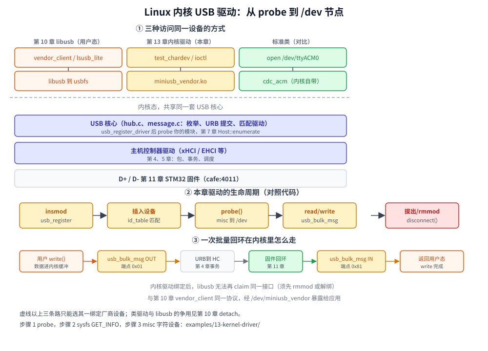
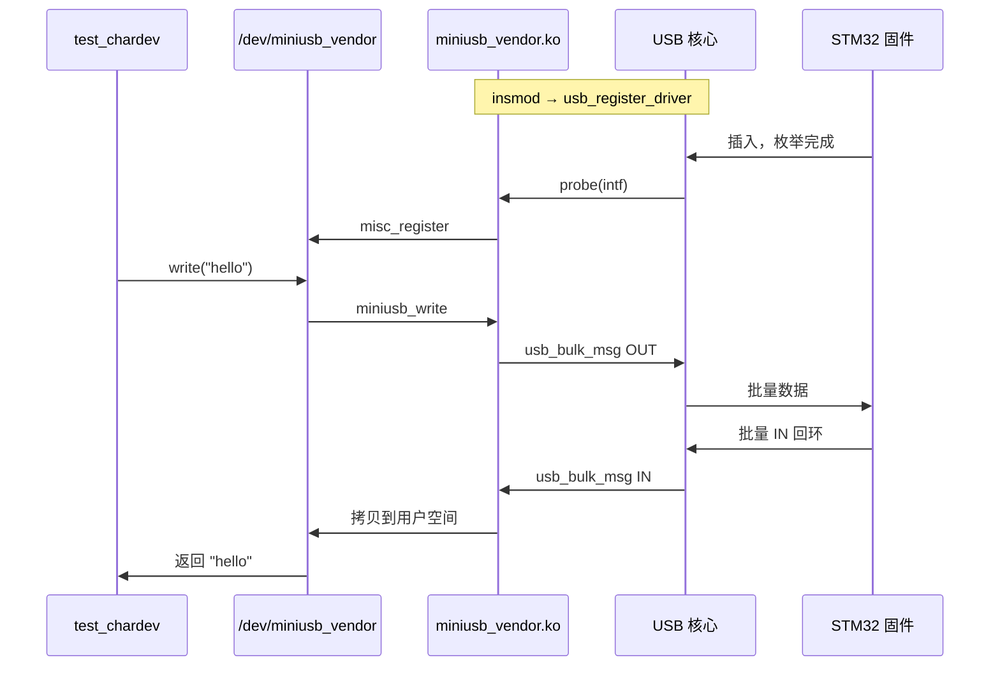

# 第 13 章　Linux USB 内核驱动：从 probe 到 `/dev`

## 本章目标

- 搞清楚**什么时候写内核驱动**、什么时候用第 10 章的 **libusb** 就够
- 看懂 Linux USB 软件栈里 **usb_driver → probe → URB** 和前面章节概念的对应关系
- 分三步亲手写一个能绑 `cafe:4011` 的模块：**探测 → sysfs → 字符设备回环**
- 用第 11 章板子或 usbipd 转发的设备做联调；对比 `vendor_client` 与 `test_chardev`

前置：至少读完 [第 7 章　枚举](07-enumeration.md)、[第 10 章　libusb](10-libusb.md)。有第 11 章固件时体验最好；没有板子时仍可编译模块，在 `insmod` 后插入设备验证 `probe`。

## 13.1 内核驱动还是 libusb？



图的上半部分对比三条路：

| 方式 | 跑在哪 | 典型用途 | 本教程 |
|------|--------|----------|--------|
| **类驱动**（`cdc_acm`、`usbhid`） | 内核 | 标准类设备，应用 open 设备节点 | 第 8、9 章 |
| **libusb** | 用户态 | 厂商类调试工具、跨平台 | 第 10 章 |
| **自己的 usb_driver** | 内核 | 量产驱动、内核里转发数据、实时性 | **本章** |

厂商自定义接口（类 `0xFF`）Linux **不会**自动绑定驱动。第 10 章的做法是：不装内核驱动，应用通过 usbfs 直接访问。本章的做法是：**注册一个** `usb_driver`**，在** `probe` **里认领设备，再_export 成** `/dev/miniusb_vendor` **或接入内核子系统**（网络、V4L2、input 等）。

选内核驱动的常见理由：

- 要给所有应用一个稳定的 `/dev/xxx` 或 `sysfs` 接口，而不是每个程序都链 libusb；
- 需要和内核其他子系统深度集成（例如把传感器注册成 `hwmon`）；
- 产品交付：用户只插设备就能用，不必装 Zadig/WinUSB。

代价：必须用 C 写、跟内核版本一起维护、调试靠 `dmesg` 和 `dynamic_debug`，门槛比 libusb 高。

## 13.2 和前面章节的对应

| 内核 API | 协议里是什么 | 章节 |
|----------|--------------|------|
| `usb_control_msg` + `USB_TYPE_VENDOR` | 厂商控制传输 | 第 7 章 |
| `usb_bulk_msg` 到 `0x01` / `0x81` | 批量 OUT/IN | 第 5、9 章 |
| `usb_driver.id_table` 里的 `USB_DEVICE(vid,pid)` | 枚举后主机选驱动 | 第 6、7 章 |
| `probe` 失败 | 设备能枚举但没有驱动绑定 | 第 12 章 |

内核里的 `usb_bulk_msg` **/** `usb_control_msg` **是同步的**：函数返回时，第 4 章里的 ACK/NAK/重试已经由主机控制器驱动做完了。这和 libusb 的同步 API 一样；高吞吐产品会用 **URB + 完成回调**（进阶练习）。

协议常量与第 10、11 章共用 [`vendor_protocol.h`](../examples/13-kernel-driver/vendor_protocol.h)：`VID 0xCAFE`、`PID 0x4011`、`GET_INFO`、`SET_LED`、批量回环端点。

## 13.3 准备环境

**不要在 WSL2 里默认编译内核模块**：微软提供的 WSL 内核往往没有匹配的 `linux-headers`，且 usbipd 转发的设备也不一定方便给自定义驱动做 bind 实验。**推荐原生 Linux**（实体机或虚拟机），插上第 11 章板子或做 usbipd attach。

```bash
# 示例：Ubuntu / Debian
sudo apt install build-essential linux-headers-$(uname -r)
uname -r    # 必须与 headers 包版本一致
```

目录：

```
examples/13-kernel-driver/
├── Makefile
├── vendor_protocol.h
├── miniusb_step1.c      # 步骤 1
├── miniusb_step2.c      # 步骤 2
├── miniusb_vendor.c     # 步骤 3（完整）
└── test_chardev.c       # 用户态测试
```

## 13.4 步骤 1：最小 probe（5 分钟）

**目标**：`insmod` 后插入 `cafe:4011`，在 `dmesg` 里看到一行 `probe`。

核心只有四件事：

1. `struct usb_device_id` 表 + `MODULE_DEVICE_TABLE`（让 `modinfo` 能显示别名）；
2. `probe` / `disconnect` 回调；
3. `struct usb_driver` 填 `.name`、`.probe`、`.id_table`；
4. `module_usb_driver()` 注册。

```c
static struct usb_device_id miniusb_table[] = {
    { USB_DEVICE(VENDOR_VID, VENDOR_PID) },
    { }
};

static int miniusb_probe(struct usb_interface *intf,
                         const struct usb_device_id *id)
{
    struct usb_device *udev = interface_to_usbdev(intf);
    dev_info(&intf->dev, "probe: %04x:%04x\n", ...);
    return 0;
}

module_usb_driver(miniusb_driver);
```

**动手**：

```bash
cd examples/13-kernel-driver
make step1
sudo insmod miniusb_step1.ko
# 插入设备（或重新 attach）；查看日志
sudo dmesg | tail
lsmod | grep miniusb
```

预期：`miniusb_step1: probe: cafe:4011 ...`

若已先用 libusb 打开设备，不影响 probe；**步骤 3 绑定后** libusb 再 `claim` 会 busy。

拆除：

```bash
sudo rmmod miniusb_step1
```

完整源码：[`miniusb_step1.c`](../examples/13-kernel-driver/miniusb_step1.c)。

## 13.5 步骤 2：sysfs 读 `GET_INFO`

**目标**：不创建设备节点，先在 sysfs 里读一次厂商请求，理解控制传输在内核里怎么写。

在 `probe` 里：

- 用 `kzalloc` 保存 `struct usb_device *`（`usb_get_dev`）；
- `usb_set_intfdata` 把私有数据挂到 `interface`；
- `sysfs_create_group` 增加只读属性 `uptime_ms`。

读属性时调用：

```c
usb_control_msg(udev, usb_rcvctrlpipe(udev, 0),
                VENDOR_REQ_GET_INFO,
                USB_TYPE_VENDOR | USB_DIR_IN | USB_RECIP_DEVICE,
                0, 0, &info, sizeof(info), USB_CTRL_GET_TIMEOUT);
```

这和第 10 章 `libusb_control_transfer(..., 0xC0, ...)` 是同一次 SETUP，只是方向常量换成内核的 `USB_DIR_IN` 等宏。

**动手**：

```bash
sudo rmmod miniusb_step1 2>/dev/null
make step2
sudo insmod miniusb_step2.ko
# 插入设备后找到 sysfs 路径（接口 0）：
grep -l uptime_ms /sys/bus/usb/drivers/miniusb_step2/*/uptime_ms 2>/dev/null
# 或：
cat /sys/bus/usb/devices/*/uptime_ms   # 多设备时需选对目录
```

看到 `uptime_ms` 随毫秒增加说明 **GET_INFO** 打通。

源码：[`miniusb_step2.c`](../examples/13-kernel-driver/miniusb_step2.c)。

## 13.6 步骤 3：misc 字符设备 + 批量回环

**目标**：应用 `open("/dev/miniusb_vendor")`，`read` 得到 `vendor_info`，`write` 走与 `vendor_client echo` 相同的回环。

### 13.6.1 驱动里多了什么

| 组件 | 作用 |
|------|------|
| `struct miscdevice` | 向核心注册 `/dev/miniusb_vendor`（次设备号动态分配） |
| `file_operations` | `read` → GET_INFO；`write` → bulk out + bulk in；`ioctl` → GET_INFO / SET_LED |
| `mutex` | 防止两个进程同时 bulk 传输搅在一起 |
| `bulk_in_buf` / `bulk_out_buf` | 内核缓冲区，最大 4096 字节（可改 `MINIUSB_MAX_XFER`） |

批量回环逻辑与第 10 章一致：先 `usb_sndbulkpipe(..., 0x01)`，再循环 `usb_rcvbulkpipe(..., 0x81)` 直到收满。

`probe` 末尾 `misc_register`；`disconnect` 里 **先** `misc_deregister` 再释放 USB 引用。

### 13.6.2 编译、加载、测试

```bash
sudo rmmod miniusb_step2 2>/dev/null
make step3
make test
sudo insmod miniusb_vendor.ko
ls -l /dev/miniusb_vendor

./test_chardev info
./test_chardev led on
./test_chardev echo hello
```

与第 10 章对比：

```bash
# 需先 rmmod miniusb_vendor，才能用 libusb
./build/examples/vendor_client info
```

| 命令 | libusb（第 10 章） | 本章 |
|------|-------------------|------|
| 读状态 | `vendor_client info` | `test_chardev info` |
| LED | `vendor_client led on` | `test_chardev led on` |
| 回环 | `vendor_client echo 你好` | `test_chardev echo 你好` |

源码：[`miniusb_vendor.c`](../examples/13-kernel-driver/miniusb_vendor.c)、[`test_chardev.c`](../examples/13-kernel-driver/test_chardev.c)。

### 13.6.3 谁在绑定设备？

```bash
lsusb -t | grep -A2 "cafe:4011"
cat /sys/bus/usb/devices/.../driver/module   # 应指向 miniusb_vendor
```

要让系统恢复给 libusb 用：

```bash
sudo rmmod miniusb_vendor
```

## 13.7 生命周期一张图（mermaid）



## 13.8 进阶方向（本章不展开）

- **URB 异步管道**：用 `usb_alloc_urb` + 完成回调做双缓冲，接近第 10 章练习 3 的异步 libusb。
- **软中断上下文**：完成回调里不能睡眠，`usb_bulk_msg` 只能用在进程上下文（`write`/`read` 里可以）。
- **宏驱动**：若设备符合标准 HID/CDC 规范，优先用类驱动 + 匹配表，而不是重复造轮子。
- **Windows 内核驱动**：用 KMDF USB；思路和 `probe`/管道类似，API 不同。
- **设备树 / ACPI**：嵌入式主机（Linux on ARM）上 OTG 端口供电、角色切换和 PC 不同。

## 练习

1. 给 `miniusb_step2` 增加 sysfs 属性 `loopback_bytes`，仍用一次 `GET_INFO` 填值。
2. 在 `miniusb_vendor.c` 的 `write` 里统计回环字节数，在 `ioctl` 里增加“清零统计”（需和固件侧 `loopback_bytes` 区分开：这是驱动本地计数）。
3. 把 `usb_bulk_msg` 改成 **单次 URB 异步**（只做一个方向），用 `completion` 等待；体会和同步版的代码结构差异。
4. 故意在 `id_table` 里写错 PID，观察 `dmesg` 与 `lsusb`：设备是否仍处于“无驱动”状态？第 12 章表里对应哪一步？

## 常见坑

- `Unknown symbol` **/ 编译失败**。headers 与运行内核不一致；WSL 上常缺 headers，换原生 Linux 或自己编译带 headers 的内核。
- `insmod: Invalid module format`。同上，或用了另一台机器编出来的 `.ko`。
- `Device or resource busy`**（libusb claim）**。内核驱动已绑定，先 `rmmod` 或在绑定时不加载本章模块。
- **bulk 写成功但 read 超时**。和第 4、9 章一样：固件是否在 IN 端点回了数据？是否缺 ZLP（本章按“读满已知长度”处理，与 `vendor_client` 相同）。
- `probe` **返回非 0**。核心会放弃绑定，设备留在无驱动状态；检查返回值和 `dmesg`。
- **在** `disconnect` **之后仍访问** `udev`。必须先 `misc_deregister`，并保证没有打开着的文件描述符；开发阶段用 `rmmod` 前关掉测试程序。

---

上一章：[第 12 章　抓包与排错](12-debugging.md)　|　回到：[教程目录](../README.md)
